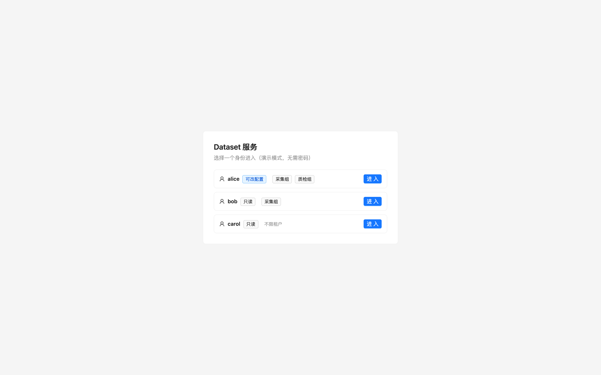
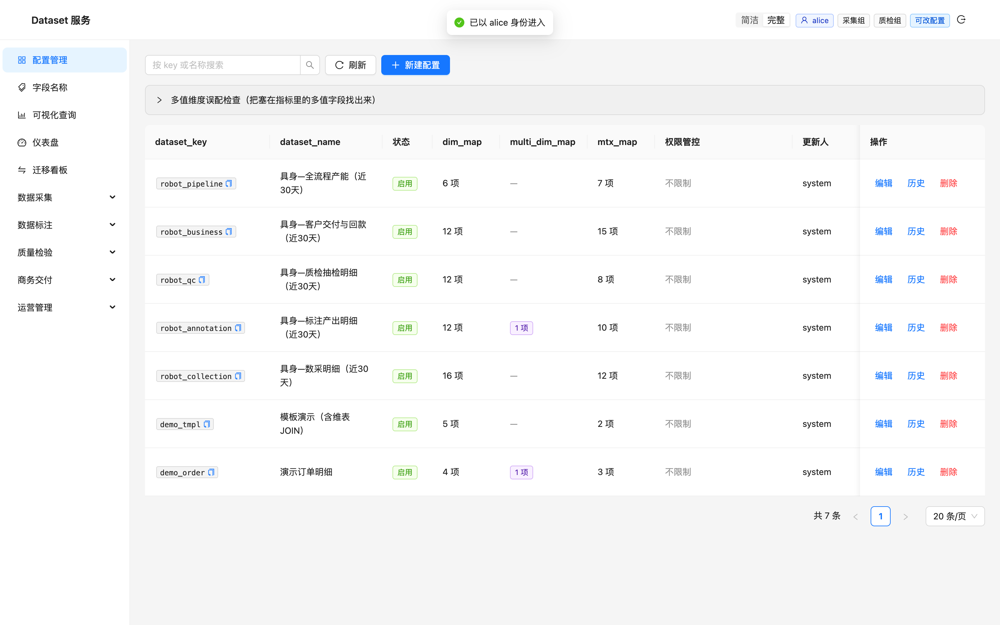
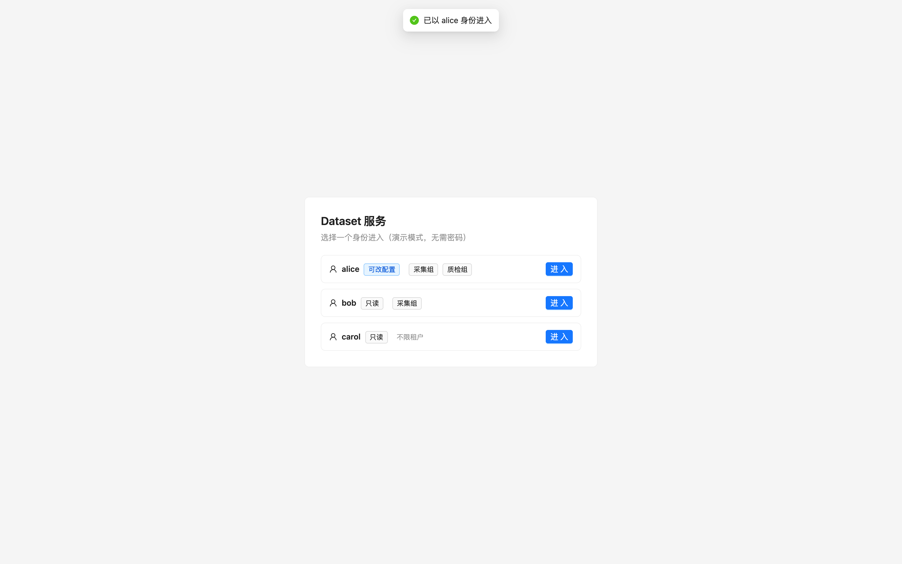
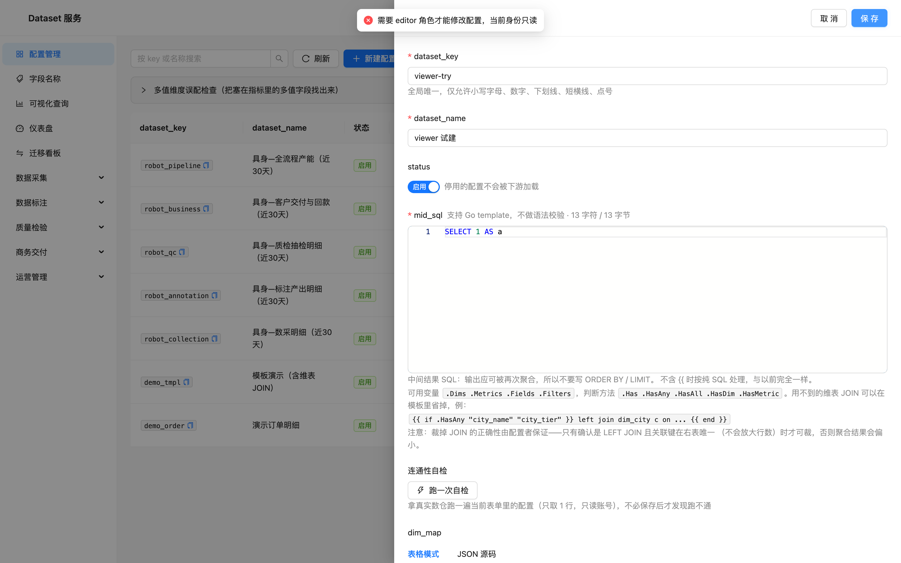

# 登录与授权设计

## 一句话

**认证只做验签，授权复用已有的 acl，默认不开启。**

真实环境的身份由企业 IdP 签发 JWT 下发，本服务只验签、只翻译 claims。
「能看哪些数据」继续由数据集上那份 `acl`（租户 / 列级 / 行级）决定——
那套逻辑一行都没改，鉴权只回答「你是谁」。

## 为什么不做用户体系

平台侧重点是数据分析。如果自己做用户表，就要做注册、找回密码、改密、会话、refresh token、
角色管理界面、权限点配置……这一整套在企业里**已经有 IdP 在做**，再做一遍永远追不上，
而且会多出一个「账号到底以哪边为准」的问题。

所以边界划在这里：

| 归企业 IdP | 归本平台 |
| --- | --- |
| 账号、密码、MFA、SSO 登录页 | 验签、claims → 身份 |
| 用户属于哪些租户、什么角色 | 租户 / 列 / 行的数据可见性（**已有 acl**） |
| token 有效期、吊销 | 能改配置还是只能看数（两个角色） |

## 三种模式

| 模式 | 用在哪 | 身份来自 | 谁签发 | 写配置 |
| --- | --- | --- | --- | --- |
| `off`（默认） | 存量部署、单机试用 | `X-User` / `X-Tenants` / `X-Visible-Users` | —— | 人人可写 |
| `dev` | 本地开发、演示 | 登录页选预置身份 | 本服务（HS256） | 有 `editor` 角色 |
| `jwt` | 生产 | 企业 IdP 的 token | 企业 IdP | 有 `editor` 角色 |

**默认 `off` 是刻意的**：升级不能把存量部署拦死。切换只改一个环境变量，代码不动。
`off` 模式下 `RequireEditor` 直接放行、`/auth/me` 返回自报身份，前端顶栏也保留原来的三个输入框。

`dev` 模式下本服务会签发 token，这是唯一一处「自己造身份」的地方，所以硬约束：
**`jwt` 模式不注册 `/auth/login`**——生产环境里本服务根本没有签发能力。

`jwt` 模式启动时如果既没有 `AUTH_JWT_SECRET` 也没有 `AUTH_JWT_PUBLIC_KEY`，直接启动失败。
宁可起不来，也不要在生产里静默放行。

## 身份模型

```go
type Identity struct {
    User         string   // sub / preferred_username：顶栏显示、审计 created_by
    Tenants      []string // 数据集级 / 列级白名单命中判断，行级 tenant 规则的取值
    VisibleUsers []string // 行级 user 规则的取值
    Roles        []string // 只有 viewer / editor 两类语义
}
```

四个字段全部来自 JWT claims，字段名可配（各家企业 IdP 不一致）。取值支持三种形态：
`["t1","t2"]` 数组、`"t1,t2"` 逗号分隔、`"t1"` 单个字符串。

没有 `sub`（或配的 user claim）的 token **一律拒绝**：既无法审计，也无法作为行级过滤的取值。

## 授权落在哪

只有一处：写接口上的 `RequireEditor`。

```
GET  /api/v1/**            → 登录即可（viewer 也能看数、也能跑查询）
POST /api/v1/query/execute → 登录即可
POST /api/v1/datasets      → editor
PUT  /api/v1/datasets/:key → editor
DELETE ...                 → editor
POST /api/v1/datasets/:key/rollback → editor
POST /datasets/:key/migrate-multi-dim → editor
POST|PUT|DELETE /labels    → editor
POST|PUT|DELETE /dashboards→ editor
```

理由：数据分析平台里「能看」是默认态，「能改」才需要资格。把读接口也按角色细分，
收益很低、解释成本很高，而且会让「为什么我看不到这张图」变成一类日常工单。

**数据可见性不走角色**，还是走数据集上已有的 acl：租户是否有交集、列是否可见、
行级 `tenant IN (...)` / `user IN (...)`。这样权限配置只有一份，不会出现
「角色说能看、acl 说不能看」的双重真相。

## 接口

| 接口 | 鉴权 | 说明 |
| --- | --- | --- |
| `GET /api/v1/auth/mode` | 否 | 前端启动第一个请求。返回 `mode`、`need_login`、`login_kind`（`dev`/`sso`/空）、`sso_url`、`identities`（仅 dev） |
| `POST /api/v1/auth/login` | 否 | **仅 dev 注册**。`{"user":"alice"}` → `{token, identity, expires_in}` |
| `GET /api/v1/auth/me` | 是 | `{mode, identity, editor}` |

`/auth/mode` 和 `/auth/login` 必须在鉴权范围之外：问「要不要登录」的人本来就还没登录，
把它们包进鉴权会形成先有鸡还是先有蛋。

失败口径统一：

- 无 token / 验签失败 / 过期 → `401`，带 `WWW-Authenticate: Bearer`。
  具体原因不回给客户端（token 为什么错是企业 IdP 该告诉他的事），细节留在服务端日志。
- 角色不够 → `403`，`{"code":403,"message":"需要 editor 角色才能修改配置，当前身份只读"}`。

## 前端

改动只有四处：

1. `api.ts` 请求拦截器加 `Authorization: Bearer <token>`；响应拦截器遇 401 清 token 并通知 App。
2. `auth.ts`：token 存取 + 类型 + 401 回调（接口层不依赖路由层）。
3. `pages/Login.tsx`：dev 模式列预置身份点一下进入；jwt 模式给「前往企业登录」+ token 粘贴框（联调用）。
4. `App.tsx`：启动先问 `mode`；未登录渲染登录页；顶栏把三个自报框换成只读身份块（用户名 + 租户 + 可改配置/只读 + 退出）。

未登录时不发业务请求——否则第一帧就换来两个必然 401 的请求，把真正的问题淹掉。

## 配置

```bash
AUTH_MODE=off|dev|jwt            # 默认 off
AUTH_JWT_SECRET=...              # HS256 验签；dev 模式兼作签发
AUTH_JWT_PUBLIC_KEY=...          # RS256 公钥 PEM；配了就走非对称
AUTH_JWT_ISSUER=...              # 配了才校验 iss
AUTH_JWT_AUDIENCE=...            # 配了才校验 aud
AUTH_CLAIM_USER=sub
AUTH_CLAIM_TENANTS=tenants
AUTH_CLAIM_VISIBLE_USERS=visible_users
AUTH_CLAIM_ROLES=roles
AUTH_EDITOR_ROLES=editor,admin
AUTH_TOKEN_TTL_SECONDS=28800     # 仅 dev
AUTH_SSO_URL=...                 # jwt 模式下登录页的跳转地址
AUTH_DEV_IDENTITIES=[{"user":"alice","tenants":["采集组"],"roles":["editor"]}]
```

内置预置身份（未配 `AUTH_DEV_IDENTITIES` 时）：

| 用户 | 租户 | 角色 |
| --- | --- | --- |
| alice | 采集组、质检组 | editor |
| bob | 采集组 | viewer |
| carol | 不限 | viewer |

## 明确不做

| 不做 | 理由 |
| --- | --- |
| 用户表 / 注册 / 找回密码 / 改密 | IdP 已有，重复建设且必然不一致 |
| 会话表 / refresh token | 短效 token + 过期重新登录足够；多一层刷新就多一处状态要同步 |
| 服务端登出 / token 吊销 | 前端删 token 即可；真要强退由 IdP 的 token 有效期管 |
| 角色管理界面 / 权限点 | 只有两个角色，写死在配置里比做界面便宜 |
| JWKS 自动发现 | RS256 用 PEM 直配已覆盖绝大多数情况；JWKS 要处理轮换与缓存，等真需要时再加 |

## 上线路径

```
off（现在）  →  dev（本地联调、演示，可选）  →  jwt（配环境变量，代码不动）
```

接企业 IdP 时只需要：把 IdP 的公钥/密钥填进去、把 claims 名对齐、把 `AUTH_EDITOR_ROLES`
指到企业里实际的管理员角色名。

## 验证记录

单元测试 `internal/auth/auth_test.go` 覆盖：签发-验签往返、换密钥伪造、过期、
无主体、iss/aud 校验、三种 claim 形态、`off` 模式不签发不验签、viewer 不是 editor。

接口层实测（`AUTH_MODE=dev`）：

```
GET  /api/v1/auth/mode            → 200, need_login=true, 3 个预置身份
GET  /api/v1/auth/me  (无 token)  → 401 缺少登录凭证
GET  /api/v1/datasets (无 token)  → 401
POST /api/v1/auth/login {alice}   → 200, token
GET  /api/v1/auth/me  (alice)     → 200, editor=true
GET  /api/v1/datasets (alice)     → 200
GET  /api/v1/datasets (bob)       → 200          # viewer 能看数
POST /api/v1/datasets (bob)       → 403 需要 editor 角色
POST /api/v1/datasets (alice)     → 400          # 是业务校验，不是权限拦截
GET  /api/v1/auth/me  (篡改签名)   → 401
GET  /api/v1/auth/me  (换密钥签)   → 401
```

界面（`AUTH_MODE=dev`）：






`off` 模式回归：`/api/v1/datasets` 仍 200，`/auth/me` 返回 `system`，
顶栏仍是三个输入框——升级不影响现有用法。
