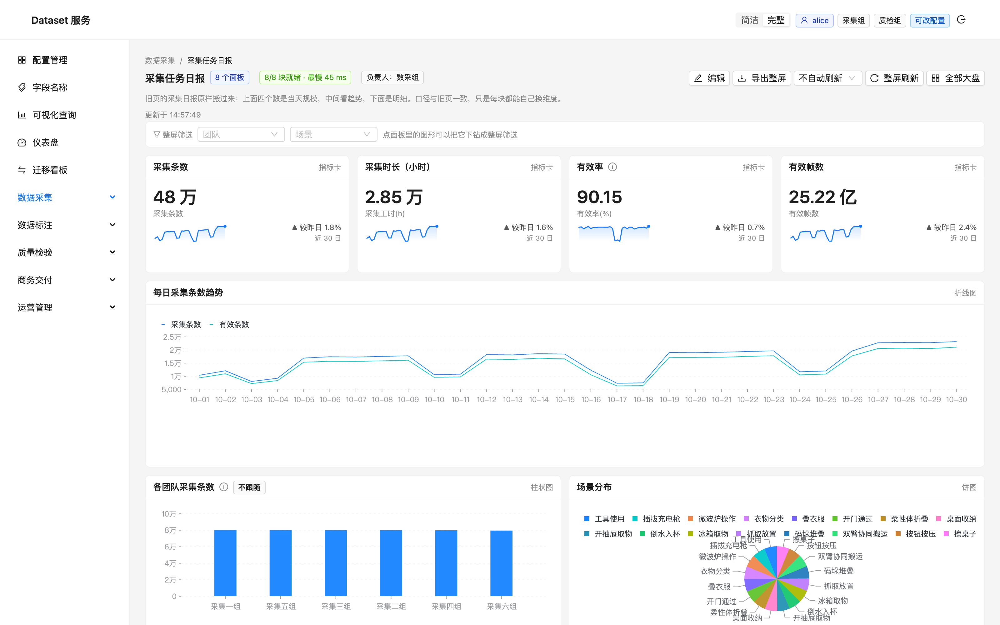
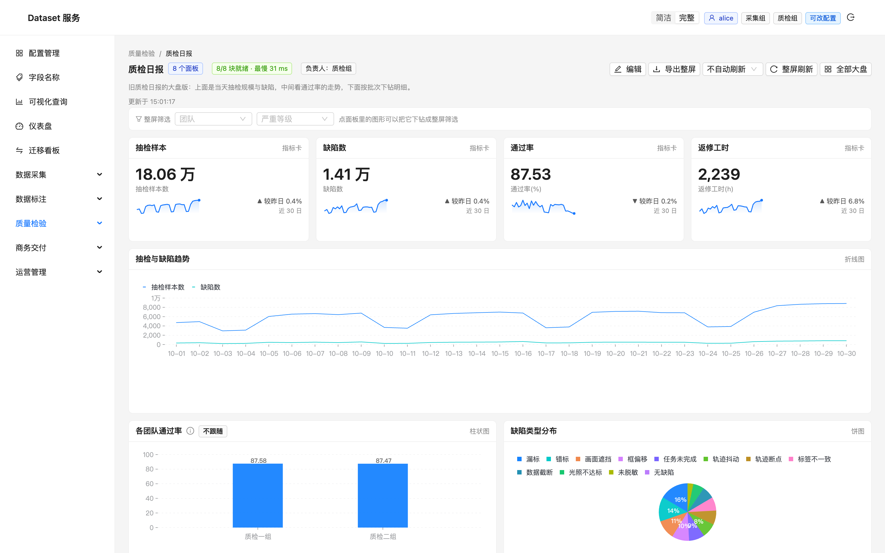
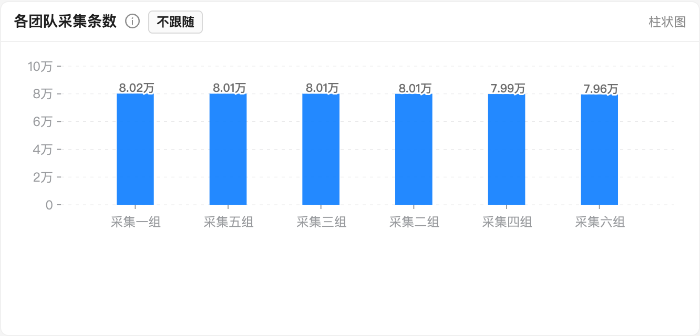

# 仪表盘体验迭代记录（v1–v5）

> 角色：一个每天要看这几张大盘的数据分析师。
> 目标：把「一屏能看的图」变成「一屏能用来做判断的工具」。
> 每一版都从真实使用里的一处不顺手出发，只解一个问题。

分支：`feature/dashboard-ux`　截图目录：`docs/dashboard-ux/shots/`

---

## v1 指标卡要有上下文：趋势小图 + 环比 + 大数缩写

**在哪一刻觉得不顺手**

打开「采集任务日报」，上面四张指标卡：采集条数 `480,000`、采集时长 `28,492.6`、
有效率 `90.15`、有效帧数 `2,521,531,570`。

三件事让我停了一下：

1. **不知道好坏**。480,000 条是多是少？比昨天涨了还是跌了？卡片只有当下这一个数，
   没有对照就没有判断——分析师看 KPI 的第一反应永远是「跟之前比怎么样」。
2. **数不出位数**。`2,521,531,570` 在 28px 的字号里，我得从右往左点三位才知道是 25 亿，
   而不是 2.5 亿或 250 亿。
3. **一张卡就是一块白**。四张卡占了大半屏，信息密度却只有四个数字。

**这一版改了什么**

- 指标卡补一条 **日趋势 sparkline**：为「指标卡 + 一个总数 + 数据集有 `date` 维度」的面板
  额外取一条按天聚合的查询，画出最近 30 天的走势。
- **较昨日环比**：取趋势最后两天算相对变化，配 ▲/▼ 方向。**刻意用中性灰、不涂红绿**——
  采集条数涨是好事、缺陷数涨是坏事，平台不该替业务假定方向，只给方向不给褒贬。
- **大数缩写**：`2,521,531,570 → 25.22 亿`、`480,000 → 48 万`，完整值放进 tooltip。
  缩写用于扫视，精确值用于核对，两者不挤在同一个字号里。

**为什么不多画**

趋势查询只在「一个总数」的面板上补（有维度拆分的指标卡本身已经是分组的，再加一条总趋势
反而打架）。数据量小的时候这是一次额外往返，换来「一个数」变成「一个数 + 它在怎么走」。

**验证**

- `480,000 → 48 万`、`2,521,531,570 → 25.22 亿`、比率 `90.15` 原样不动（没有万/亿级不进缩写）
- 四张卡都出现 sparkline；环比出现 ▲/▼ 且颜色中性
- 截图：`shots/v1-指标卡带趋势与环比.png`、`shots/v1-指标行特写.png`

---

## v2 图表要看得清：饼图标签收敛 + 柱状图补数值

**在哪一刻觉得不顺手**

「质检日报」的「缺陷类型分布」饼图，每个扇区外侧都标着名字，类目一多就出事：
「漏标 / 误标」叠在一起，「画面遮挡」压住「无缺陷」，外侧标签还伸到图例下面。
想读某个扇区是啥，得在图例和一坨文字之间来回找。

「各团队通过率」柱状图则是另一种难受：两根柱子一样高，只能目测「差不多」，
到底差多少得去点 tooltip 或翻明细。

**这一版改了什么**

- **饼图标签收敛**：名字交给图例（颜色对名字），扇区内只标占比，而且只有「扇区角度够宽」
  （≥ 8%）才标。8% 是物理下限——比它小的扇区连「6%」都放不下，十几个等分扇区各标一个
  只会叠成一团（「场景分布」16 类各约 6%，正好是反例）。大扇区标比例、小扇区交给图例与
  tooltip，反而更清楚。
- **柱状图补数值**：单系列柱状图在柱顶标数值，并给白描边衬底——
  比大小靠的是「差多少」，不是「目测谁高一点」；白描边保证柱子顶到坐标轴时字也看得清。
  多系列（分组/堆叠）不标，一排数字会盖住柱子本身。

这段改动落在 `ChartView` 这层共用组件里，所以查询页的饼图/柱状图同样受益，不只是大盘。

**验证**

- 质检饼图：外侧标签全部消失，只剩大扇区的「30% / 17% / 14%…」，与图例不再打架
- 场景分布（16 类）：不再有挤成一团的 6%
- 柱状图：柱顶出现 `8.02万 / 8.01万 …`，白描边清晰
- 截图：`shots/v2-质检日报-饼图标签收敛.png`、`shots/v2-采集日报-柱状图数值标签.png`、
  `shots/v2-饼图特写.png`、`shots/v2-柱状图特写.png`

