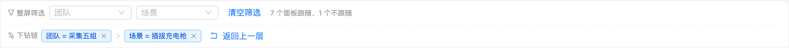
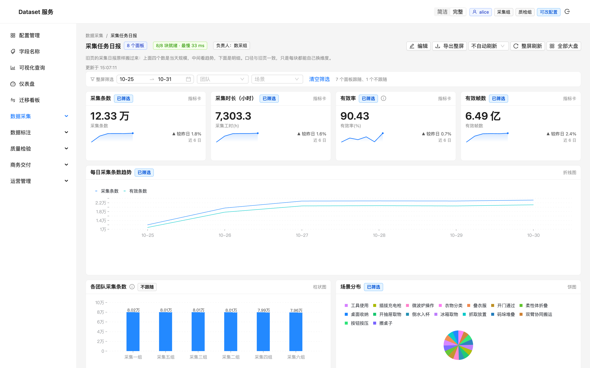
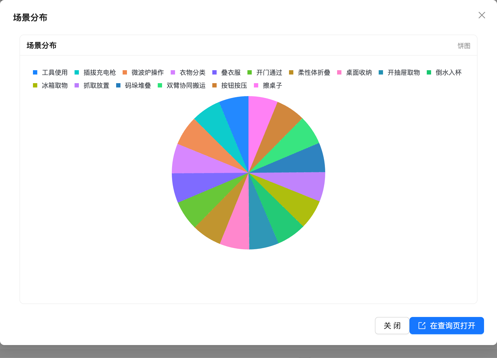
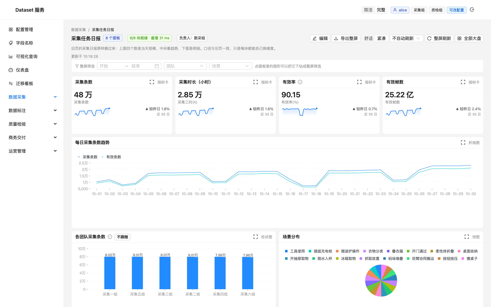
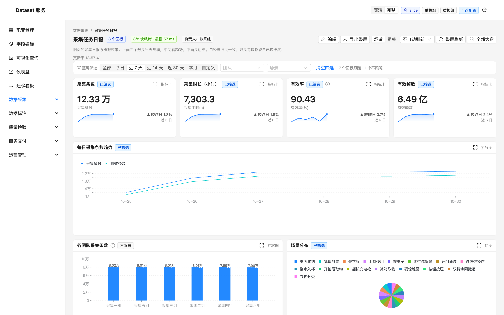
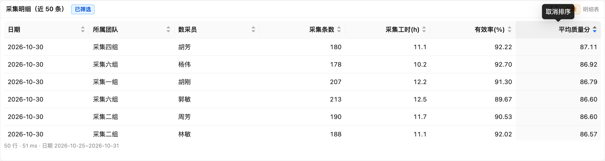
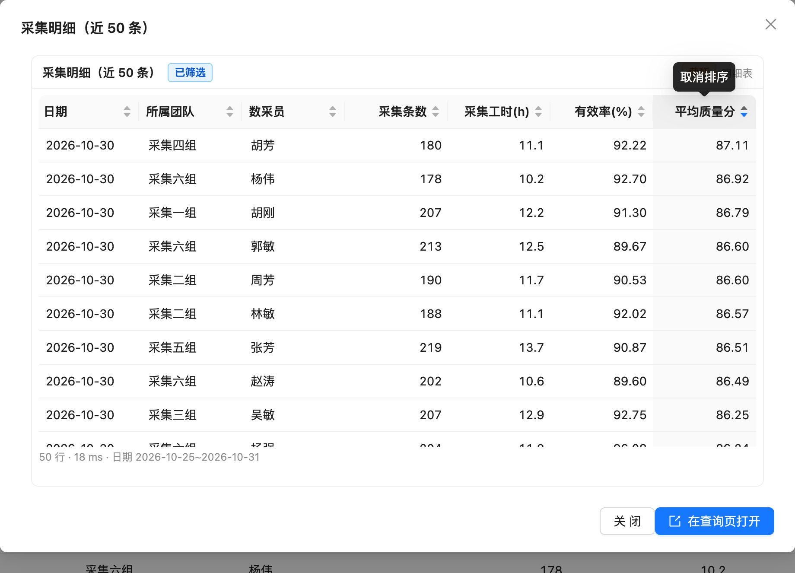
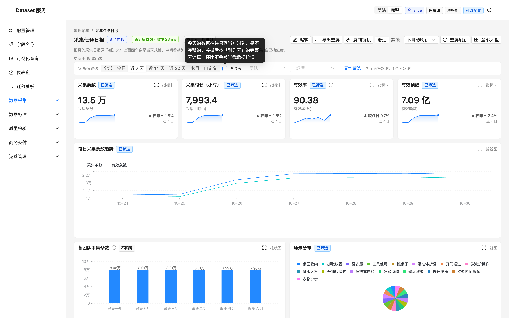
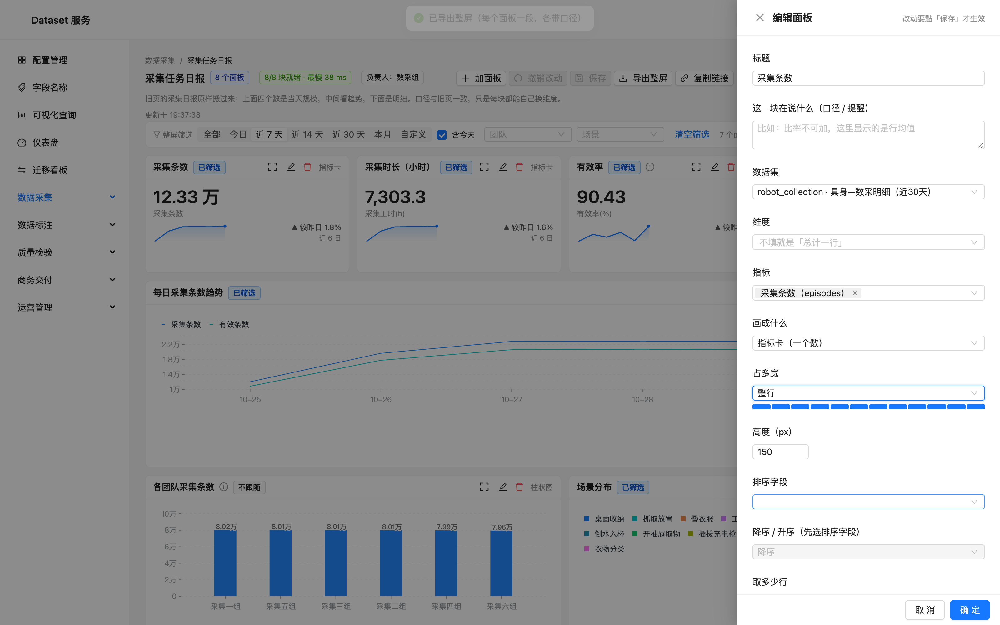

# 仪表盘体验迭代记录（v1–v5）

> 角色：一个每天要看这几张大盘的数据分析师。
> 目标：把「一屏能看的图」变成「一屏能用来做判断的工具」。
> 每一版都从真实使用里的一处不顺手出发，只解一个问题。

分支：`feature/dashboard-ux`　截图目录：`docs/dashboard-ux/shots/`

---

## v1 指标卡要有上下文：趋势小图 + 环比 + 大数缩写

**在哪一刻觉得不顺手**

打开「采集任务日报」，上面四张指标卡：采集条数 `480,000`、采集时长 `28,492.6`、
有效率 `90.15`、有效帧数 `2,521,531,570`。

三件事让我停了一下：

1. **不知道好坏**。480,000 条是多是少？比昨天涨了还是跌了？卡片只有当下这一个数，
   没有对照就没有判断——分析师看 KPI 的第一反应永远是「跟之前比怎么样」。
2. **数不出位数**。`2,521,531,570` 在 28px 的字号里，我得从右往左点三位才知道是 25 亿，
   而不是 2.5 亿或 250 亿。
3. **一张卡就是一块白**。四张卡占了大半屏，信息密度却只有四个数字。

**这一版改了什么**

- 指标卡补一条 **日趋势 sparkline**：为「指标卡 + 一个总数 + 数据集有 `date` 维度」的面板
  额外取一条按天聚合的查询，画出最近 30 天的走势。
- **较昨日环比**：取趋势最后两天算相对变化，配 ▲/▼ 方向。**刻意用中性灰、不涂红绿**——
  采集条数涨是好事、缺陷数涨是坏事，平台不该替业务假定方向，只给方向不给褒贬。
- **大数缩写**：`2,521,531,570 → 25.22 亿`、`480,000 → 48 万`，完整值放进 tooltip。
  缩写用于扫视，精确值用于核对，两者不挤在同一个字号里。

**为什么不多画**

趋势查询只在「一个总数」的面板上补（有维度拆分的指标卡本身已经是分组的，再加一条总趋势
反而打架）。数据量小的时候这是一次额外往返，换来「一个数」变成「一个数 + 它在怎么走」。

**验证**

- `480,000 → 48 万`、`2,521,531,570 → 25.22 亿`、比率 `90.15` 原样不动（没有万/亿级不进缩写）
- 四张卡都出现 sparkline；环比出现 ▲/▼ 且颜色中性
- 截图：`shots/v1-指标卡带趋势与环比.png`、`shots/v1-指标行特写.png`

---

## v2 图表要看得清：饼图标签收敛 + 柱状图补数值

**在哪一刻觉得不顺手**

「质检日报」的「缺陷类型分布」饼图，每个扇区外侧都标着名字，类目一多就出事：
「漏标 / 误标」叠在一起，「画面遮挡」压住「无缺陷」，外侧标签还伸到图例下面。
想读某个扇区是啥，得在图例和一坨文字之间来回找。

「各团队通过率」柱状图则是另一种难受：两根柱子一样高，只能目测「差不多」，
到底差多少得去点 tooltip 或翻明细。

**这一版改了什么**

- **饼图标签收敛**：名字交给图例（颜色对名字），扇区内只标占比，而且只有「扇区角度够宽」
  （≥ 8%）才标。8% 是物理下限——比它小的扇区连「6%」都放不下，十几个等分扇区各标一个
  只会叠成一团（「场景分布」16 类各约 6%，正好是反例）。大扇区标比例、小扇区交给图例与
  tooltip，反而更清楚。
- **柱状图补数值**：单系列柱状图在柱顶标数值，并给白描边衬底——
  比大小靠的是「差多少」，不是「目测谁高一点」；白描边保证柱子顶到坐标轴时字也看得清。
  多系列（分组/堆叠）不标，一排数字会盖住柱子本身。

这段改动落在 `ChartView` 这层共用组件里，所以查询页的饼图/柱状图同样受益，不只是大盘。

**验证**

- 质检饼图：外侧标签全部消失，只剩大扇区的「30% / 17% / 14%…」，与图例不再打架
- 场景分布（16 类）：不再有挤成一团的 6%
- 柱状图：柱顶出现 `8.02万 / 8.01万 …`，白描边清晰
- 截图：`shots/v2-质检日报-饼图标签收敛.png`、`shots/v2-采集日报-柱状图数值标签.png`、
  `shots/v2-饼图特写.png`、`shots/v2-柱状图特写.png`

---

## v3 下钻要能一步步退：筛选链取代平铺标签

**在哪一刻觉得不顺手**

在「各团队采集条数」点一根柱子，这一屏被收窄成「团队=采集一组」，很好用。
接着我在「场景分布」上再点一刀，变成两步筛选。这时候问题来了：

- 两枚蓝色标签**并列**排着，看不出谁先谁后——「先限定这个团队，再看它的场景构成」
  这个先后关系，恰恰是我做这次分析的心智路径。
- 想退回上一步，只能去点某一枚标签的 ×，而且要自己判断「该撤哪一个」；
  没有「返回上一层」这种最符合直觉的动作。
- 标签只能用字段原值（`team=采集一组`），不如中文名（`团队=采集一组`）好读。

**这一版改了什么**

- 下钻从「扁平标签」改成**有顺序的下钻链**：`团队 = 采集五组 › 场景 = 插拔充电枪`，
  每一步之间用箭头连起来，顺序就是我点的顺序。
- 每一步带 **id**（不再用字段当身份），所以可以**只删中间某一步**，
  而不是按字段把同名的一整片删掉。
- 新增 **「返回上一层」**：一次退最后一步，符合「撤销刚才那次下钻」的直觉。
- 字段显示**中文名**：优先取顶部声明筛选器里的 label（`团队` 而不是 `team`）。
- 同字段重复点击是「改这一层的取值」，**就地替换、保持链上位置**，
  不会把这一步挪到队尾打乱路径。

**验证**

- 点柱状图 → 点饼图，得到两步链，整屏跟着收窄（KPI 从 48 万降到 4,958 等，
  每个受影响面板挂「已筛选」；「不跟随」的团队对比图保持全量）
- 「返回上一层」退最后一步；单步 × 只删该步
- 截图：`shots/v3-下钻链两步.png`、`shots/v3-下钻链特写.png`

---

## v4 看趋势要能收窄：大盘级时间范围

**在哪一刻觉得不顺手**

打开「采集任务日报」，趋势图是 10-01 到 10-30 一整个月。我想看「最近 7 天到底怎么走的」，
只能去每个面板里改 limit 或者加过滤——一张大盘有七八块，改一遍等于把这屏拆了重拼。
顶部有「团队 / 场景」两个筛选，唯独**没有时间**，而时间恰恰是分析里最常收窄的那一刀。

**这一版改了什么**

- 顶部「整屏筛选」里加**时间范围**：一个日期区间控件，自带「近 7 / 14 / 30 天」预设，
  也可以选任意区间。
- 应用时拆成 `date >= 起` 与 `date <= 止` 两个条件，落在 `date` 维度上，
  和团队/场景筛选、下钻链一起 AND。
- **只作用于有 `date` 维度的面板**：没有时间轴的面板强行加日期会直接查空，
  所以先判断字段再拼条件；一屏里一个 date 面板都没有时，连控件都不露。
- 「不跟随整屏筛选」的面板（如团队横向对比）**同样不吃时间范围**——它本来就是拿全量做对比的；
  这跟团队/场景筛选是同一套 follow 语义，不另造规则。
- 时间范围也进指标卡的趋势查询、进每块的口径标注、进整屏导出——收窄了什么，导出的 CSV 里说得清。

**一个已知边界**

「近 7 天」是相对**今天**算的（客户端的当下）。demo 数据是历史区间，若某天整体晚于数据末日，
预设区间会落在数据之外而查空——真实环境里数仓当日有数，不构成问题，这里如实记一笔。

**验证**

- 选「近 7 天」后：顶部显示 `10-25 ~ 10-31`，趋势图只画 10-25 起，
  KPI 从 48 万降到 12.33 万，每块状态从「近 30 日」变「近 6 日」
- 「各团队采集条数」（不跟随）保持全量，证明 follow 语义对时间范围同样生效
- 截图：`shots/v4-时间范围-预设下拉.png`、`shots/v4-近7天-整屏收窄.png`、
  `shots/v4-时间范围特写.png`

---

## v5 看不清楚就放大：面板聚焦 + 直通查询，密度也能调

**在哪一刻觉得不顺手**

两件事：

1. **想看清某一块，却只能看个大概**。饼图十六个类目挤在四分之一屏宽的卡片里，
   图例折成两行、扇区细得点不准；趋势图压在两三厘米高的绘图区里，
   想看某个拐点是哪一天，得先点开 tooltip 再挪半天。这块「看着不对」，我想放大看清——
   但大盘没有放大，只能去查询页把同样的维度、指标、排序**再搭一遍**。
2. **一屏块多的时候，密度不由我**。留白舒服是舒服，可汇报前要快速核对七八块、
   或者就想一眼扫更多，却没一个开关能把间距收一收、字号压一压。

**这一版改了什么**

- **面板聚焦放大**：每块卡片右上角加一个「放大这一块」。点开是弹层，
  用更大的高度（460）重画**同一份数据**——同一个面板配置、同一套整屏筛选（含下钻链、时间范围），
  不放大部分屏的空白。它是放大镜，不是第二个窗口。
- **放大弹层直通查询页**：弹层底部给一个「在查询页打开」深链。用面板本身那份查询串还原出
  `/query?ds=…&dims=…&metrics=…&order=…&dir=…&limit=…`，并把当前整屏筛选作为 `filter` 的 JSON
  一起带过去。于是「在大盘里看到异常 → 去查询页换个维度接着挖」这一步，不用再从零搭。
  弹层里不另做筛选/编辑——口径要改就去查询页（深链直达），避免大盘和弹层出现两套查询状态。
- **布局密度（舒适 / 紧凑）**：顶栏加一个两档切换。紧凑档把卡片间距（gutter 12→8）
  与内边距（8→4）收窄、指标卡主数字 28→24，一屏多扫几块；舒适档保持原来的疏朗留白。
  密度只影响排版，不影响任何取数与口径。

**验证**

- 「场景分布」点「放大这一块」→ 弹层里是一张大饼图（图例单行铺开、扇区变大），
  footer 有「关闭 / 在查询页打开」
- 点「在查询页打开」→ 落到
  `/query?ds=robot_collection&dims=scene&metrics=episodes&order=episodes&dir=desc&limit=20`，
  结果表正是同一份「场景 → 采集条数」构成（工具使用 30,146、插拔充电枪 30,144…）
- 顶栏切「紧凑」→ 卡片变紧、主数字变小；切回「舒适」恢复疏朗
- 截图：`shots/v5-放大面板弹层.png`、`shots/v5-放大面板弹层-本体.png`、
  `shots/v5-在查询页打开-深链.png`、`shots/v5-密度-紧凑.png`、`shots/v5-密度-舒适.png`

---

## v6 · 时间筛选不该是「冻结的日期」，该是「滚动的窗口」

**在哪一刻觉得不顺手**

作为一个每天都要点开这几张大盘的人，我对时间的真实用法是「**每次打开就看最近一段**」：

1. **打开默认「全部」**。历史全量铺满趋势图，最近几天的变化被稀释掉，我总要再点一下筛选。
2. **选了「近 7 天」第二天就失效**。v4 的预设是在点击那一刻把「近 7 天」算成一对**绝对日期**写死
   （`10-24~10-30`），第二天打开还是这七天，并不会滚到「今天往前 7 天」——
   我要的是「最近 7 天」这个**意图**，不是那七个具体的日子。
3. 专项排查时手动选的固定区间，又希望第二天打开还在，别每次重选。

问题的根子：**预设被存成了「绝对区间」，而它应该被存成「相对意图」**。

**这一版改了什么**

- **模式与值分离**：时间筛选从 `dateRange`（一对写死的日期）改成 `dateMode` 三态——
  `全部` / `相对窗口（今日·近7天·近14天·近30天·本月）` / `自定义固定区间`。
  相对模式在**每次取数时基于「今天」重新算出实际窗口**，所以每天打开、每次自动刷新
  都会滚到最新；自定义模式存绝对日期，保持不动。
- **默认近 7 天**：首次打开（无任何记录时）默认落在「近 7 天」的相对窗口上，
  一打开就是最近七天，而不是全部历史。
- **记住模式（localStorage）**：切换相对预设或选自定义区间都会记下来，下次打开还在；
  「清空筛选」只清当次（不写入），下次打开仍回到记住的模式。
- **时间模式常驻可见**：原来是 RangePicker 里藏着的预设下拉，选完只剩两个日期，
  看不出「这是会滚的」；现在换成筛选条里的一排 `Segmented`（全部/今日/近7天/近14天/近30天/本月/自定义），
  选中的是「滚动窗口」还是「固定区间」一眼可见；选「自定义」才出现日期选择器。
- **滚动跟随自动刷新**：自动刷新的 tick 上同步重算「今天」，页面挂着不动，数据也往前滑。
- **导出口径如实**：相对窗口在 CSV 口径里写成「近 7 天（10-25~10-31）」——
  既说明这是滚动意图，也留下导出那一刻的实际窗口，收件人不会被两个日期误导。

**为什么不多画**

没有做「保存多套时间方案」「相对+取整（如按周）」这类更重的能力——
先把「默认近 7 天 + 自动滚动 + 固定区间可记」这条主路径走通，它覆盖了日常巡检与专项排查两端。
另外「今日数据是半截」的问题（今天只到中午，环比会被低估）这版没动，
留作后续观察：如果实际用起来确实噪声大，再补一个「到昨天」的开关。

**验证**

- 冷打开 → 默认高亮「近 7 天」，趋势图横轴 `10-25~10-30`，取数即最近 7 天
- 切「近 30 天」→ 窗口变宽，localStorage 写入 `{"kind":"relative","preset":"30d"}`
- 刷新页面 → 仍高亮「近 30 天」，窗口重新滚到今天
- 切「自定义」→ 出现日期选择器（默认给了近 7 天的绝对区间作起点），
  localStorage 写入 `{"kind":"custom","start":"2026-10-25","end":"2026-10-31"}`，不再滚动
- 「清空筛选」→ 回到「全部」，但不写 localStorage，下次打开仍是记住的模式
- 截图：`shots/v6-默认近7天.png`、`shots/v6-时间模式特写.png`、`shots/v6-近30天.png`、
  `shots/v6-刷新后仍记住近30天.png`、`shots/v6-自定义固定区间.png`

---

## v7 · 大盘里的明细表也要能「排个序」

**在哪一刻觉得不顺手**

放大「采集明细」想看「哪个数采员的质量分最低」，只能用眼睛从头扫到尾——
查询页的结果表是能点表头排序的，大盘的明细表面板却不能。
同一份数据，换个地方看就少了同一个基本动作，这是割裂的。
另外数值列跟文本列一样左对齐、没有千分位，扫一列数字时位数对不齐。

**这一版改了什么**

- **列排序**：明细表每个表头可点，升 → 降 → 取消。数值列按定点比较
  （与查询页同一套 `parseScaled` 语义，Decimal 保精度不经过 float），
  维度列按中文拼音序。数据已在内存里，「谁最高」不该回查询页重设排序再查一遍。
- **数值右对齐 + 千分位**：与查询页同一套规则——按「这一列的实际值」判定是否数值列
  （指标列也可能返回非数值，那时退回原样显示），列内统一小数位，
  `tabular-nums` 等宽数字让纵向扫列时位数对得齐。
- 放大弹层里是同一个组件，排序与格式**自动同步生效**，不用单独做一份。

**为什么不多画**

没有把查询页的「隐藏列 / 派生列 / 合计行」整套搬过来——大盘明细表的定位是
「扫一眼、挑出 top / bottom」，真要深挖还有「在查询页打开」的深链。一次只补最缺的排序。

**验证**

- 「采集明细」点「平均质量分」表头两次 → 降序，87.11 → 86.92 → …，底部口径行不变
- 数值列全部右对齐、等宽数字；日期/团队列保持左对齐
- 放大弹层里点表头排序同样生效
- 截图：`shots/v7-明细表-默认.png`、`shots/v7-明细表-升序.png`、`shots/v7-明细表-降序.png`、
  `shots/v7-放大弹层-降序.png`

---

## v8 · 整屏状态跟着链接走

**在哪一刻觉得不顺手**

我在大盘里下钻了两层、收窄到某个团队、切了时间窗口，终于挖到异常了——
想把「我此刻看到的这屏」发给同事对一下口径，只能口头描述：
「你打开采集任务日报，团队选采集一组，然后在场景分布上点码垛堆叠，时间切近 30 天」。
查询页早就把状态写回 URL 了（收藏/复制链接都靠它），大盘却只有一条光秃秃的地址。

**这一版改了什么**

- **状态写回 URL**：筛选值（`f`）、下钻链（`x`，含来源面板）、时间模式（`dm`）
  都进 URL，`replace` 语义（改一个筛选不多一条历史，与查询页同一约定）。
  打开时从 URL 还原，坏掉的参数一律当「没带」，手改过的链接不会打不开页面。
- **相对时间窗口只存预设名，不存绝对日期**：分享「近 30 天」出去，
  对方打开时基于**他的「今天」**重算窗口——分享的是滚动意图，不是一段死日期，与 v6 语义一致。
- **顶栏「复制链接」**：状态已经在 URL 里，这个按钮只是把地址栏交到用户手上，
  复制完提示「对方打开即回到当前这屏」。

**为什么不多画**

没有做「生成短链 / 二维码 / 权限校验」——链接的可达性由登录与权限体系管着，
这里只负责「状态不丢」。URL 直观可读（能看出 `scene=码垛堆叠`），比短链更好排查。

**验证**

- 造状态：饼图下钻「场景 = 码垛堆叠」+ 团队筛选「采集一组」+ 近 30 天
- 地址栏变成 `?f={"team":"采集一组"}&x=[{"field":"scene","value":"码垛堆叠",…}]&dm={"kind":"relative","preset":"30d"}`
- 新开同一链接 → 下钻链、筛选值、时间模式全部还原，面板数据一致（采集条数 4,828 · 近 29 日）
- 复制链接按钮 → toast 提示，剪贴板即当前地址
- 截图：`shots/v8-造好的状态.png`、`shots/v8-链接打开还原同屏.png`、`shots/v8-复制链接提示.png`

---

## v9 · 仪表盘列表：常用的放前面

**在哪一刻觉得不顺手**

列表把三张大盘平铺，永远一个顺序。可我每天点开的就是「采集任务日报」——
它是我的入口页，却躺在最右边；每换一个常用的大盘，眼睛都要先扫一遍列表再点。
搜索框不需要（大盘就几条），但**顺序该跟人走**。

**这一版改了什么**

- **最近打开**：打开大盘时在本地记一笔时间，列表卡片显示「最近打开 今天 19:30 /
  昨天 10:11 / 10-29」，从未打开过的不显示——一眼能读出「我多久没看这张了」。
- **星标置顶**：卡片右上角一个星标，点完钉在最前面并带「常用」标；
  排序规则：星标 → 最近打开 → 后端原顺序。从未打开过的保持原位，不会被顶乱。
- **只存 localStorage**：常用哪张是「我」的习惯，不是大盘的属性——
  写进后端就变成要协调的团队配置了。
- 实现上把使用痕迹收在 `utils/dashboardPrefs.ts`（记时间 / 切星标 / 格式化时间），列表与大盘页共用。

**为什么不多画**

没有做「拖拽自定义顺序 / 多套排序」——星标 + 最近打开已经覆盖
「常用的置顶」这一种真实诉求，拖拽排序引入的心智与维护成本不成比例。

**验证**

- 清空痕迹 → 默认顺序 `质检日报 | 标注产能看板 | 采集任务日报`
- 打开采集任务日报再回来 → 顺序变 `采集任务日报 | …`，卡片带「最近打开 今天 19:30」
- 给标注产能看板点星 → 顺序 `标注产能看板 | 采集任务日报 | 质检日报`，金 star + 「常用」标
- 刷新页面 → 星标仍在（localStorage）
- 截图：`shots/v9-列表默认.png`、`shots/v9-最近打开上浮.png`、`shots/v9-星标置顶.png`

---

## v10 · 「近 7 天」可以不含今天：完整天不误读

**在哪一刻觉得不顺手**

v6 之后每天打开都是「到今天的近 7 天」，但今天的数据只到当前时刻——
是半截的。于是「较昨日」的环比天天被拉低：上午看是 -60%，下午看是 -20%，
其实业务没变化，只是分母还没长齐。我想要的其实是两件事：
平时连今天一起看（要新鲜感），下结论时看完整天（要准确）。

**这一版改了什么**

- **「含今天」开关**：相对窗口（近 7/14/30 天、本月）后面跟一个勾选框，默认勾上
  （维持 v6 行为）；取消后窗口止于**昨天**——「近 7 天」变成 `今天-7 ~ 昨天`，
  每一天都是完整的。今日预设没有这个开关（不含今天的「今日」是空集）。
- **偏好跨预设保留**：切「近 7 天 → 近 30 天」时完整天偏好跟着走——那是同一个
  「我要完整天」的意图，不该被换预设重置。
- **记进 localStorage 与 URL**：跟着时间模式一起存（`includeToday:false`）、
  一起分享——同事打开也是同样的完整天口径。
- **导出口径说清楚**：关掉时 CSV 口径写「近 7 天（到昨天）（10-24~10-30）」，
  免得「近 7 天」三个字和面板里的日期对不上。

**为什么不多画**

没有做「半截数据置灰 / 预估到今晚」这类重的方案——数据还在长这件事没法假装准确，
把选择权给用户、把口径写清楚，是最诚实的那一档。

**验证**

- 默认勾选「含今天」，窗口 `2026-10-25~2026-10-31`
- 取消勾选 → 窗口 `2026-10-24~2026-10-30`，localStorage 写入 `{"preset":"7d","includeToday":false}`
- 切「近 30 天」→ 仍是未勾选（偏好保留），窗口止于昨天
- 刷新页面 → 偏好仍在
- 截图：`shots/v10-含今天默认.png`、`shots/v10-到昨天.png`、`shots/v10-完整天整屏.png`、`shots/v10-切预设仍保持.png`

---

## v11 · 两根小刺：导出不乱码，宽度说人话

**在哪一刻觉得不顺手**

这两处都不致命，但每次撞上都很烦：

1. **整屏导出的 CSV 用 Excel 双击打开是乱码**。查询页的导出早就带了 BOM
   （`EF BB BF`，Excel 靠它认出 UTF-8），整屏导出没跟上——同一个产品里
   两个导出，一个能双击打开、一个不能，用户只会觉得「时好时坏」。
2. **面板编辑器里调宽度要算术**。「占多宽（12 栅格）」下拉里是「6 / 12」——
   我脑子里想的是「这块占半行」，还得自己换算栅格；而且选完看不到效果，
   保存之后才发现比例不对，再改一次。

**这一版改了什么**

- **整屏导出补 BOM**：与查询页同一套写法（`EF BB BF` + `\r\n` 行尾），
  Excel 双击即正确显示中文。
- **宽度档位说人话**：下拉从「3/4/6/8/12 ÷ 12」改成「1/4 行 · 1/3 行 · 1/2 行 · 2/3 行 · 整行」，
  想什么选什么。
- **12 格实时预览**：选完立刻看到比例（涂蓝的格数就是占的栅格），不用保存后再验证。

**为什么不多画**

没有做「导出 xlsx / 拖拽调宽」——BOM 解决的是「打不开」，xlsx 是「更好用」，
后者牵扯依赖与样式映射，值得单独立项；拖拽调宽的坐标计算与碰撞处理，
远比一个预览条重，先把「看得懂、选得对」补齐。

**验证**

- 点「导出整屏」→ 下载文件前 3 字节 `EF BB BF`（xxd 校验），文件名 `collect-overview-2026-10-31.csv`
- 编辑面板 → 「占多宽」下拉显示五个人话档位；选「整行」→ 预览条 12 格全蓝
- 截图：`shots/v11-宽度档位与预览.png`

