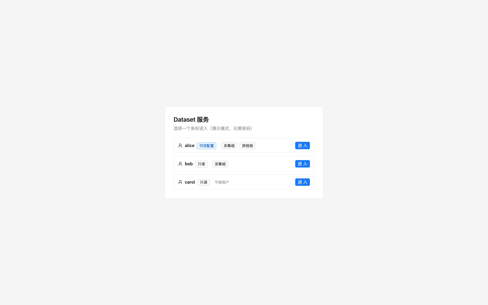
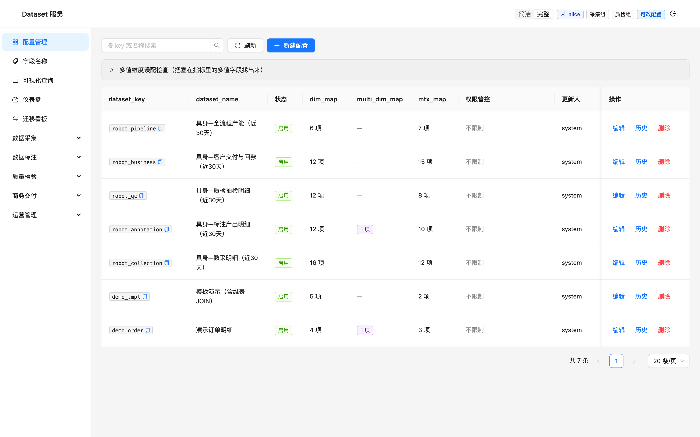
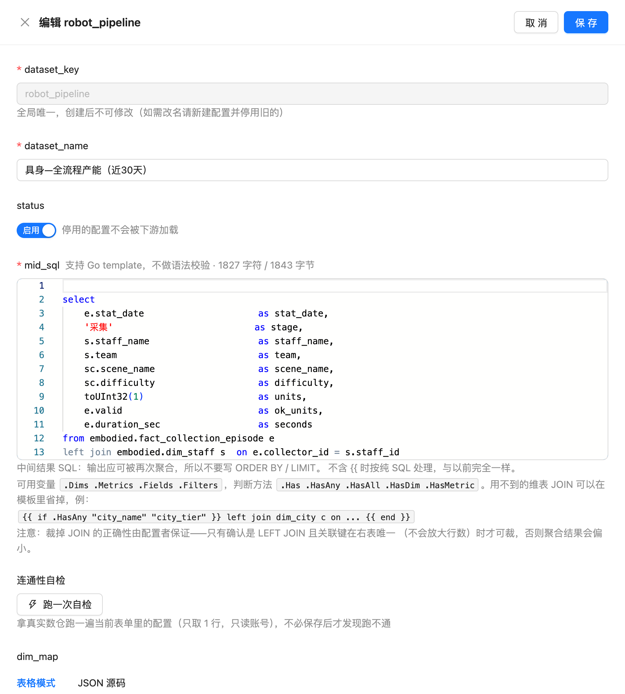
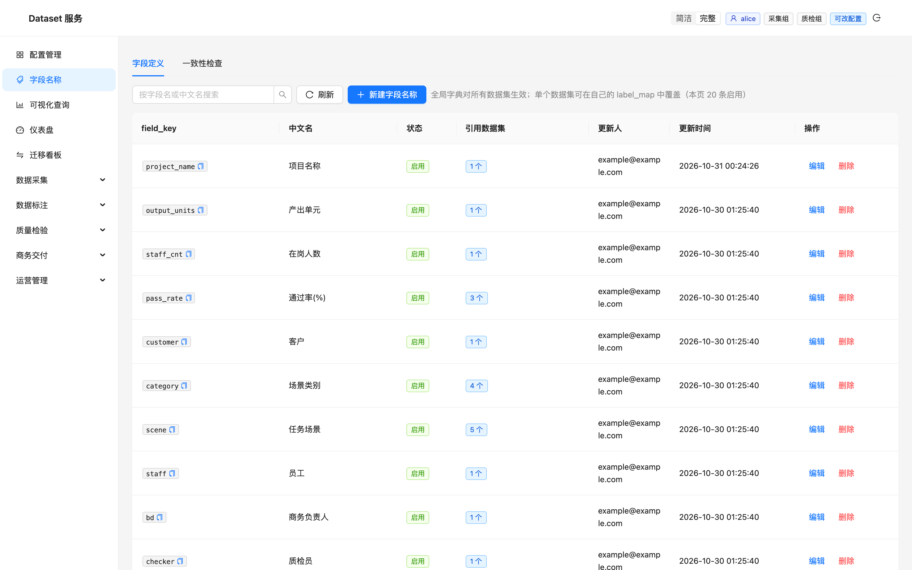
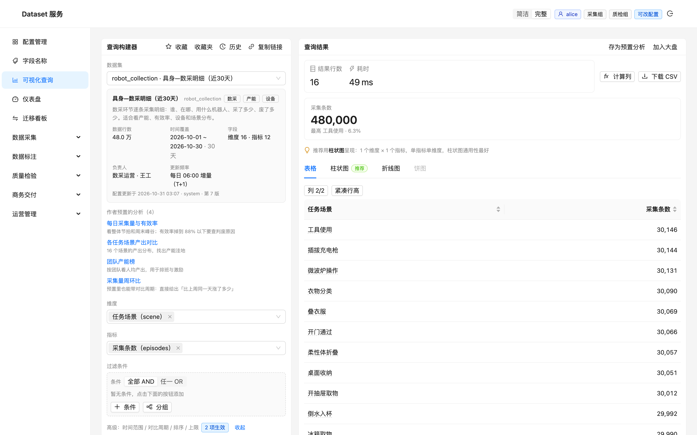
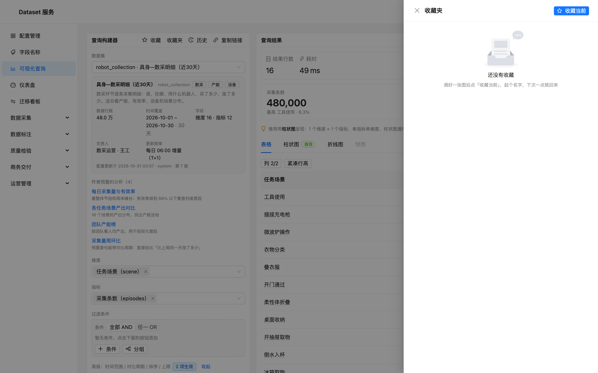
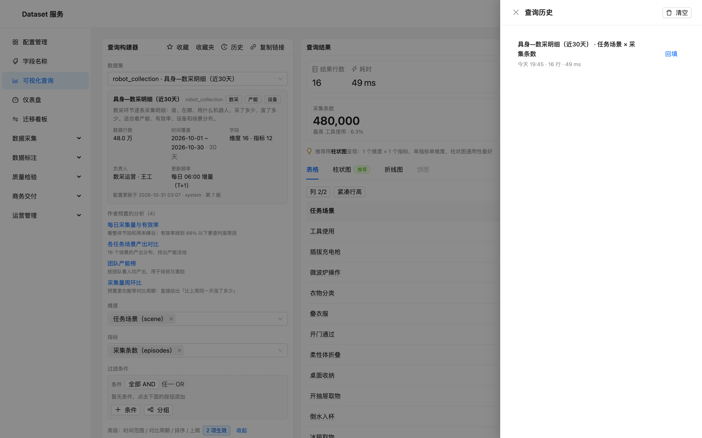
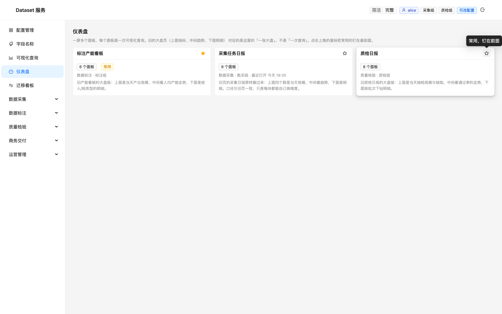
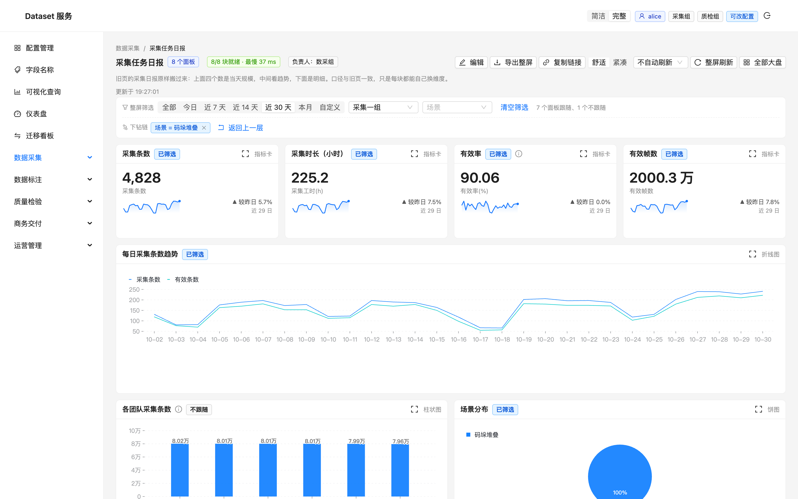
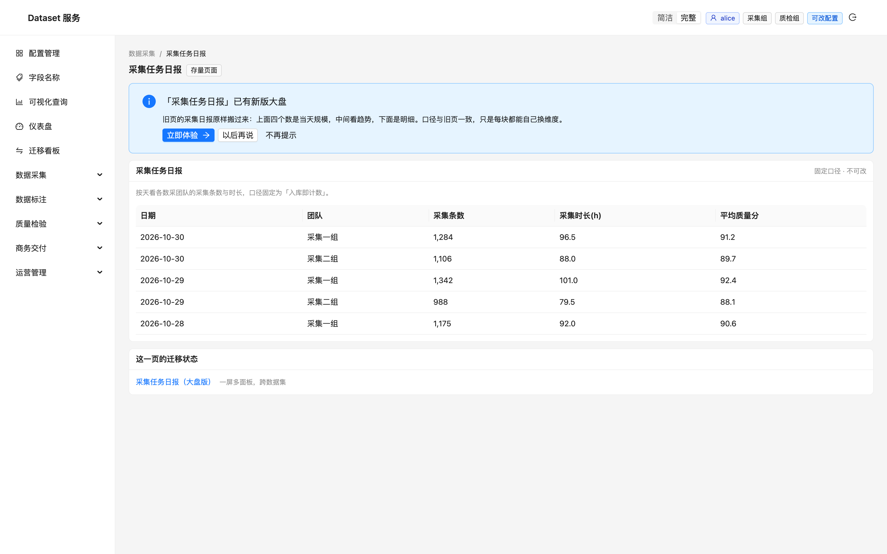

# Dataset 服务平台 · 用户手册

> **版本 1.0 · 面向所有需要看数据的同学**
>
> Dataset 服务平台把「接数据、查数据、看数据」放进同一个网页：数据同学把表接进来、配好字段含义；每个人用可视化查询自己跑数；常用的一屏钉成仪表盘天天看；旧的报表页则通过对照机制平滑搬到新平台。本手册按使用顺序介绍各功能，照着截图就能上手。

---

## 1 平台总览

左侧菜单分四层，对应数据从进到出的完整链路：

| 模块 | 你在这里做什么 |
| --- | --- |
| 配置管理 / 字段名称 | 把数据表接入平台，配好维度、指标与中文名 |
| 可视化查询 | 自己搭条件跑数，结果可存、可分享、可变成图表 |
| 仪表盘 | 把常用的一屏查询钉成看板，每天打开就是它 |
| 数据采集 / 数据标注 / 质量检验 / 商务交付 | 原有各业务的报表页，正在逐页对照迁移 |



首次访问输入平台地址即可进入登录页；演示环境提供预置身份一键体验，正式环境使用分配的账号密码登录。

## 2 配置管理：把数据接进平台

「配置管理」是数据集的中控台。列表支持关键字搜索与分页，每个数据集展示负责人、更新时间与配置版本。



每个数据集包含三类要素：

- **维度**：你分析时用来切分的口径，如日期、团队、任务场景；
- **指标**：可聚合的数值，如采集条数、有效率；
- **中文名映射**：让表头显示「采集条数」而不是 `episodes`。

### 2.1 收口 SQL：你查询的是「数据集」，不是裸表

平台把数据接入做成了一层**收口**：每个数据集背后是一段由数据负责人维护的 SQL（`mid_sql`），它把底层明细表、多表 JOIN、以及 `sum` / `count` / `avg` 等聚合逻辑一次性封装好，对外呈现为一张语义清晰的「宽表」。

对使用者的意义：

- **你不需要会 SQL**。在查询页面对接的只是「数据集 + 维度 + 指标 + 条件」，GROUP BY、聚合函数、口径换算全部由平台自动生成；
- **你不需要知道底下是几张表**。底层模型怎么拆、JOIN 怎么连、金额从哪张表来，都被收口在数据集内部，口径变了只改一处配置，所有下游查询与看板自动对齐；
- **口径是受控的**。查询字段只能引用配置里登记过的维度与指标（白名单校验），筛选取值一律走参数绑定——既防止误用，也杜绝注入。

编辑抽屉里自带「连通性自检」：拿真实数仓跑一遍当前配置（只取 1 行、只读账号），不必保存后才发现 SQL 跑不通。



### 2.2 三级权限：表级、列级、行级

数据集内置三级访问控制，全部由服务端在查询合成时强制生效，客户端无法绕过：

| 级别 | 控制什么 | 规则 |
| --- | --- | --- |
| **表级** | 整个数据集对谁可见 | 租户白名单。留空 = 平台内公开；配置后，登录态租户与白名单有交集才可见（不可见的直接从列表消失） |
| **列级** | 某个维度 / 指标对谁可见 | 按字段配租户白名单。没配的列默认可见；典型用法是把「成本」「单价」这类敏感指标只开放给特定团队 |
| **行级** | 每个人能看到哪些行 | 两类规则：按登录态租户、按登录态可见用户。服务端把登录态直接合成进 WHERE 条件（在聚合之前），所以任何图表、导出、分享链接拿到的都是过滤后的数据 |

行级权限有一条刻意的设计：**规则开启但登录态对应列表为空时，一行都不匹配**——权限配置宁可拒，不可放。

### 2.3 Go 模板语法：为性能优化预留的口子

`mid_sql` 支持 Go template 语法。可用变量是本次查询实际用到的字段（`.Dims` / `.Metrics` / `.Fields` / `.Filters`），配套 `has` / `hasAny` / `hasAll` / `hasDim` / `hasMetric` 判断方法：

```sql
{{ if .HasAny "city_name" "city_tier" }} left join dim_city c on ... {{ end }}
```

也就是说：**这次查询没用到城市字段，JOIN 就根本不会发给数仓**。数据量大的维表可以按需挂载，为数据集开发预留了直接的性能优化手段。安全边界同样清晰：模板只能改变标识符与 SQL 片段（字段键已过白名单），用户可控的取值永远走参数绑定，拼不出注入字符串。当然，裁剪 JOIN 的正确性由配置者保证——只建议裁剪确认是 LEFT JOIN 且关联键在右表唯一的连接，否则聚合结果会偏小。

### 2.4 字段名称：全平台共享的字段字典

「字段名称」是全平台共享的字段字典：一处改名，处处生效。删除或改名前，页面会列出引用了这个字段的所有数据集，避免牵连。



### 2.5 两个实用能力值得记住

1. **变更历史**：每次配置改动都有记录，谁在什么时候改了什么可回溯，任一历史版本可一键回滚；
2. **误配扫描**：展开后对每个数据集做一次体检，提前发现配置与真实表结构对不上的地方，避免「查到一半才发现字段错了」。

## 3 可视化查询：三步跑数

这是平台的主工作台，核心只有三步：**选数据集 → 选维度与指标 → 加条件**，点「查数」即出结果。



### 3.1 选好数据集再动手

选定数据集后，左侧信息卡会告诉你这个数据集「是干什么的」：口径说明、负责人、最近更新时间与每日增量。下方的「作者预置的分析」是数据接入者替你调好的常用查询，点一下直接跑，不用从零开始搭。

### 3.2 结果区的四种看法

结果默认给出「总行数 + 耗时 + 指标卡」，平台还会根据结果形状**推荐**合适的图表（单个维度的构成推荐饼图，时间趋势推荐折线）。表格视图里：

- 点任意表头即可排序，数值列右对齐、千分位对齐，一眼找出最大最小；
- 底部自动给合计行（比率、均值类指标不参与合计，避免「百分比之和」的误读）；
- 「计算列」支持在结果上再算一列（如单价 = 金额 / 数量）；
- 「下载 CSV」自带口径注释与 BOM 编码，Excel 双击打开不乱码；图表也可一键下载 PNG。

### 3.3 下钻：点一下，只看这个值

表格与图表中的维度值都可以点击，点击后查询自动收窄到该值，页面顶部显示「下钻路径」，可逐层回退。比如从「任务场景」总览点进「码垛堆叠」，立刻得到该场景的单维度明细。

### 3.4 你的工作不会丢



- **收藏**：给当前这一屏起个名字保存，可勾选「设为默认视图」——以后打开这个数据集自动跑出你常用的那屏；
- **历史**：最近跑过的查询自动记录，点一条即整体回填重跑；
- **复制链接**：把当前查询的完整状态（数据集、条件、排序）压进一条 URL，发给同事，对方打开即同屏；
- **存为预置分析 / 加入大盘**：调好的查询可以反哺给团队（出现在数据集的预置分析里），或变成仪表盘上的一个面板。



## 4 仪表盘：把常用的一屏钉住

### 4.1 仪表盘列表



点卡片右上角的星标，常用的大盘会钉在最前面；每张卡片还显示「最近打开」时间，多久没看一眼便知。

### 4.2 一屏多面板

一张大盘由多个面板拼成，每个面板是一次可视化查询，支持五种视图：指标卡、折线图、柱状图、饼图、明细表。指标卡不只一个数——它带日趋势小折线与「较昨日」变化，大数自动缩写成「48 万」「25.22 亿」，完整值悬停可见。


明细表面板同样支持点表头排序，配合「放大这一块」，在仪表盘里就能完成 top / bottom 的筛选。


### 4.3 整屏筛选与下钻链

大盘顶部的筛选器对整屏生效：选一个团队，所有有该维度的面板一起收窄。个别需要保持全局视角的面板，作者可以设为「不跟随」，卡片上有标注。

在任意图形上点击，会把该类目变成整屏筛选。多次下钻会形成一条**下钻链**：步骤之间有箭头标明先后，每一步都可以单独删除，也可以「返回上一层」——不是只能全部重来。


### 4.4 时间窗口：每天打开都是「最近 7 天」


时间筛选提供「今日 / 近 7 天 / 近 14 天 / 近 30 天 / 本月」几个相对窗口。它们是**滚动**的：今天选「近 7 天」，明天打开自动就是新的近 7 天，不需要重新选。如果觉得「今天的数据还没跑完」影响判断，取消勾选「含今天」，窗口自动改为「到昨天」的完整七天。要做专项排查时，切到「自定义」选固定区间即可。

### 4.5 面板放大与直通查询


某一块看不清，点卡片右上角的放大按钮，弹层里用大尺寸重画同一份数据；要换个角度深挖，弹层里的「在查询页打开」会把这块的查询连同当前整屏筛选一并带到查询页，不用重新搭条件。

### 4.6 编辑面板


编辑态下可以调整面板的宽度与高度。宽度用「1/2 行」「2/3 行」「整行」这样的人话档位，选完立刻看到比例预览；还可以指定每个面板是否跟随整屏筛选、点图形时按哪个字段下钻。

### 4.7 分享、导出与自动刷新



- **复制链接**：把当前整屏的筛选、下钻链、时间窗口压进 URL，同事打开即回到同一屏（相对时间窗口到对方那边依然滚动）；
- **导出整屏**：一个 CSV 文件按面板分段，每段自带数据口径说明，Excel 可直接打开；
- **自动刷新**：可选每 1/5/15 分钟整屏自动重查，页面顶部显示「更新于」时刻；挂着看板时数据自己往前走。

## 5 平滑迁移：旧报表页的对照



左侧「数据采集 / 数据标注 / 质量检验 / 商务交付」菜单对应各业务的既有报表页。迁移期间旧页保持可用，新平台提供逐页对照：固定表头与旧页完全一致，顶部有「回到旧版」入口，你可以放心先在新平台核对口径，再逐步把日常工作切过来。哪些旧页已经被新平台承接、承接了多少，迁移看板里一目了然。

## 6 常见问题

**查询返回 0 行？** 不是简单告诉你「没有数据」：页面会给出诊断（哪些条件把结果筛空了、时间范围是否过窄），并提供「一键放宽」按钮。

**查询报错？** 错误会翻译成人话：是字段不存在、权限不足还是条件写错，并附修复建议。

**结果被截断了？** 达到返回上限时表格会挂「截断」标记；调大上限或收窄维度即可看到全量。

**某个面板没跟着时间筛选变？** 两种可能：该面板的数据集没有日期维度，或作者特意把它设成了「不跟随」。卡片上的标记会说明原因。

**数字对不上旧报表？** 先看面板标题旁的「口径说明」（感叹号图标），新旧页统计时点不同的差异都会写在那里。

---

*Dataset 服务平台 · 数据从接入到看板的一站式工作台*
