# 数据分析看板迭代记录（第二轮 v11–v20）

上一轮（[v1–v10](../ux-iteration/迭代记录.md)）解决的是「能不能查出来」：数值格式、排序、时间范围、空值、图表可读性、链接、历史、计算列、导出。
这一轮换两个身份接着用：

- **看板使用者**（分析师 / 业务方）：每天打开看板，要回答「这个数能不能信、够不够全、说明了什么」。
- **数据集开发者**（我）：负责 `embodied` 库的 145 万行数据与 5 个数据集的注册。用户看不懂看板，一半是页面问题，一半是我把数据集交出去时没说清楚。

两者的交集是同一件事：**让看板上的一屏，能独立支撑一个结论**。

- 环境：`docker compose` 的 MySQL + ClickHouse，后端本地起在 8080，前端 vite 5173
- 数据：`embodied` 库（145 万行，近 30 天，数采/标注/质检/商务四类角色）+ `demo_order`
- 验证：每版 `go vet` / `go test` / `tsc --noEmit` + 浏览器截图（1600×1000 @2x，真实 Chrome）
- 截图脚本：`docs/ux-iteration-v2/shots/v*.mjs`，可直接 `node` 重跑

---

## 总览

| 版本 | 身份 | 用起来卡在哪 | 改了什么 |
| --- | --- | --- | --- |
| v11 | 使用者 | 看到「50 行」不知道后面还有 890 行 | 结果概览条（行数/耗时/覆盖区间/合计）+ 截断探针 + 一键放宽 |
| v12 | 使用者 | 只有一张表，没有第一屏结论 | 指标摘要卡：合计、Top1 占比、极值、趋势 |
| v13 | 使用者 | 本周比上周怎么样，要查两次人肉对比 | 同环比：后端自动平移周期，表格出对比列与变化率 |
| v14 | 使用者 | 看到一根柱子高，点不动 | 图表/表格下钻：点一下就把该值加成筛选条件 |
| v15 | 开发者 | 几十个字段一锅下拉，用户不知道选哪个 | 字段选择器分组 + 搜索 + 字段口径说明 |
| v16 | 使用者 | 轴上是 480000，不知道是条还是万条 | 数值轴自动换单位 + 目标线 |
| v17 | 使用者 | 好用的查询只能靠 URL 传，攒不起来 | 命名收藏 + 收藏夹 |
| v18 | 使用者 | 空结果/报错看不懂，只能猜 | 空态与错误的人话诊断 + 一键放宽建议 |
| v19 | 开发者 | 数据集交出去后，用户不知道它可不可信 | 数据集卡片：行数/字段数/更新时间/负责人/口径 |
| v20 | 开发者 | 每个新人都在重搭同一张周报 | 预置分析（数据集自带的示例看板），一键打开 |

---

## v11 「50 行」到底是全量，还是被截断了？

**发现**：数采明细按「日期 × 采集员」查，界面上写着「共 50 行」。
我以为是只有 50 条，拿去做日报，第二天被人问「10 月 20 号以后怎么没有」——
其实后面还有 3,130 行，被返回上限截掉了。而页面上唯一相关的线索是右上角
一个灰色小 Tag「结果已截断至上限」，还只在**引擎硬顶**触发时才出现。

根因在后端：`truncated` 只在读取行数触及 `maxRows`（10000）时才置位。
用户自己设的 `LIMIT 50` 是被写进 SQL 的，引擎读满 50 行就正常结束，
看起来和「只有 50 行」一模一样——**这是查数场景里最容易导致结论错误的误判**。

**改动**：

后端（`internal/query`）

- `Build()` 改成 `LIMIT limit+1`：多取一行作为「后面还有」的证据，这行由上层丢弃。
- 抽出 `EffectiveLimit(spec)`，SQL 生成与截断判定共用同一份收敛后的上限，
  不会出现「界面写 5000、后端按 10000 判断」。
- `ClickHouse.Query` 允许比 `maxRows` 多读一行（`max_result_rows` 同步 +1），
  它只被计数、不进结果集。
- `Service.Execute` 拿 `RowCount > effLimit` 判断截断，并裁掉探针行。

前端（`web/src/components/ResultSummaryBar.tsx` 新增）

一屏回答四个问题，而不只是一个行数：

- **结果行数**（截断时红黄 Tag 直接贴在数字后面）
- **耗时**（超过 3 秒标红——慢查询会让人反复点，越点越慢）
- **数据覆盖**（自动认时间列，显示 `2026-10-01 ~ 2026-10-30`；
  不知道边界就会拿 T+1 的数据按今天解读）
- **合计**（取第一个可加的数值列，比率/去重类跳过，不硬加）

截断时下面跟一条 Alert，直接给「放宽到 1000 / 5000 / 10000」按钮，
**点了就带着新上限重查**——只把左上角输入框改掉、让你自己再点一次「查数」的做法，
等于把「已截断」这件事又还给了用户。

**验证**：
`limit=50` 时 `row_count=50 / truncated=true`，点「放宽到 5000」后 3,180 行、
覆盖区间扩到 `10-01 ~ 10-30`、合计 480,000，Alert 消失。

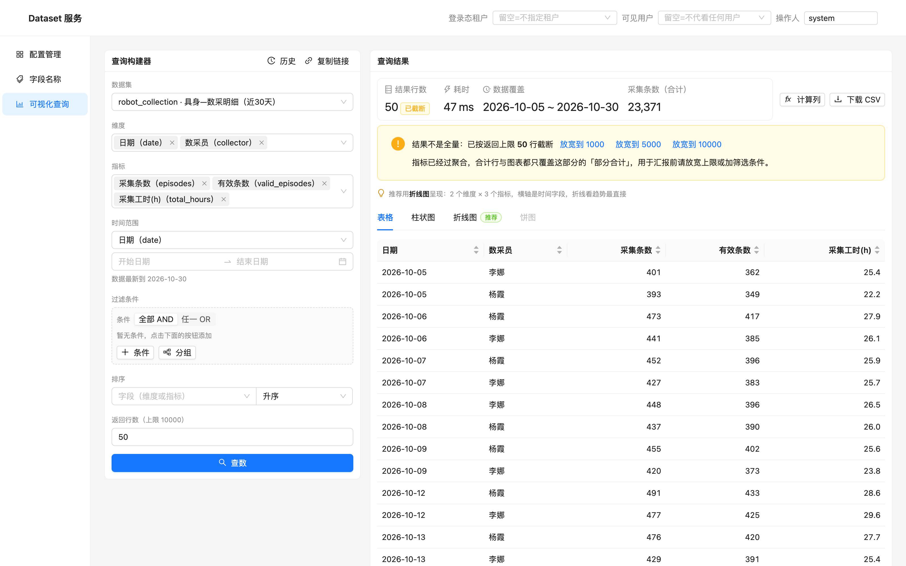

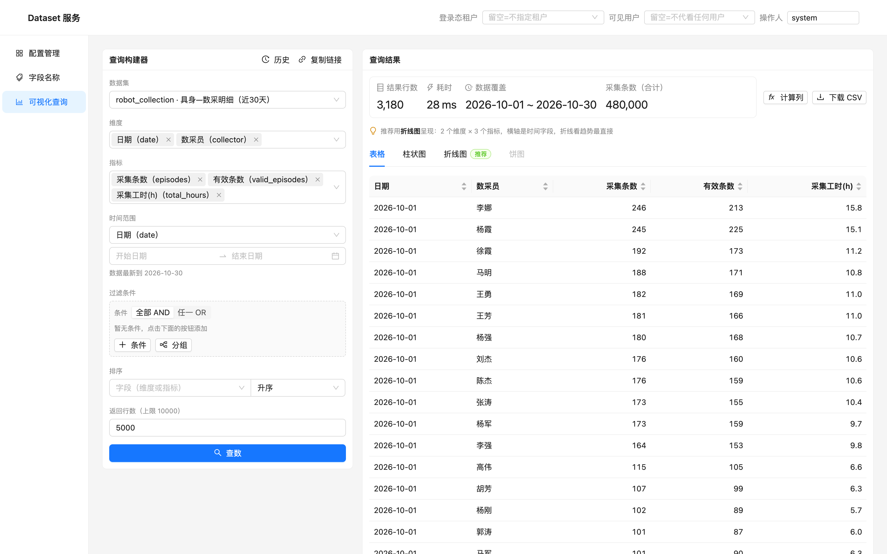

新增单测 `TestBuildLimitProbe`（普通上限 / 未指定 / 超硬顶三种），
并同步修正 4 处旧断言里的 `LIMIT n` → `LIMIT n+1`。

---

## v12 一屏只有一张表，看完还得自己心算

**发现**：早上打开看板看昨天的数采，16 个任务场景，一张表铺满屏幕。
想知道「一共采了多少」「哪个场景占大头」「通过率大概什么水平」，
得自己把 16 行加一遍、找出最大值、再扫一遍比率列——**看板给出了数据，没给出结论**。

更别扭的是不选维度的时候：屏幕正中孤零零一行数字，外面套着表头、分页器、
「共 1 行」，像一张被裁掉内容的表。

**改动**（`web/src/components/MetricCards.tsx` 新增，挂在概览条下面）

每个指标一张卡，最多四张，每张只回答一个问题：

| 指标类型 | 大字 | 小字 |
| --- | --- | --- |
| 可累加（sum） | 全部返回行的合计 | `最高 工具使用 · 8.0%`（维度是日期时说「峰值」并带日期） |
| 不可累加（比率/均值/去重） | 各分组值的算术平均 | `行均值 · 范围 87.70 ~ 91.10` |

三条刻意的约束：

1. **不是可加指标就不给合计**。通过率的合计会是 1400% 这种数，宁可显示行均值并标注
   「整体口径请去掉分组再查一次」，也不给一个看起来像结论的错数。
2. **时间维度带迷你趋势线**（内联 SVG，28px 高）。不为一条小线去拉 400KB 的图表库；
   常量序列（在岗人数 30 天都是 269）直接不画——一条直线没有信息量。
3. **长数字不换行**。`94,571,410` 在窄卡里被折成 `94,571,41` + `0`，看起来像两个数。
   按长度降字号，宁可小一点也保持一行。

顺带两处收口：

- 概览条里的「合计」删掉了。同一个数在概览条和卡片各出现一次，只会让人怀疑是不是两个值。
- 无维度查询不再渲染那张 1 行表，直接给 KPI 页；要原始精度去导 CSV。

**验证**：16 个任务场景 → 产出单元合计 94,571,410，最高「工具使用」占 8.0%
（16 个场景平均分，本就该是这个量级）；通过率显示行均值 89.37、范围 87.70~91.10。
按日期查时三张卡各带一条趋势线，出勤人数 269 恒定 → 不画线，小字变成「各分组相同（30 个）」。

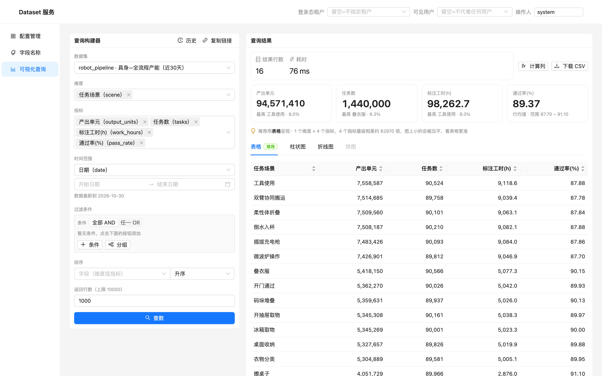

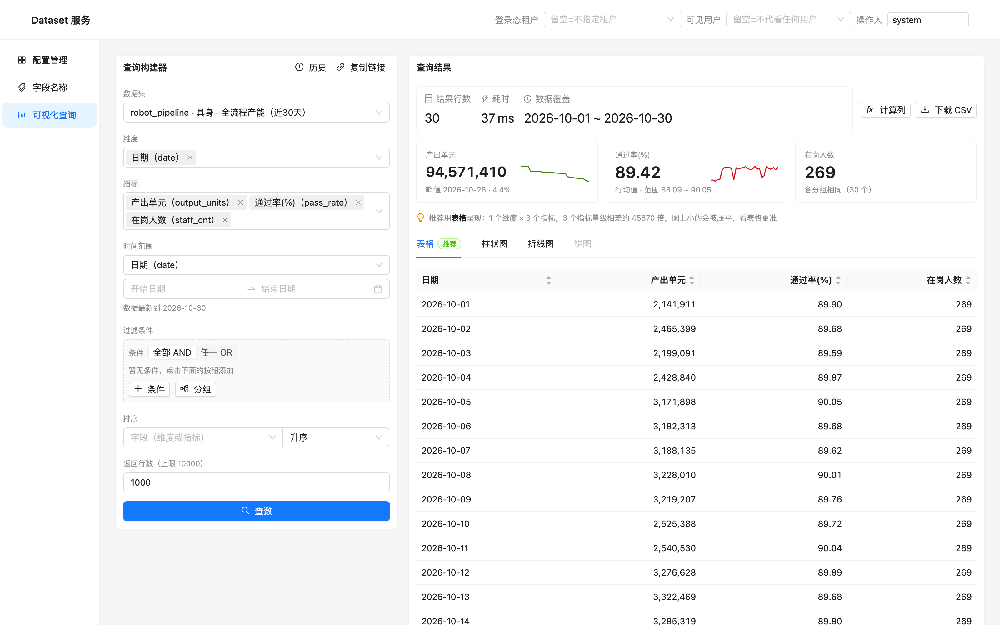

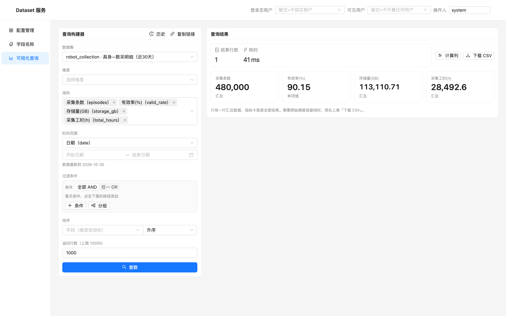

---

## v13 本周比上周怎么样，只能查两次再拼表

**发现**：周会前要做「本周 vs 上周」的对比。看板只能给一个区间，
于是要么查两次再导两份 CSV 用 Excel 对，要么在脑子里记住上周那七个数字。
更麻烦的是**维度会漂移**：上周有这个客户、这周没有，两次查询的行根本对不上，
肉眼对齐一定漏。

**改动**

后端（`internal/query/compare.go` 新增 `Compare` / `CompareMeta`）

做法是**用同一份查询再跑一次**，而不是在 SQL 里写窗口函数：

- 上期查询 = 本期条件树，把日期维度上的区间换成平移后的区间（`ReplaceRange`）。
  指标表达式、行级权限、多值维度收拢全部自动复用，不会出现「本期 sum / 上期 avg」。
- 两种口径：`prev_period` 上一个等长周期、`prev_year` 去年同期。
- 没有设时间范围时，先探一次该日期列的 min/max（`BuildDateRangeSQL`）再平移——
  默认查全量的人也该能开对比。
- 对齐按**维度元组**做 key，不按行序：两期的默认排序不同，按下标对齐必错。
- 上期有、本期没有的组合**补一行**（本期指标 NULL）。少了它们，
  「这个客户这个月没交付」会直接从表里消失，环比看起来比实际好。
- 本期结果被截断时直接报错而不是给个对比：
  被截掉的分组会被当成「上期没有」，算出来的变化率是错的。

三个自己踩到的坑：

1. **对比字段本身是分组维度时**（按天看周同比），两期日期不重叠，
   按值对齐变成 14 行、每行各有一半是空。改成先把上期日期整体平移到本期时间轴上
   （`ShiftDimDates`），按「期内第几天」配对，才是周同比该有的样子。
2. **比率类指标不能看相对变化**。通过率 88%→90% 说成「+2.3%」会被读成涨了两个千分点，
   改用百分点差（`+1.7pp`）。
3. **上期整段没数据时要解释**。拿只覆盖 30 天的数据集做同比，一排「—」等于没说，
   直接挂一个「上期区间没有数据，无法对比」并说明原因（去年同期为空是正常的）。

前端

- 查询构建器新增「对比周期」开关（等长周期 / 去年同期 + 日期字段），随 URL 走。
- 结果区顶部写清两个区间，补入行数、上期截断、上期无数据都用 Tag 标出来。
- 指标卡直接给「环比 +16.4%」；表格里每个指标多一列「环比」，
  上行上期值、下行变化（涨红跌绿）；可点表头按变化率排序。
- CSV 同时导出「上期」「变化」两列，并在文件头写明对比口径。

**验证**：场景 × 采集条数，近 14 天 vs 前 14 天 → 合计 246,080，环比 +16.4%；
「工具使用」15,568 vs 13,185（+18.1%），「桌面收纳」+18.4%；
有效率 90.11 vs 上期均值 → −0.06pp（卡片与逐行的 +0.27pp 不冲突：
卡片是各场景的算术平均，逐行是单个场景）。
按天看 10-24~10-30 → 7 行，每天对上上周同一天（10-24 的 11,708 vs 19,686，+17.9%）。
去年同期 → 全部 `—`，并提示「上期区间没有数据」。

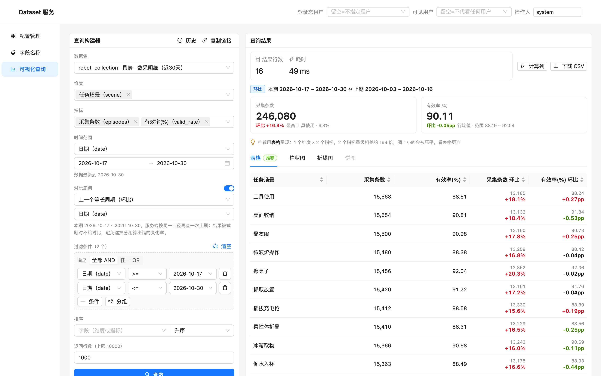

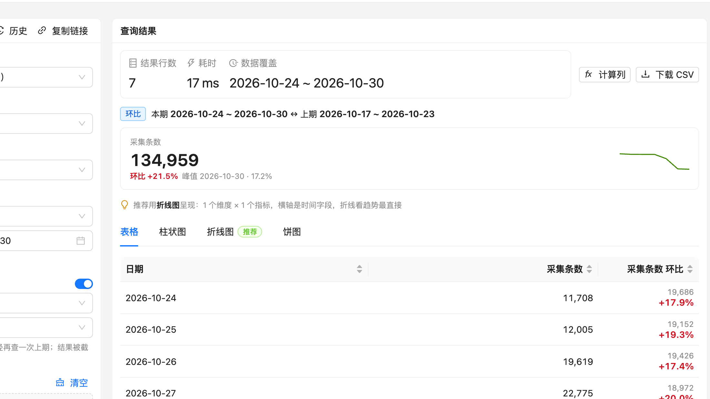

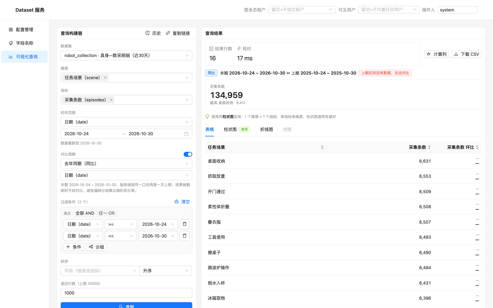

新增单测 8 个：等长前移（含首尾那天）、去年同期、非法口径、
找区间、OR 根替换区间、旧边界被替换、按维度对齐、NULL 与空串不合并、日期平移。

---

## v14 看到一根柱子特别高，点不动

**发现**：柱状图上「倒水入杯」的产出明显比别的场景低一截。想只看它，
得回左边：选维度字段 → 选操作符 → 输入值 → 点查数，四步。
而图就在眼前，那根柱子就是我想要的条件。**看得见的东西点不动，是最典型的工具感缺失。**

**改动**

- `ChartView` 接 `onReady` 拿 G2 实例，绑 `element:click`；柱状图与饼图都支持。
- 表格里维度值变成可点（虚线下划线 + hover 提示「只看 X = Y」）。
  指标列**不做**点击——指标是聚合结果，点它下钻没有语义。
- 下钻不引入新算子，而是往条件树里写一条 `= 值`（`addCondition` / `removeCondition`）。
  这样条件计数、「清空」、URL、历史、导出全部自动生效，
  用户也能在条件区看到它到底加了什么——**「界面看着筛了」和「实际筛了」必须是同一件事**。
- 根节点是 OR 时包一层再 AND：直接塞进 OR 会让下钻变成「或」，查出来的数翻倍。
- 结果区顶部给「下钻路径」面包屑，每层可单独 ×，也可以「返回上一层以上」。
  面包屑渲染前会与条件树对一遍（`hasCondition`）——用户在条件区手动删掉的条件，
  不该还挂在上面。

**验证**：柱状图点「工具使用」→ 面包屑出现，结果 1 行 30,146，条件区同步出现
「任务场景 = 工具使用」；表格里点「倒水入杯」→ 6 个城市，合计 29,992。

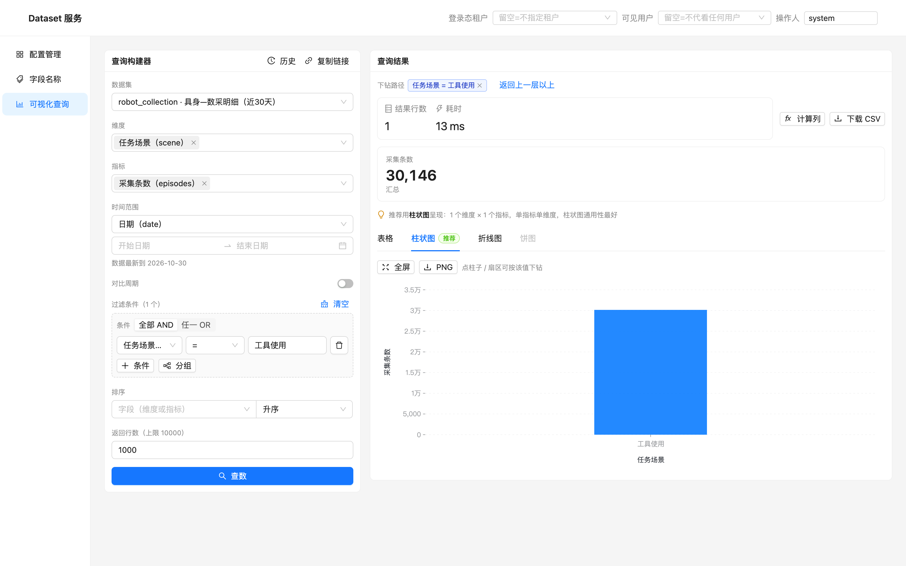

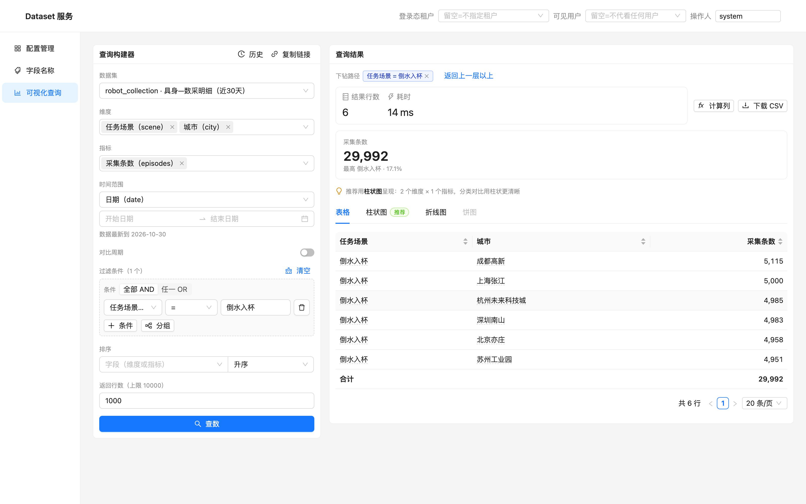

---

## v15 几十个字段一锅端下来，不知道选哪个

（换成数据集开发者的身份）

**发现**：商务数据集有 13 个维度、15 个指标。用户打开维度下拉，
看到的是一长串「客户分层(tier)、客户(customer)、行业(industry)…」，
既没有分组、也不能搜。更要命的是**没有任何口径说明**：
「应收金额」含不含未到期？「回款率」的分母是应收还是合同额？
用户不知道，只能来问我——而我一周被问三次同一个问题。

这不是前端问题。**是我把数据集交出去的时候没写说明书。**

**改动**

后端：给 `tb_dataset_config` 加一列 `meta`（JSON），存六样东西：

```
description  一句话说明这个数据集能回答什么问题
owner        出问题找谁
update_freq  多久更新一次（T+1 还是实时，差别很大）
tags         业务标签
field_notes  每个字段的口径说明，key 是 dim_map / mtx_map 的键
examples     预置分析（v20 用）
```

几个设计决定：

- **与 dim_map / mtx_map 分开存**。前者决定「能不能查」，后者决定「敢不敢用」。
  混在一起会让「补一句说明」也得动 SQL 配置，出错的代价完全不对等。
- `meta` 在 Update 请求里是**指针**，不传 = 不修改。用值类型的话，
  配置页保存一次就会把别人写的说明整段清空——「没说」和「说没有」必须是两件事。
- 不做格式校验，只做 trim 与空值剔除：它只影响提示文案，写错顶多是不准，
  不该像 map 写错那样卡住保存。

`deploy/register_embodied_datasets.py` 里补了 5 个数据集共 39 条字段口径、11 个预置分析。

前端：

- 维度下拉拆成「普通维度」「多值维度（收拢展示）」两组，指标一组并带计数。
- 支持搜索，且**同时命中字段名、中文名、口径说明**——
  用户记得「不含税」但记不住字段叫 `revenue`，这很常见。
- 每个选项两行：名字 + 口径说明。选之前就能看到单位和公式。
- 数据集下拉下方直接显示这个数据集是干什么的。

**验证**：输入「不含税」→ 只命中「交付收入(元) revenue」；
标注数据集的维度下拉里「技能标签 skill_tags」单独归在多值维度组；
商务数据集描述显示为「商务环节项目级明细：合同、交付、收入、回款与账期…」。

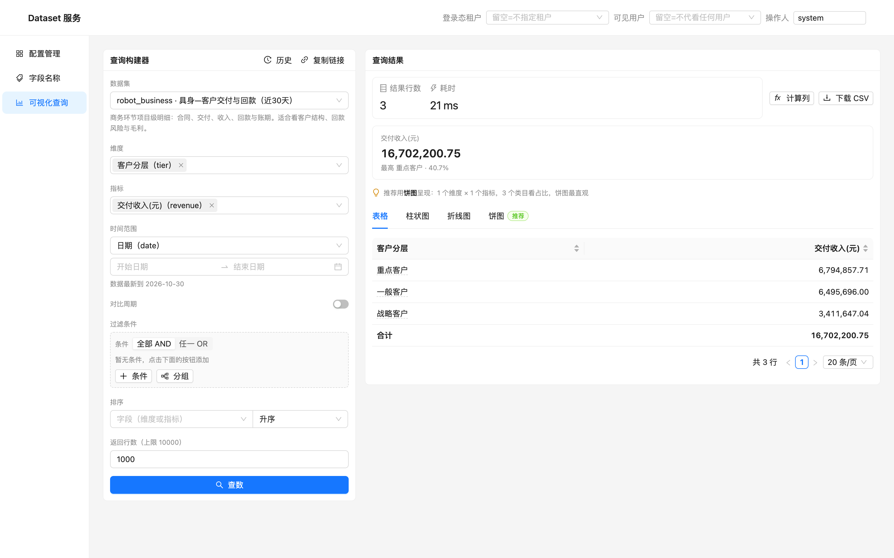

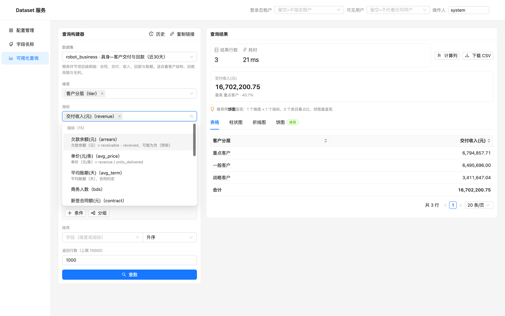

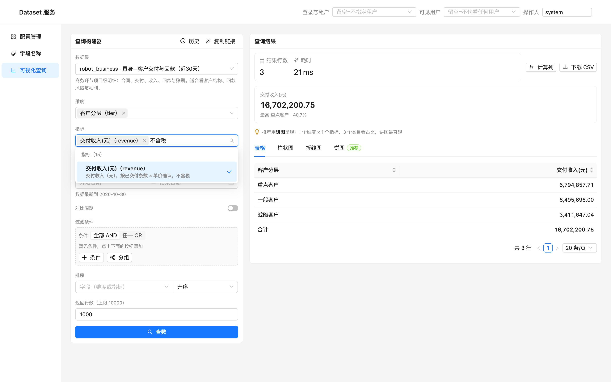

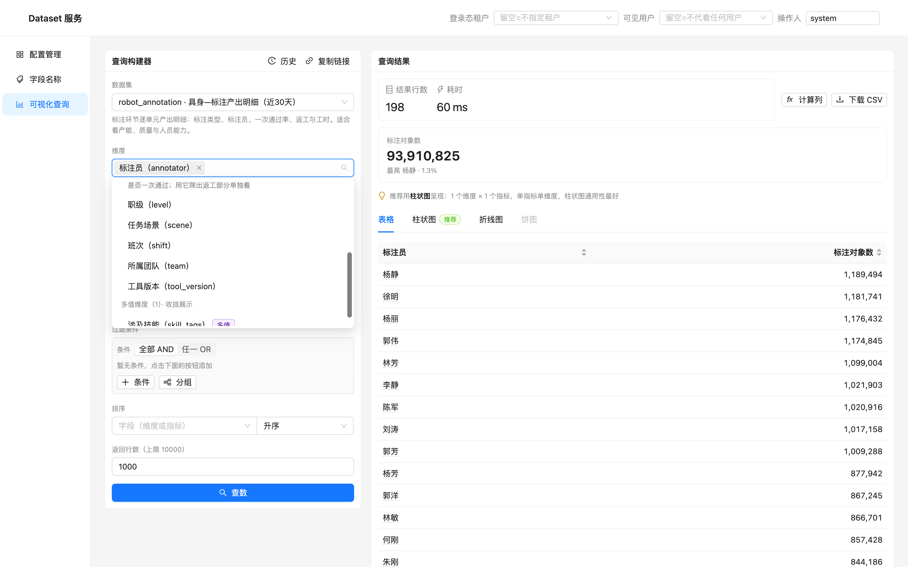

---

## v16 四个指标画在一张图上，三条看不见

**发现**：全流程数据集里，产出单元 94,571,410、任务数 1,440,000、通过率 89.42、
标注工时 98,262.6。四个指标画一张折线图，**只有产出单元是看得见的**，
其余三条贴着 X 轴压成直线。而页面上那句「推荐用表格呈现：4 个指标量级相差 82970 倍，
图上会被压平」——等于看板自己承认画了个假图。

**改动**（`ResultView` 分面 + `ChartView` 窄图标签）

- 多指标时默认**分面**：一个指标一格，各自一根 Y 轴，各带自己的合计 / 行均值。
  这不是「多画几张图」，而是承认不同量纲的指标本来就画不到一张图上。
- 保留「合并」开关，并说明什么时候该合并：**要比量级本身**（谁大谁小）才合并；
  要看趋势形状就分面。
- 切回合并时给一条提示，解释「量级小的那条会被压平」，而不是让用户对着一张
  三条直线在 0 附近的图猜。
- 顺带修指标卡：四张卡并排时每张只剩 150px，64px 的趋势线会把数字挤成
  「1,440 …」。现在数字过长或卡片过窄就不画趋势线——趋势线是辅助，数字是主角。

**验证**：分面后四格分别显示 450 万档、700 万档、88~90 档、4,500 档，
通过率的周内波动（88.09~90.05）第一次看得清；合并模式下通过率真的是一条压在 0 的直线，
证明这次改动不是审美选择而是读图正确性问题。

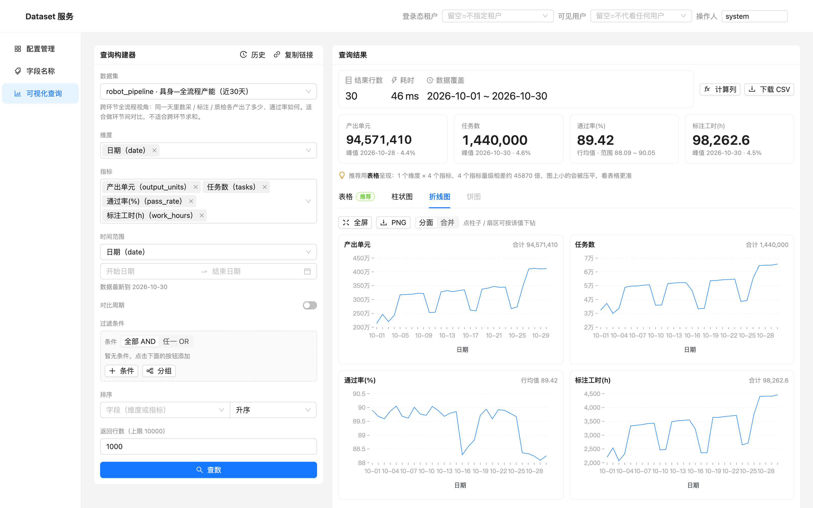

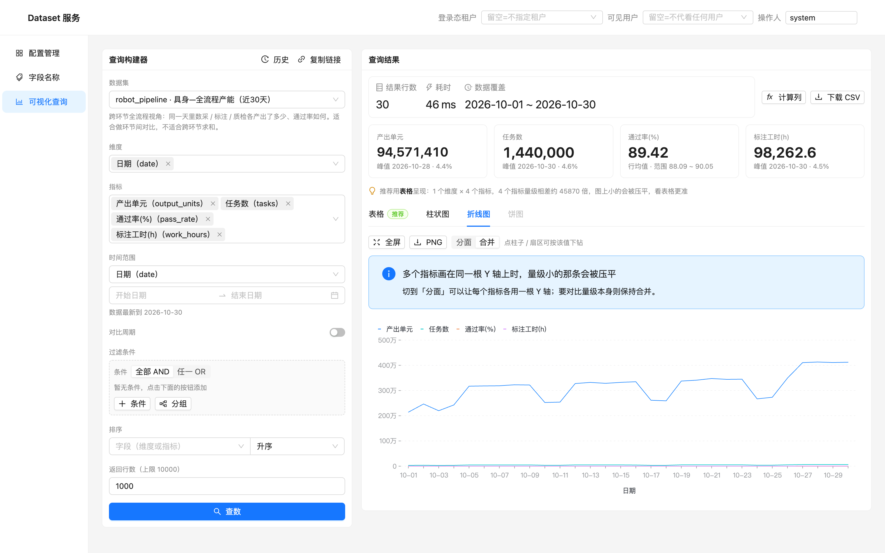

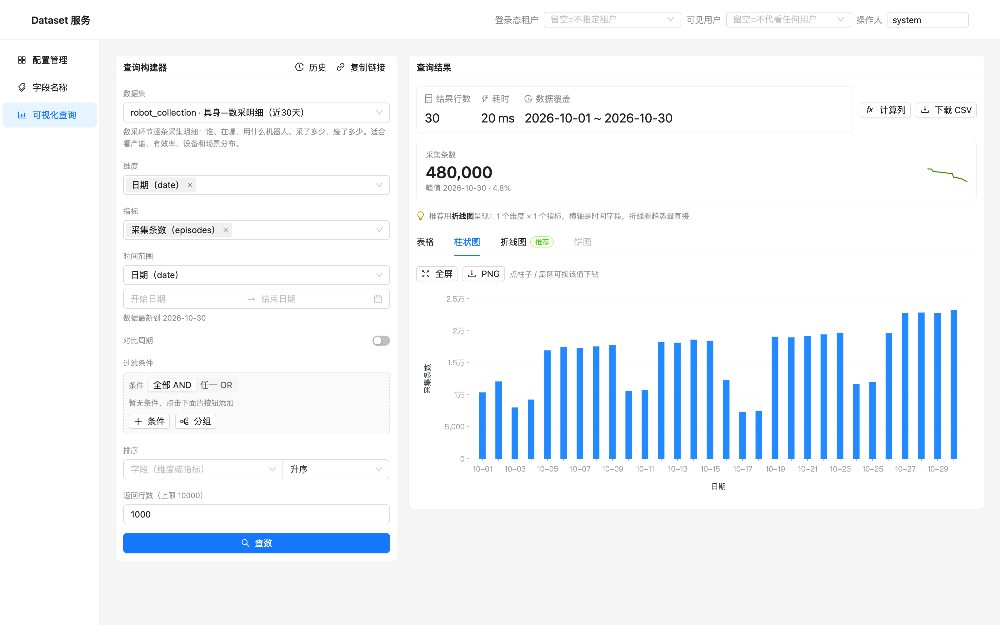

---

## v17 好用的查询只能靠一条 URL 传来传去

**发现**：URL 里带着完整查询，复制给别人能还原——但**自己攒不起来**。
上周调好的「各场景产出排名」，这周要看只能重新选数据集、选维度、选指标、点查数，
或者翻历史记录（20 条就滚没了，而且叫「质检数据集 · 场景 × 产出单元」，
和「标注数据集 · 场景 × 产出单元」长得几乎一样）。真正每周都要看的图，
没有名字就找不回来。

**改动**（新增 `web/src/utils/favorites.ts` 与 `FavoritesDrawer.tsx`）

- **命名收藏**：顶栏「收藏」给当前这一屏起个名字。默认名自动拼出
  「数据集 · 按维度 · 指标（筛选）」，用户改两个字就能用——留空的话收藏夹里会躺一堆「未命名」。
- 收藏存的是**一整套查询输入**：数据集 + 维度 + 指标 + 筛选 + 排序 + 上限 + 对比周期，
  不是一条 URL。打开时按当前数据集的字段重新校验，数据集改名/迁环境也不会拿到一个 404 的链接；
  列表里还能直接显示「按什么维度、什么指标、筛了什么」。
- **收藏夹抽屉**：跨数据集攒，可改名、写备注（「每周一晨会第一页」）、删除。
  当前这一屏命中的那条会打上「当前」并高亮，带环比的打「环比 / 同比」，
  数据集已不可见的打红标并禁掉「打开」——而不是点下去才报错。
- 按钮状态即答案：没存过是空心星「收藏」，存过是实心星「已收藏」，
  悬浮提示直接告诉你存成了什么名字。

几个设计决定：

- **同口径覆盖，不重复堆**。按「数据集+维度+指标+筛选+排序+上限+对比」算指纹，
  名字和备注不算口径——改个名不该让按钮失去「已收藏」状态。
- 上限 200 条、不滚动淘汰。历史是「刚才查过什么」，20 条够了；
  收藏是「每周都要看一次」，悄悄被挤掉比没有更糟。
- 仍然存 localStorage：这个服务不接鉴权，为收藏建表建接口不划算，
  代价（换浏览器就没了）与历史保持一致。

**验证**：连续收藏三条（采集日趋势 / 采集量周环比 / 各场景产出排名，跨两个数据集），
收藏夹里三条各自显示数据集名、维度 × 指标、备注与收藏时间；
点第三条「各场景产出排名」一键回到 `robot_pipeline` 的场景视图；
对环比那条改名加备注后，列表里的名字与备注同步更新。

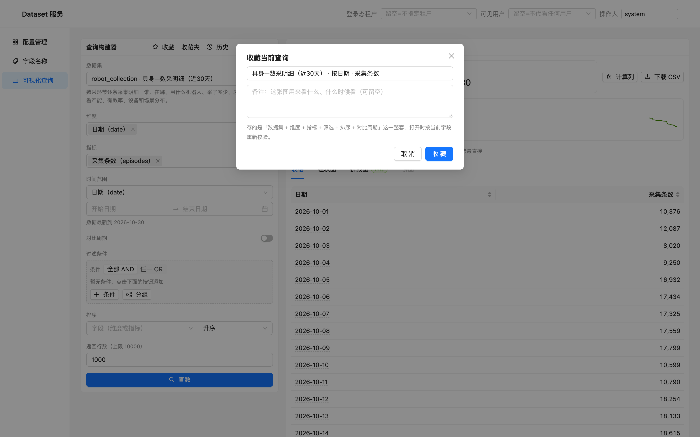

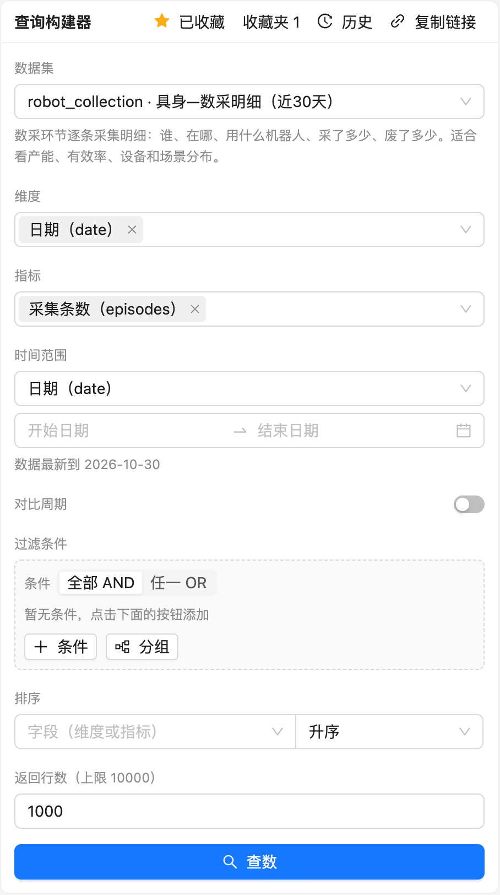


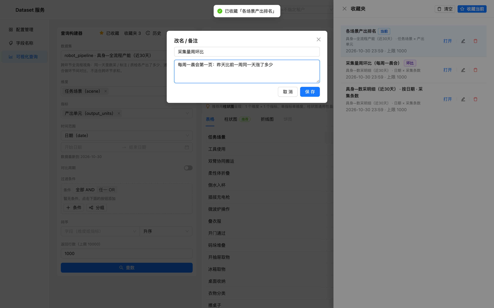

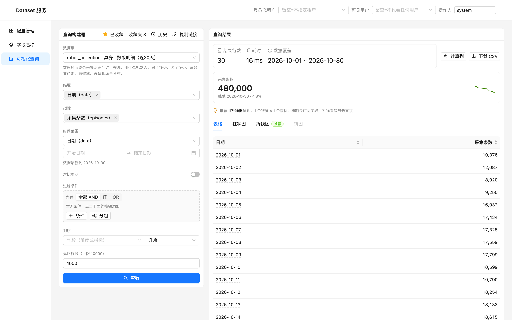

---

## v18 「暂无数据」和一行红色报错，都是把问题原样还给用户

**发现**：两处最需要帮忙的地方，界面什么都没帮。

- 查出来 0 行，表格里只有一句「暂无数据」。是数据集空了？筛选写错了值？
  日期区间写反了？**用户只能自己一条条试**——而试的成本是每次重选一遍条件再点查数。
- 报错直接把服务端原文铺上去，例如 `invalid query: 过滤字段 "xxx" 不在该数据集的
  dim_map / multi_dim_map / mtx_map 中`。这句话给写 SQL 的人看很准确，
  给只是想查个数的人看，等于没说。

**改动**（新增 `web/src/utils/diagnose.ts` 与 `DiagnosisPanel.tsx`）

- **报错分六类**，每类给一句人话结论 + 归谁 + 能点的动作：
  权限（说清是谁在拦、负责人是谁）、**字段已不存在**（数据集改过字段 / 链接是旧的）、
  条件组合不出来（OR 里混了聚合前与聚合后）、条件没填完整（这是没填，不是没数据）、
  超时/连不上（按当前维度数与上限给具体的降载建议）、数仓执行报错（**是数据集作者的锅，
  报出负责人**）。
- **空结果给诊断**：把筛选条件摊平，逐条渲染成「去掉「城市 = 火星基地」」按钮，
  外加「清空全部筛选」。没有筛选还 0 行，才判定为数据集空 / 行级过滤挡住，
  并提示数据更新频率与负责人。
- 0 行时**不再渲染空表和 0 值指标卡**——一句「暂无数据」抄三遍没有意义。
- 原始错误折叠在「原始错误（排查用）」里，可复制。普通用户看不见，要排查的人拿得到。

几个设计决定：

- **每个按钮都是「改状态 + 立刻重查」**，没有「我知道了」这种关掉就消失的按钮——
  那等于把问题还给用户。
- 按「字段 + 值的展示文本」匹配条件（`removeLeafByText`）而不是按索引：
  用户可能先改了别的条件，索引会错位；而文本就是他看到的那一行。
- 分类只匹配关键词，不解析错误结构：后端错误文案已经够稳定，
  加一层结构化错误码是过度设计，代价是新增错误类型要回来补一条匹配。

**验证**：`城市 = 火星基地 且 难度 = 易` → 0 行，面板列出两条条件各一个「去掉」按钮；
点掉「火星基地」后立刻带着 `难度 = 易` 重查，结果回来（证明按钮不是关提示）；
筛选项里塞一个不存在的字段 → 命中「数据集里已经没有这个字段」并给出
「刷新数据集字段 / 清空筛选条件」；开了环比但没选指标 →
提示「对比周期需要至少一个指标」而不是抛断言。

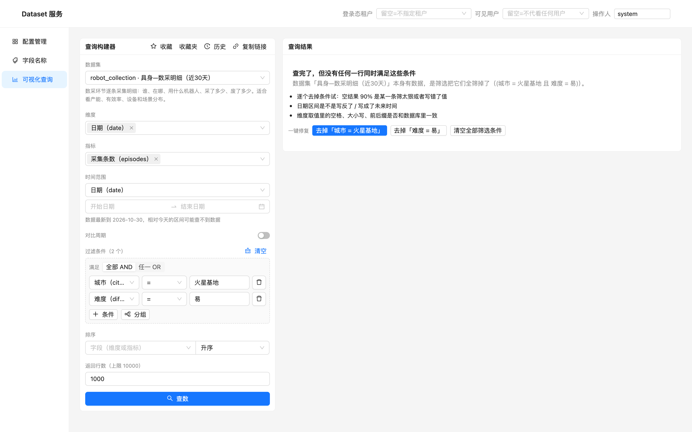

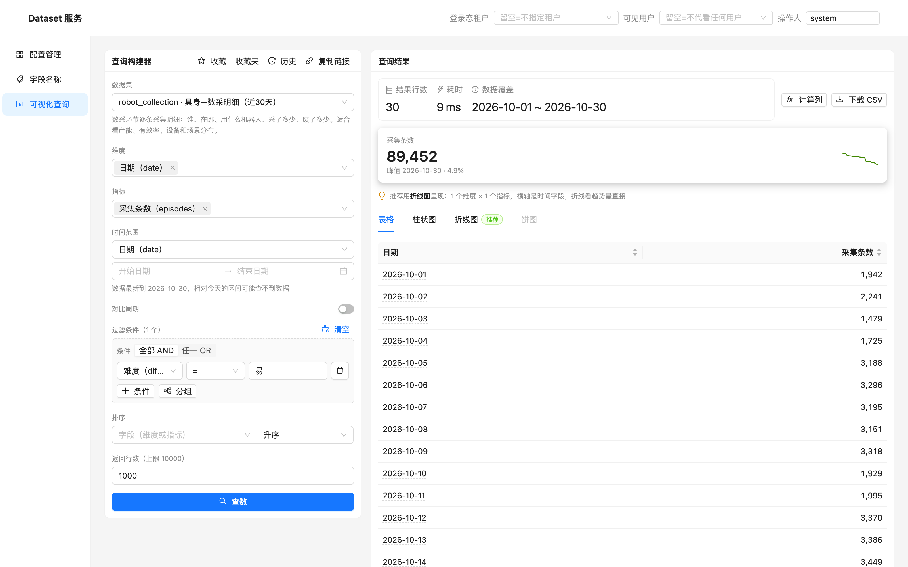

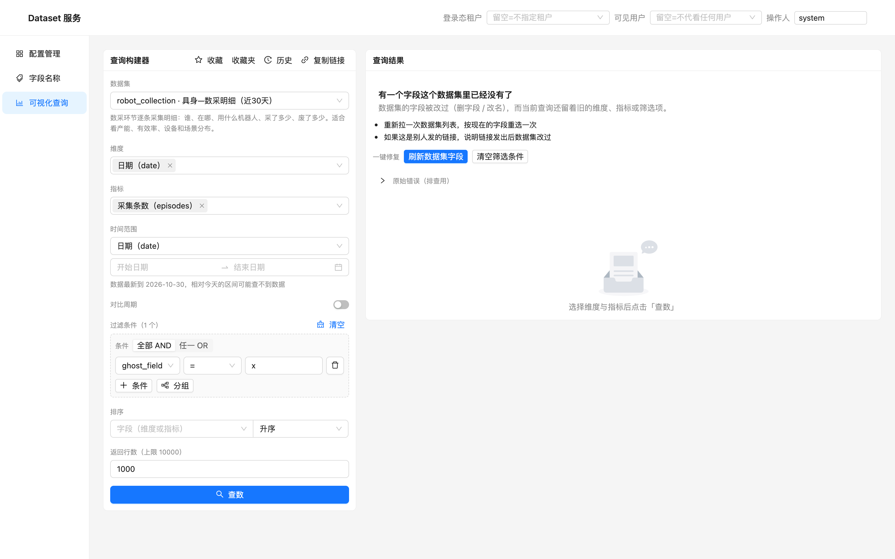

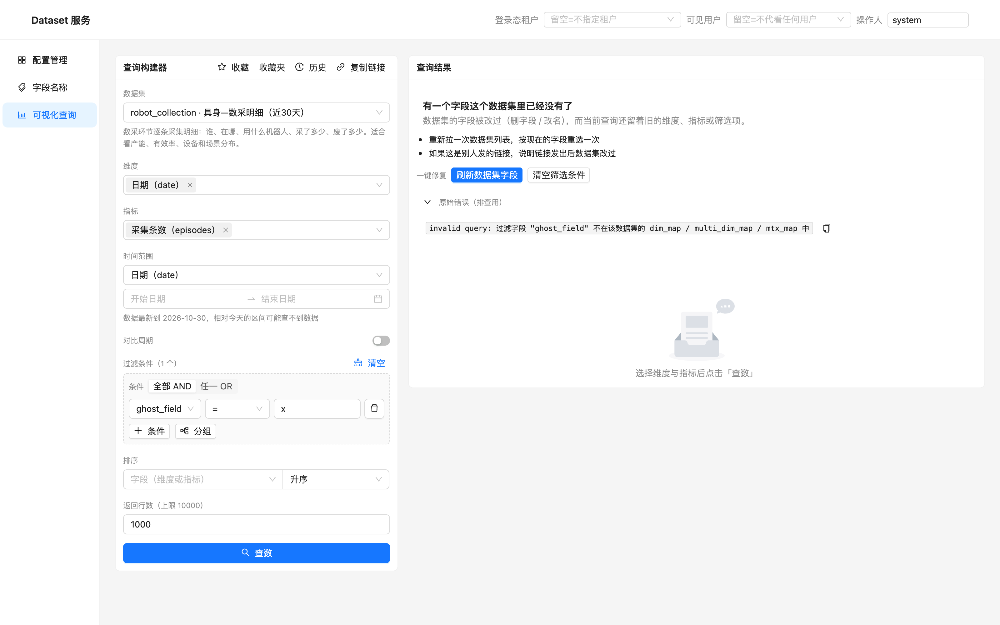

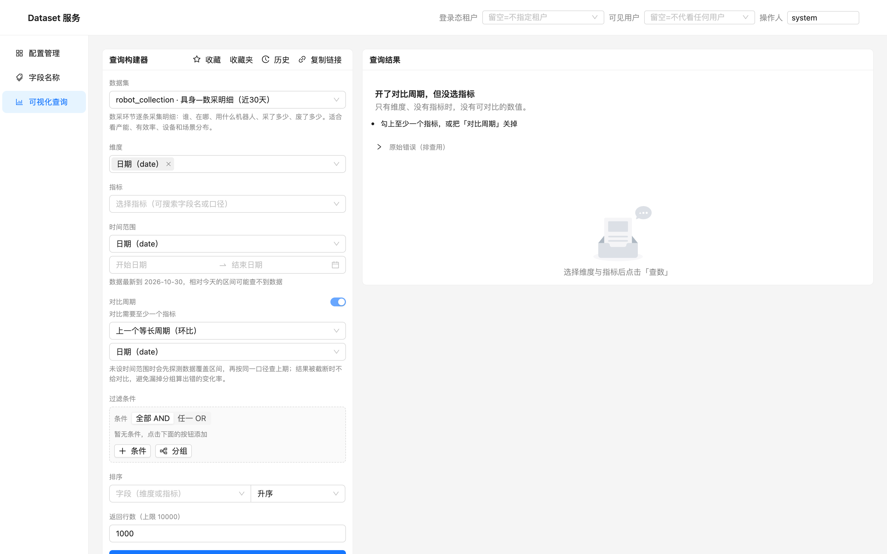

---

## v19 数据集交出去之后，用户不知道它能不能信

**发现**：查询页能回答「怎么查」，回答不了「敢不敢用」。
选一个数据集，页面上只有名字和一堆字段下拉。这些数有多少行？覆盖到哪天？
上周的数据到齐了吗？口径不对找谁？**全靠问人**。
而问人的代价是：拿到一个数，先花半天确认这个数能不能用。

**改动**

后端（新增 `internal/query/stats.go`，路由 `GET /api/v1/datasets/:key/stats`）：

- 一次扫描给出：行数、时间覆盖区间（min~max，按数据集里的日期维度）、
  覆盖天数、距今天数（新鲜度）、字段数（维度 / 多值 / 指标）、配置版本与最后修改人。
- **结果缓存 10 分钟，按「数据集 + 登录态」分 key**：
  行级过滤会让不同人看到的行数不同，共用一个 key 会把别人的行数显示给你。
- 同一个 key 的并发扫描串行化（谁先到谁扫，其余等结果），
  避免三个人同时开页面就把全表扫三遍。
- **扫描失败不连坐**：错误放进响应的 `error` 字段，卡片写「规模扫描没跑出来：…」并给重试，
  而不是让整个查询页打不开——查数不该因为体检报告没做出来就不能用。
  失败结果只缓存 30 秒，一次抖动不该在十分钟内一直显示失败。

前端（新增 `DatasetTrustCard.tsx`，挂在数据集下拉下方）：

- 行数用「144 万 / 1.44 亿」这种量级写法，完整值在悬浮提示里（含扫描耗时与是否命中缓存）。
- **新鲜度会下判断，但只在有依据时**：把「更新频率」翻译成容忍阈值
  （实时/小时→1 天，每日→2 天，每周→8 天，每月→35 天），
  超过才亮「数据可能滞后：每日更新，但只到 2026-10-20（12 天前）」。
  **没有标注更新频率就只陈述事实、不做猜测**——假警报比不报警更伤信任。
- 数据里出现未来日期（lag 为负）单独提示，多半是时区或录入问题。
- 负责人 / 更新频率**没写就直接显示「未填写」**：这是对数据集作者的压力，也是用户的免责说明。

几个设计决定：

- 日期维度要用 `dim_map` 里的**列表达式**（`date` → `stat_date`）而不是维名，
  否则 ClickHouse 直接报 `Unknown identifier`。
- 体检报告不进数据集列表接口：列表要快（打开页面就请求），扫全表要慢，
  混在一起会把下拉列表拖住。
- row_count 用 `count()` 扫全表而不是取系统表的估算值：
  体检报告是给人看的，宁可慢 50 ms，也不要一个和真实行数差 10% 的数字。

顺带：新增 `deploy/seed_demo_meta.py` 给 demo 数据集补说明书，
并**故意保留 demo_tmpl 不写负责人**作为对照组——让数据集作者看到「不写是什么样」。

**验证**：`robot_pipeline` 显示 144 万行、2026-10-01 ~ 10-30 共 30 天、负责人「数据平台 · 架构组」、
每日 09:30 更新；切换数据集后卡片跟着换（`robot_annotation` 90 万行 + 多值维度 1 个）；
`demo_tmpl` 负责人与频率显示「未填写」；`demo_order` 标注每日更新但数据停在 12 天前，
如实亮出滞后告警。

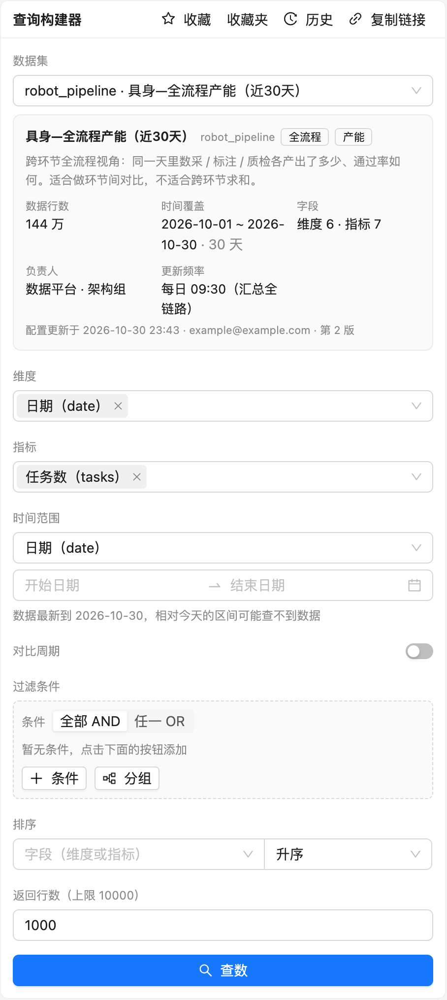

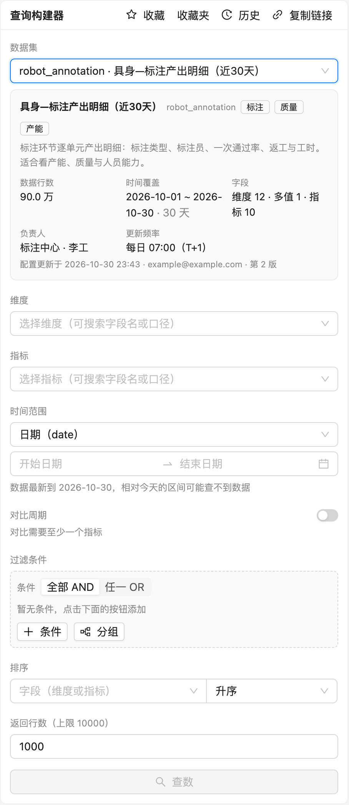

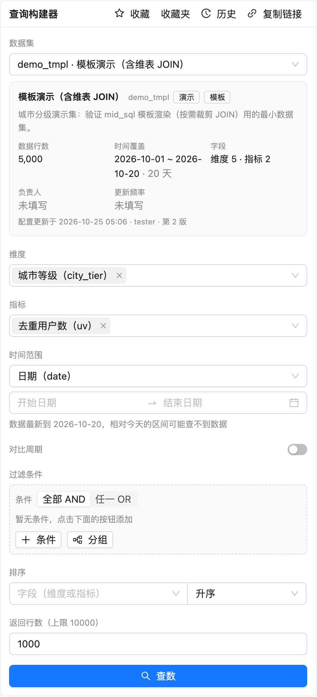

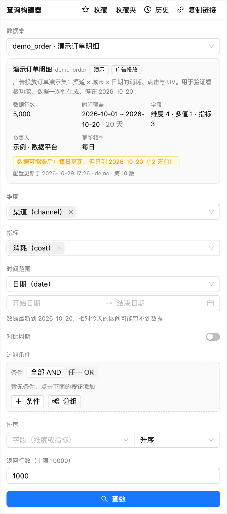

---

## v20 每个新人都在重搭同一张周报

**发现**：从使用者角度，最难的一步是「打开一个陌生数据集，然后呢」——
维度十几个、指标十几个，第一次用只能瞎试。
从开发者角度更亏：作者心里明明有答案（「看通过率要按环节拆」
「看缺陷分布得先筛标注环节，不然两个环节的字典会混在一起」），
但这个答案只在作者脑子里和周报模板里，**每个接手的人都得重搭一遍**。

v15 已经把 `meta.examples` 存进了数据集，但**界面上根本没有入口**——存了等于没存。

**改动**（新增 `PresetAnalyses.tsx`，挂在数据集下拉下方）

- 数据集有几条预置分析，就在下拉下方列几条：标题 + 一句「这张图用来看什么」的说明。
- **点一下就是作者当时那张图**：维度、指标、筛选条件、排序、上限、对比周期一次性落位并立刻查。
  不是「把链接塞给你」，是直接复现。
- **与 URL 共用同一份解析**（`parseIntent`）。预置存的就是 URL 里 `ds` 之后那一段，
  所以只要链接能还原，预置就一定能还原——不存在「链接能开、预置开不了」这种两套规则。
- 空态加一句引导：数据集有预置时，比起「点查数」更值得先试试作者的那几个。
- 给 `robot_collection` 补了一条带对比周期的预置（采集量周环比），
  用来证明预置不只是「维度 + 指标」——它可以是任何能被 URL 表达的一屏。

几个设计决定：

- **一次落全量状态再查**，不让用户「先选数据集、再看预置里少了什么」。
  预置里带着筛选条件也一样：点完条件区要同步显示「环节 = 标注」，
  否则用户会以为结果是被筛过的全量，那是比没筛选更危险的误读。
- 预置写在数据集里（`meta.examples`）而不是前端常量表：
  它跟着数据集走，作者改口径时顺手就能改，不需要发版。
- 不给预置加「收藏」语义——收藏是使用者自己的事（v17），
  预置是作者的建议，两者混在一起会让「谁定的口径」变得模糊。

**验证**：`robot_collection` 只选数据集时列出 4 条预置；
点「各任务场景产出对比」直接出 16 个场景的产出 / 有效率 / 质量分；
点「采集量周环比」开箱带环比列；换到 `robot_qc` 点「标注环节缺陷 TOP」，
条件区同步落位「环节 = 标注」，结果只剩标注环节的缺陷类型（漏标 2,332、错标 1,952…）。

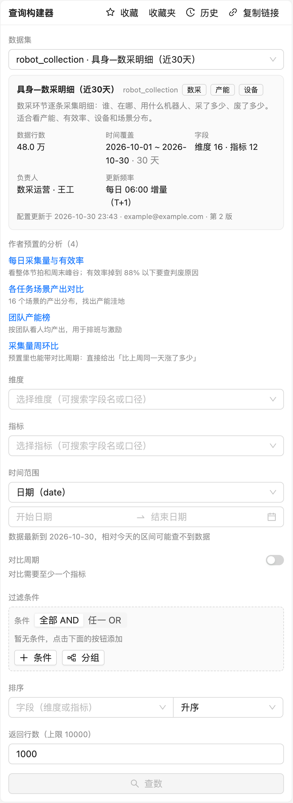

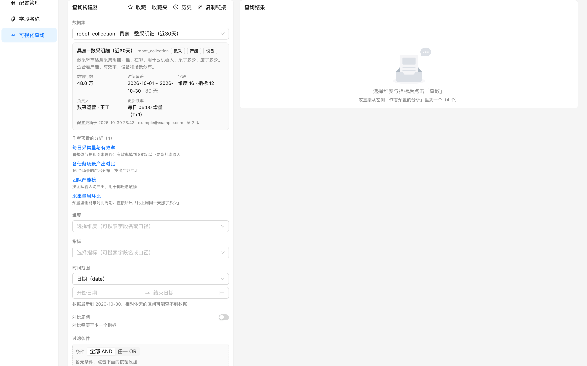

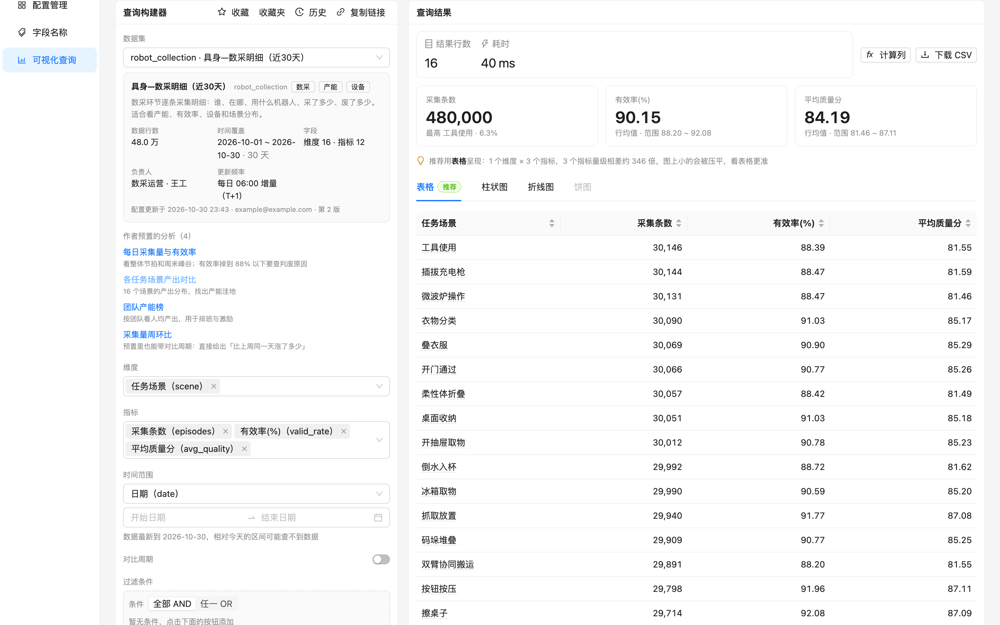

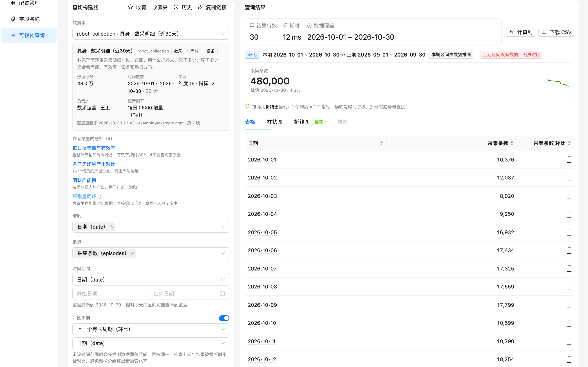

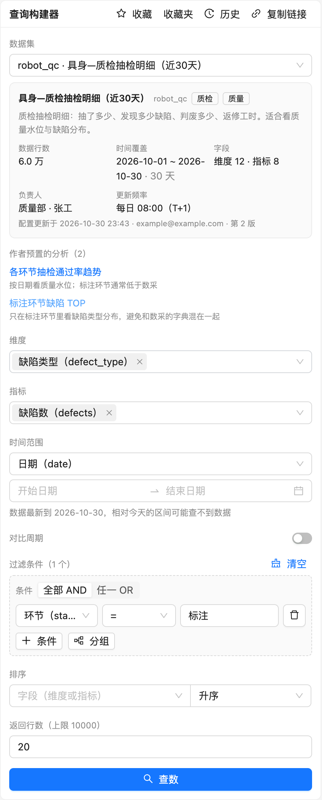

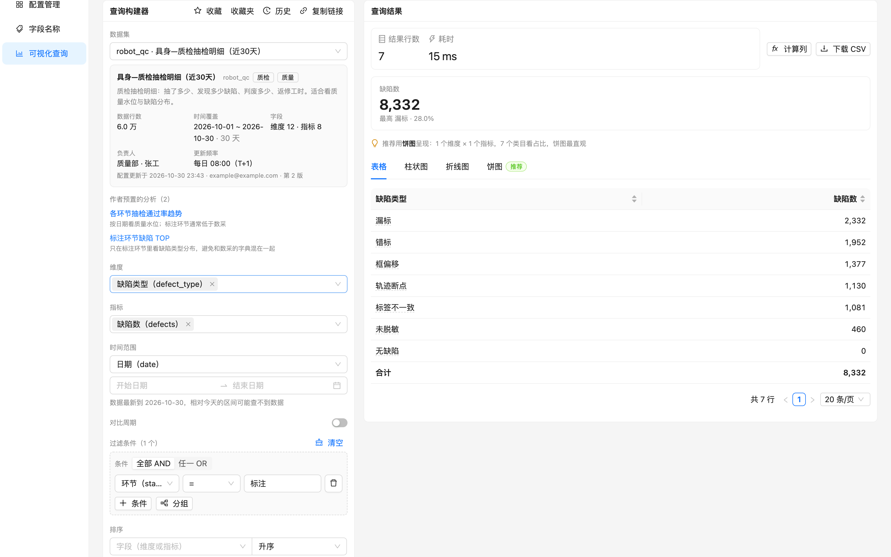

---

## 这一轮（v11~v20）回头看

十个版本里有六条来自使用者、四条来自数据集开发者，但它们指向同一件事：
**看板的价值不在「能画多少种图」，而在「看到一个数之后能不能直接信它、用下去」。**

| 使用者这边真正卡住的 | 解决它的版本 |
| --- | --- |
| 不知道后面还有多少数据 | v11 截断判定 + 概览条 |
| 一屏没有结论 | v12 指标摘要卡 |
| 比上周怎么样要查两次 | v13 同环比 |
| 看到一根高柱子点不动 | v14 下钻 |
| 好用的查询攒不起来 | v17 命名收藏 |
| 空结果和报错只能猜 | v18 人话诊断 |

| 开发者这边真正卡住的 | 解决它的版本 |
| --- | --- |
| 用户不知道字段口径 | v15 说明书 + 字段分组/搜索/口径 |
| 多指标被压平还以为图画错了 | v16 分面 |
| 数据集交出去不知道能不能信 | v19 体检卡 |
| 每个新人重搭同一张周报 | v20 预置分析 |

（v16 虽然由使用者视角发现，修的是「图该怎么画」这种开发者的决定。）

---

## v21 预置分析对老手是噪音：给看板一个档位

**发现**：v20 加的预置分析对第一次用这个数据集的人是救命的，
但对每天用的人就是**每天都要滑过去的四行字**——他已经知道自己要看什么，
作者的建议、字段的口径说明、卡片的迷你趋势线、「推荐用折线图」全在跟他抢注意力。
同一个界面要服务两种人，而之前只有一种：**最啰嗦的那种**。

**改动**（新增 `web/src/utils/prefs.ts`，档位开关放顶栏）

- **两档全局偏好**：`简洁` / `完整`，存 localStorage，切换后所有页面立刻生效，刷新后保持。
  做成档位而不是一堆零散开关：没人愿意在设置里翻十分钟去关掉五种提示，
  他要的是一句话——「我熟了，别教我」。
- 简洁档收起的都是**教学性内容**，一个功能都没删：
  - 预置分析收成一行「作者预置的分析（4） 展开」；
  - 字段下拉只显示名字（**搜索仍然命中口径说明**——「记得说明、记不住字段名」是另一种需求，与档位无关）；
  - 体检卡从五格明细压成一行「48.0 万行 · 到 2026-10-30（30 天）· 维度 16 · 指标 12 · 王工」；
  - 指标卡的迷你趋势线不画；
  - 结果区的「推荐用 X 呈现」、tab 上的「推荐」角标、「点柱子可下钻」、分面与量级的解释全部隐藏。
- **功能性提示不受档位影响**：截断告警、系列数超限、图表不可用、数据滞后告警照旧。
  档位管的是「要不要教你」，不是「要不要告诉你出问题了」。

几个设计决定：

- 用 `useSyncExternalStore` 订阅偏好：订阅在渲染阶段建立，
  不会出现「切到简洁档后第一帧还是完整档」的闪动。
- 切档位会**重置预置分析的展开状态**（`useEffect` 同步），
  否则从完整档切过去列表还摊着，用户会以为开关坏了。
- 手动展开/收起只在当前档位内有效，不写回偏好：档位表达的是习惯，临时展开表达的是这一次。

**验证**：同一条查询（`robot_collection · date × 采集条数/有效率`）在两档下的对比——
完整档左栏有描述、五格体检卡、四条预置；简洁档左栏只剩数据集名 + 一行事实 + 一行收起的预置，
结果区没有推荐提示与趋势线；点「展开」预置仍在；切档后刷新页面仍是简洁档。

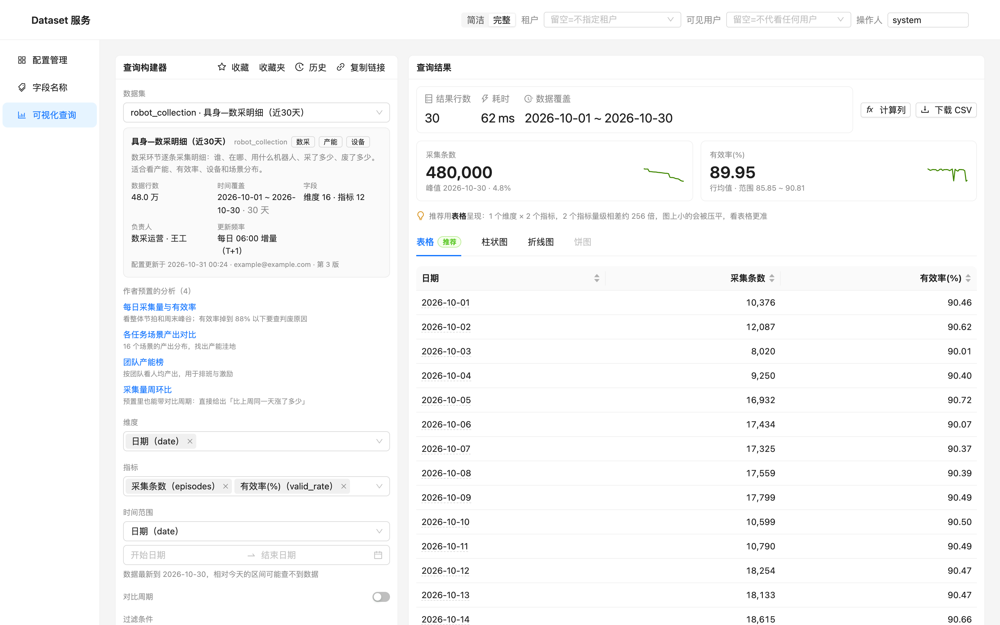


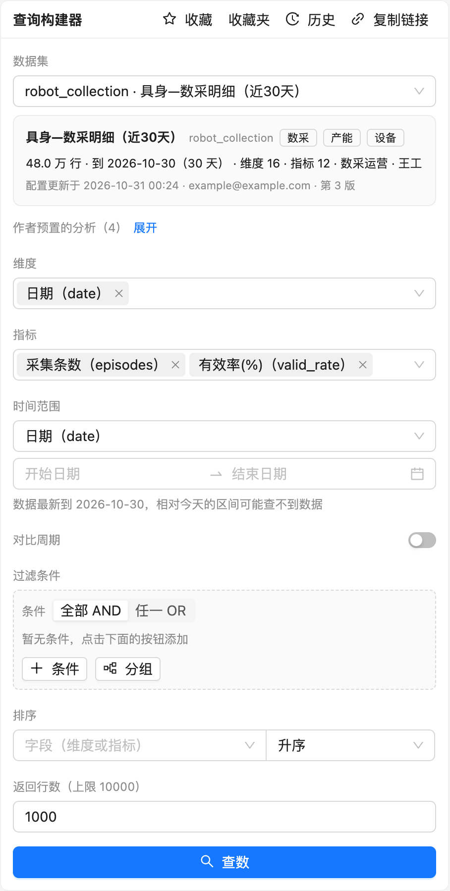

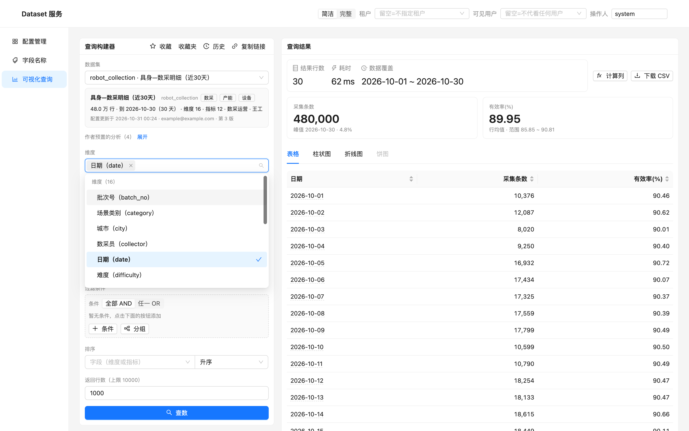

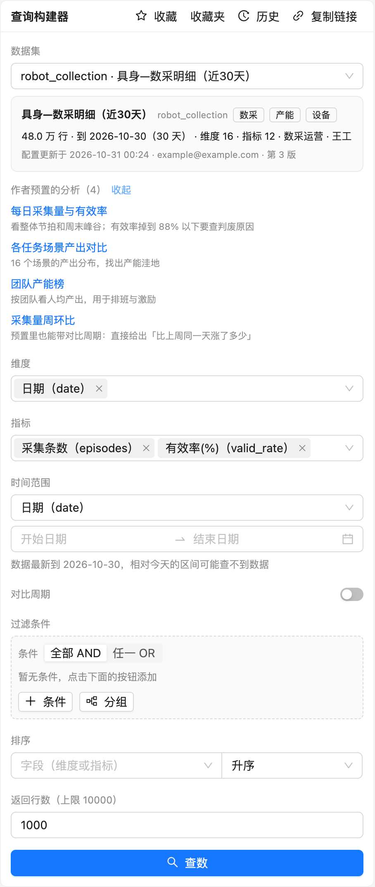


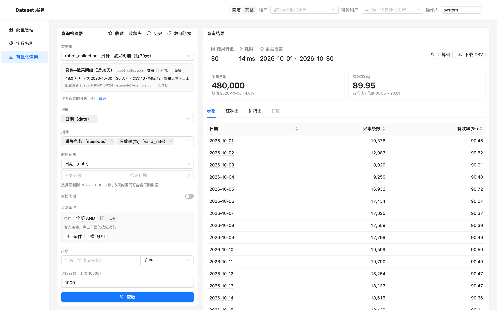

---

## v22 老手的问题不是「找不到」，是「每天都得点一次」

**发现**：v17 的收藏解决了「攒不起来」，但用起来还是每天三步：
打开数据集 → 打开收藏夹 → 点我的那条。而作者的建议（预置分析）
却**直接挂在数据集上**、一点就到。作者的分析比我自己分析的位置更好，
这件事本身就很荒唐——用得最多的人，入口反而更深。

**改动**（`favorites.ts` 增 `isDefault` / `pinned`）

- **收藏可设为默认视图**：以后打开这个数据集，直接跑这条，一次都不用点。
  收藏弹窗里就有这个勾（该数据集还没有默认视图时默认勾上：第一次收藏多半就是「我以后就按这个看」）。
- 同一个数据集**只允许一条默认**，新的自动顶掉旧的——两条默认意味着
  「打开这个数据集该看到什么」没有答案。
- 结果区标出「默认视图：XXX」并给「取消默认」：自动跑的东西必须**看得见、能反悔**，
  否则用户会对着一张自己没点的图怀疑是不是缓存。
- 收藏夹排序：**默认视图 → 置顶 → 收藏时间**，并支持置顶（常用那几条不该被新收藏挤下去）。

几个设计决定：

- **链接优先于默认视图**：URL 里带了 dims/metrics 就以链接为准。
  分享出去的链接必须能还原，这是比「我想看我的默认视图」更强的约定。
  只在「链接只给了数据集」时才用默认视图。
- 默认视图存在**收藏里**而不是数据集配置里：它是「我的习惯」，不是「数据的属性」；
  换数据集、换机器都不该污染别人的视图。
- 踩到一个真实的坑：首次加载时数据集列表刚取回来还没进 state，
  `applyFavorite` 用它校验数据集可见性会拿到空数组、静默失败。
  改成允许显式传入列表（`applyFavorite(f, items)`）——**静默失败比报错更难查**。

**验证**：收藏「各场景产出（我每周看这个）」并设为默认后，
只带 `?ds=robot_collection` 重新进入页面直接出场景视图（不用点任何东西），
结果区带「默认视图」标记；切到别的数据集再切回来同样自动跑；
带完整链接进入时以链接为准（维度是 date 而不是默认的 scene）；
收藏夹里默认视图排在最前并显示金色「默认视图」标签。

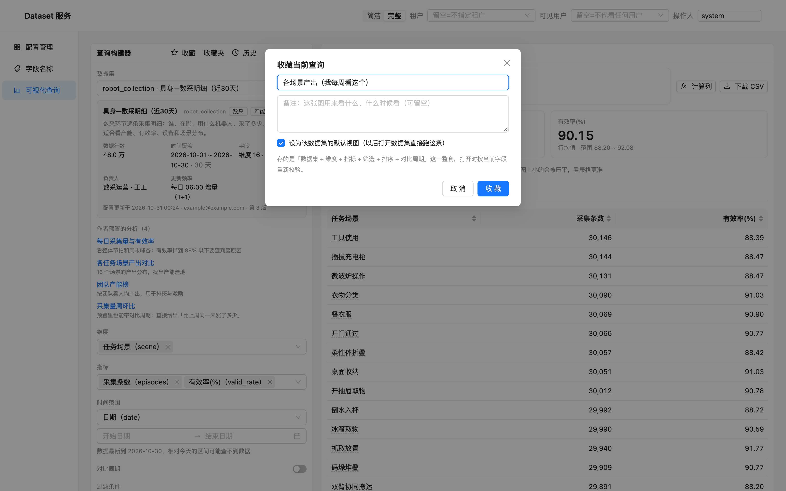

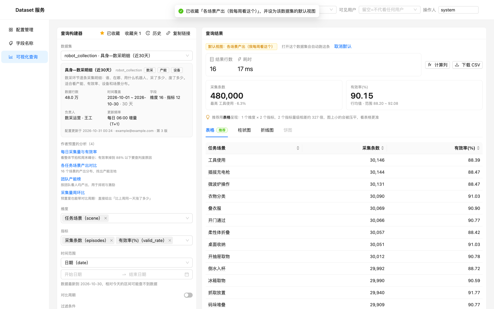

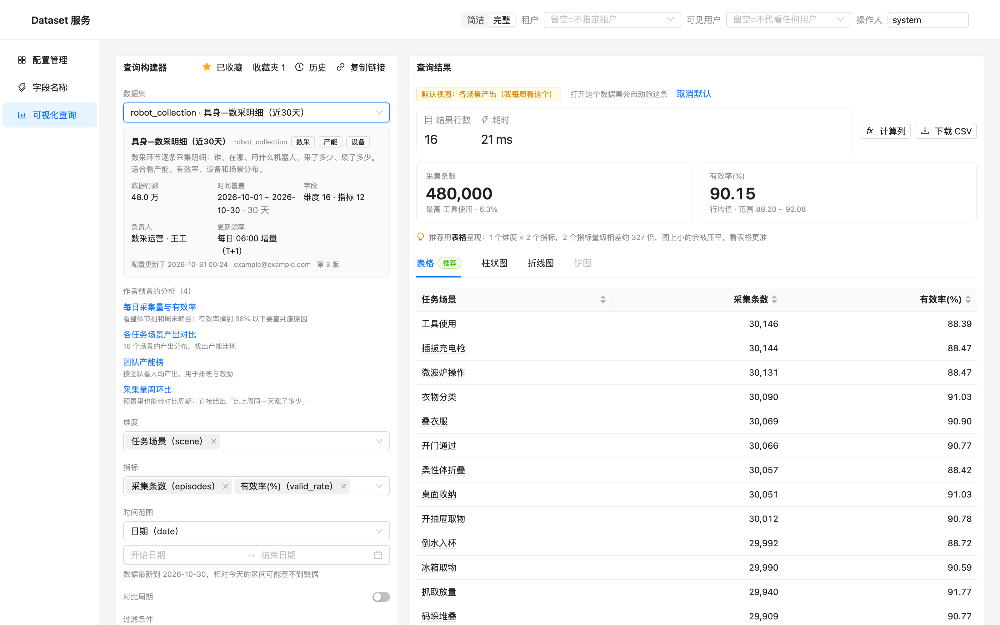


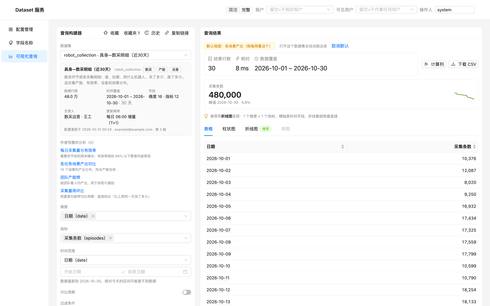

---

## v23 左栏越来越长：不是每次都要改的东西，不该占着首屏

**发现**：几轮迭代下来，左栏堆成了十来个控件：数据集 → 体检卡 → 预置分析 →
维度 → 指标 → 时间范围（字段 + 日期区间）→ 对比周期（开关 + 两个下拉）→
过滤条件 → 排序（两个下拉）→ 上限 → 查数。**换一次维度要滚两屏**。
功能都是有用的，但「有用」不等于「该出现在首屏」。

**改动**（`QueryBuilder` 增加「高级」区）

- 时间范围 / 对比周期 / 排序 / 上限 收进「高级」一行，**默认收起**（简洁档）或展开（完整档），
  手动切换后写进偏好——每天都要手动收一次的东西，等于没收。
- **过滤条件留在外面**：它是最高频的分析动作，而且下钻会往里写条件，
  收起来就会发生「我点了柱子但看不见条件变了」。
- **收起时必须说清里面有几项在生效**：`3 项生效 · 环比 · 按采集条数降序 · 上限 3000`。
  折叠区里藏着生效条件，是最容易让人以为「我筛过了没生效 / 我没筛却被筛了」的设计——
  折叠省下的空间，不能拿确定性去换。

**验证**：同一条查询下，完整档左栏是 12 个区块；简洁档高级区收成一行后，
数据集 → 维度 → 指标 → 过滤条件 → 高级 → 查数 一屏放得下；
带 `order + limit 3000 + cmp` 的链接进来，收起状态如实列出 3 项生效及具体内容。

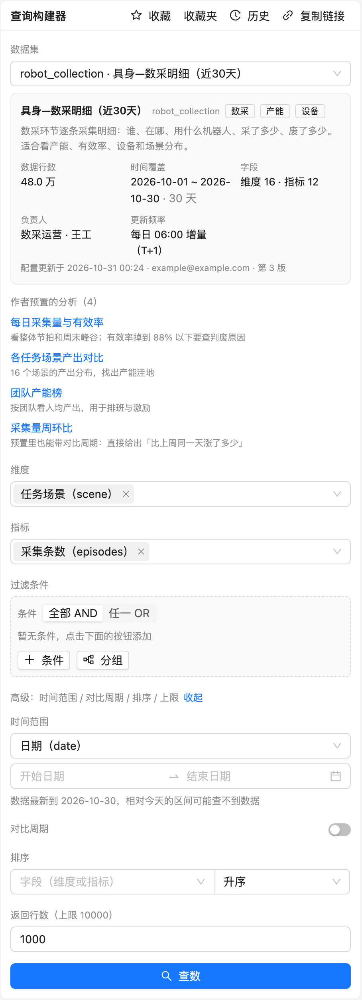

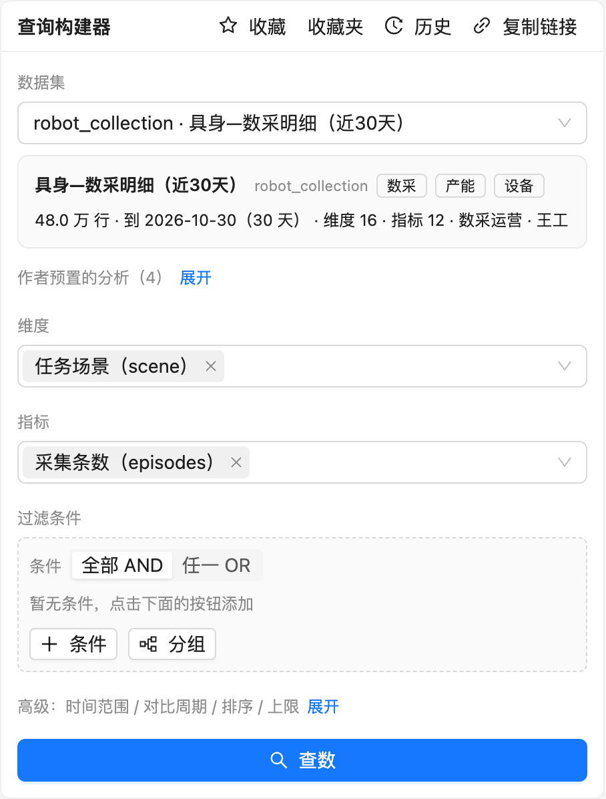

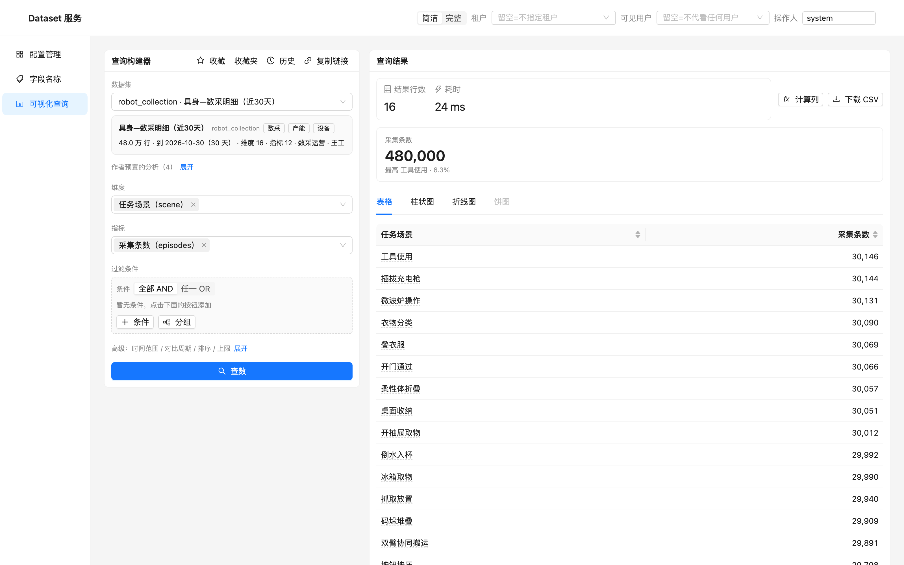

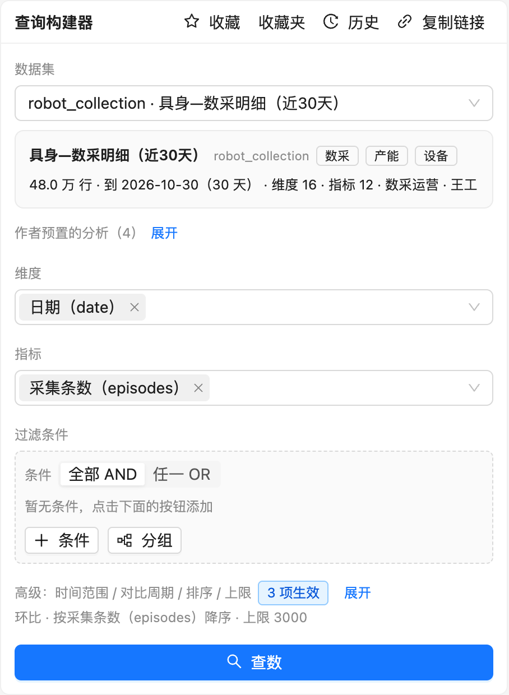

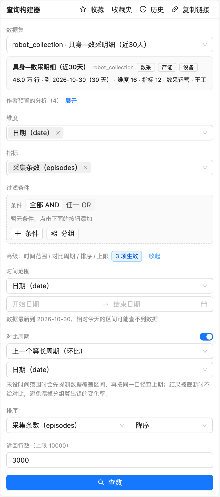

---

## v24 老手拿到结果后要的是「表格让我自己摆」

**发现**：查完数，老手真正干活的地方是那张表——排序、挑几列、扫一遍。
但表格是固定的：列全给（16 个维度的数据集一查就七八列，只能横向滚）、
行高一刀切、想少看几列只能回左边把维度删掉再查一次。
**结论区（指标卡、概览条、推荐）是为新手准备的，表格是老手的主战场，
但主战场一直没被照顾过。**

**改动**（`ResultView` 表格工具栏）

- **列显隐**：`列 4/7 · 已隐藏` 按钮 + 勾选面板，按列名（不是 `c0/c1` 下标）隐藏。
  换一次查询就重置隐藏列表——新结果的列名跟旧的没关系，
  留着旧列表会出现「我明明选了指标却看不到列」这种鬼故事。
- **紧凑 / 宽松行高**：一屏能多看一倍行。默认跟随档位（简洁档紧凑），手动切换写进偏好。
- **隐藏的列仍然写进导出的 CSV**：藏是为了**看**，不是为了改数据。
  顺手把这句话写在工具栏上，否则用户会担心「我藏掉的列是不是也丢了」。

**验证**：`团队 × 数采员 × 城市` + 4 个指标查出 7 列（横向滚动）；
关掉「平均时长 / 平均质量分 / 城市」后只剩 4 列，表格不再需要横向滚动，
提示「隐藏的列仍会写进导出的 CSV」，按钮显示「列 4/7 · 已隐藏」；
切紧凑行高后同样高度内多显示一倍行。


---

## v25 作者不该靠「堆十条预置」表达意图，而且说明书一直只能靠脚本写

**发现**：两件事都卡在作者身上。

- 预置分析（v20）是**平铺**的：四条一样大、一样重要。
  作者的真实想法是「先按这个看，别的自己挑」，但界面只能表达「这里有四个」。
  **把选择成本转嫁给用户，是作者偷懒的一种形式。**
- 更要命的是：这么重要的说明书（描述 / 负责人 / 更新频率 / 字段口径 / 预置分析），
  **界面里根本没有入口**——前几版全是靠 `deploy/register_embodied_datasets.py` 灌进去的。
  数据集作者最常用的东西，在这个系统里最没有位置。

**改动**

查询页（作者侧）：

- 结果卡右上角新增「**存为预置分析**」：作者在看板里调好一张图 → 起个名 → 写进数据集的
  `meta.examples`。作者最自然的动作就是「我现在看到的这个，存下来」，
  而不是去配置页手敲一段查询串。
- 存的查询串**直接复用 URL**（去掉 `ds`）——已经有一份序列化了，再造一份迟早不一致。
- 可勾选「**设为作者默认视图**」：`meta.default_example`。
  打开数据集时：**用户自己的默认收藏 > 作者的默认视图 > 什么都不跑**。
  别人的建议永远不该盖过本人的习惯。
- 预置列表里默认视图排最前并标「作者默认」——十条平铺等于没有重点。

配置页（作者侧）：

- 编辑抽屉新增「**说明书（meta）**」折叠区：描述、负责人、更新频率、标签、
  字段口径（复用 `StringMapEditor`）、默认视图下拉。默认收起——
  它不决定「能不能查」，只决定「敢不敢用」。

后端（`model.DatasetMeta` 增 `default_example`）：

- `normalizeMeta` 会校验默认视图**必须指向仍然存在的 example**：
  指向一条被删掉的预置，等于「打开数据集该看到什么」没有答案。
- `UpdatePayload` 的 `meta` 仍是**指针语义**（不传 = 不动），
  所以「存预置」这类只改说明书的操作不会顺手清掉别的字段。

**验证**：在 `robot_qc` 里调出「缺陷类型 × 缺陷数（按缺陷数降序）」，
点「存为预置分析」→ 写进 meta（含 `order`/`dir`）→ 左侧预置列表立刻多出这条并标「作者默认」；
只带 `?ds=robot_qc` 打开页面，直接就是这张图；
配置页编辑抽屉里能看到并修改描述、负责人、更新频率、标签、字段口径与默认视图。


---

## 第三轮（v21~v25）：界面复杂度——同一个看板服务两种人

| 版本 | 视角 | 一句话 | 关键决定 |
| --- | --- | --- | --- |
| v21 | 使用者 | 预置分析对老手是噪音 | 给看板一个**档位**（简洁/完整），收起教学性内容但一个功能都不删 |
| v22 | 使用者 | 每天都得点一次我的分析 | 收藏可设为**默认视图**，挂在数据集上；链接优先于默认 |
| v23 | 使用者 | 左栏越来越长 | 高级区可收起，**收起时仍报出生效了几项** |
| v24 | 使用者 | 老手的主战场是表格 | 列显隐 + 行高密度；隐藏的列仍进 CSV |
| v25 | 开发者 | 作者不该靠堆数量表达意图 | 在看板里存预置 + 指定**作者默认视图**；配置页终于能写说明书 |

贯穿五版的一条线：**复杂度不是功能多少的问题，是「谁在什么时候需要它」的问题。**
凡是「第一次有用、之后每天碍事」的东西，都应该能被收起来——
但**收起来必须留下痕迹**（几项生效、默认视图是什么、隐藏的列仍导出），
否则省下的空间是拿确定性换来的，不划算。

---

## 第四轮（v26~v30）：迁移——让新入口长在旧菜单上

**场景**：系统里有一批写死的表格页 / 看板页。新加的可视化查询能力要迁移这批用户，
但「所有数据集只有一个查询页入口」时，用户得先去查询页、再在数据集列表里
认出哪个是自己原来那张表——识别成本整个压在他身上。

**思路**：不要把入口做成「跳到查询页的快捷方式」，而是把入口**挂在原菜单位置**，
且它是「数据集 + 固定视图」的组合。同时给迁移一个能推进也能退回的状态机。

### v26 入口（entry）模型与菜单挂载

数据集的说明书里新增 `entry`：key / title / module / legacy / status / note / default_query。
前端按它把菜单长出来——原页面下面多一个「（可视化查询版）」子项。


入口页复用整屏查询能力，只把数据集固定住：


存量页面（本仓库里是替身）上能看到自己被哪个入口替代：


关键决定：

- **入口存在 meta 里，不是单独一张表**：它就是作者的一句声明「我该出现在哪个菜单下」，
  跟说明书同类，不参与 SQL 生成。
- **入口 key 要进 URL，所以后端校验得比说明书严**：只允许小写字母数字与短横线，
  非法的直接丢弃（半填的入口会在菜单上渲染出一个点不开的菜单项，比没有更糟）。
- **菜单不是数据集的目录**：没配入口的数据集只在查询页出现，不进菜单。

### v27 入口打开即跑：不用再自己搭一遍

只挂数据集、进去是空构建器，等于把「找」换了个地方。入口打开必须直接是
用户熟悉的那张图——所以它带着自己的默认视图。


打开入口时跑什么的优先级：**链接 > 用户默认收藏 > 入口默认视图 > 数据集默认视图**。
用户优先于作者；入口默认视图优先于数据集默认视图——从「采集日报」进来的人
不该先看到「质检通过率」。

另外补了出口：**回到旧版** 与 **全部数据集**。迁移最怕「进来了出不去」，
不管新版多好，用户随时能退回熟悉的那一页，他才敢留下来试。

### v28 旧页面自己把人送过来

菜单里多一项是不够的：用户每天的路径是肌肉记忆，他不会主动去看菜单多了什么。
提示必须出现在**他正在看的那一页**上。


三种表态对应三种后果，而不是一个「知道了」：

- **立即体验** → 带过去，并带上来处（`?from=legacy`）
- **以后再说** → 提示从一整条降级成一行，不挡内容，但不消失
- **不再提示** → 彻底消失，菜单里仍留着入口

新版认出「你是从旧版过来的」，先把**旧页固定表头**摆出来做对照——
他此刻唯一的疑问是「这跟我原来那张表是不是一回事」，不该默认他看得懂。

踩坑：查询页会把状态单向写回 URL，而它只写自己认识的参数，
所以 `from` 必须在首次渲染时取一次并固定下来，否则提示会在第一次查询后自己消失。

### v29 迁移状态机：并存 → 默认走新版 → 旧页下线

同一个菜单位置会长成三种样子，切换只改配置、不改代码：

| 状态 | 菜单长什么样 | 语义 |
| --- | --- | --- |
| 并存 | 原页面 + 「原页面（可视化查询版）」两条 | 观察期，用户自己选 |
| 默认走新版 | 只剩一条，点进去是新版，带「新」角标 | 推进期，旧页仍可从新版退回 |
| 旧页下线 | 只剩一条，且**名字变回原页面名** | 收敛完成 |


三个关键决定：

- **后缀是过渡期的标记，不是名字的一部分**：下线后菜单名自动变回「质检日报」，
  否则「（可视化查询版）」会在菜单上挂一辈子，变成历史包袱。
- **个人选择覆盖系统推进**：入口已切到「默认走新版」，但选过「以后再说」的人
  点菜单仍然进旧页。迁移不能靠覆盖个人选择来推进——他的体感会是「系统不听我的」。
- **旧页下线后老链接要能自救**：从收藏/旧链接进来的人看到的是「去哪儿」，
  而不是一张还能用的表。

### v30 迁移看板：能度量，才知道什么时候能下线

没有数据，迁移进度只能靠感觉：要么一直并存着不敢动，要么某天一拍桌子删掉旧页。


- 看板回答一个问题：**还有没有人在用旧页**。新版 / 旧版各被打开多少次，
  迁移率是多少，最近一次是什么时候。
- **一键推进只推进、不下线**：把并存期的一批推到「默认走新版」。
  观察期都没过的入口直接下线，是把风险一次性放大。
- 入口页可以把自己调好的那一屏**钉成入口默认视图**——作者最自然的动作是
  「调好一张图 → 钉住」，不是去配置页手敲查询串。

---

### 第四轮小结

| 版本 | 一句话 | 关键决定 |
| --- | --- | --- |
| v26 | 数据集挂到旧菜单下 | 入口 = 数据集 + 固定视图，挂在原页面菜单下面；入口存在 meta 里 |
| v27 | 打开就是原来那张表 | 优先级：链接 > 用户默认 > 入口默认 > 数据集默认；出口常驻 |
| v28 | 旧页自己把人送过来 | 三种表态各有后果；新版先摆旧页表头做对照 |
| v29 | 能推进也能退回 | 三态状态机；下线后菜单名变回原页面名；个人选择覆盖系统推进 |
| v30 | 能度量才知道能不能下线 | 迁移看板；一键推进只推进不下线 |

贯穿五版的一条线：**迁移的敌人是「找不到」和「不敢切」。**

- 找不到 → 入口长在原来的位置上，且长出来就是他熟悉的那张图；
- 不敢切 → 随时能退回旧版、个人选择能覆盖系统推进、下线前先看数据。

还有一条反过来的约束：**迁移不该在系统里留下永久痕迹。**
「（可视化查询版）」是过渡期的标记，旧页下线后菜单名会自动变回原页面名——
否则半年后菜单上会挂满一堆带「版」字的条目，谁也说不清那是什么。

---

## 第五轮（v31~v35）：从「一次查询」升级到「一张大盘」

**场景**：可视化查询一次只出一张表或一种图，而存量页面大多是「大盘」形态——
上面一排指标卡、中间趋势图、下面明细表，三块东西来自三次查询。
单次查询只能替代其中一块，所以拿它去替换一个页面必然是降级的体验：
新手在旧页一眼能看到结论，切到新版却要自己搭三遍。

**思路**：把单位从「一次查询」升级成「一张大盘」。
面板 = 一次可视化查询 + 怎么呈现（复用同一段查询串），
大盘 = 一组面板 + 布局。旧的大盘页对位的是「一张大盘」，不是「一次查询」。

### v31 仪表盘成为一等公民

面板与查询页共用同一段查询串（URL 里 ds 之后那一段），
所以「在查询页调好的那一屏」可以直接搬进大盘，不需要翻译，
也不会出现「链接能开、面板开不了」的两套规则。


关键决定：

- **大盘不挂在数据集的 meta 里，是一张独立的表**：一张大盘天然跨数据集
  （上面是采集的趋势，下面是质检的明细），塞进某个数据集的说明书里，
  等于规定「这一屏属于那一张表」——既不对，也会随数据集改名一起失效。
- **布局刻意模仿旧大盘页的形状**：上面四张指标卡（span 3 正好一行）、
  中间趋势整行、下面左图右表。视觉上的「熟悉」是大盘能替代旧页的一半原因。
- **面板没有数据集就丢掉**：它永远跑不出数，在大盘上就是一个永远转圈的方块，
  比没有更糟——用户会以为系统卡了。
- **面板 id 必须稳定唯一**：作者不填或填重了由后端补。用数组下标当身份时，
  删掉中间一个面板会让后面所有面板的编辑状态集体错位。

踩坑：gorm 的 `serializer:json` 在 `Updates(map)` 这条路上不生效，
直接塞结构体进去会生成 `panels=('{...}','{...}')`，MySQL 报 1241。
写路径必须自己 `json.Marshal`。
