# 数据分析看板迭代记录（v1–v10）

以使用者身份（数据分析师）在真实浏览器里把看板当日常工作用：查数、筛时间、看趋势、找异常、导出给同事。
每卡住一次就记一条，按「一次只改一件事」的节奏迭代 10 个版本，每版改完立刻截图。

- 环境：`docker compose` 起的 app + MySQL + ClickHouse，浏览器 Chrome（1600×1000，2x）
- 数据：`demo_order`（5000 行订单明细，20 天 × 5 城市 × 3+空渠道 × 2000 用户）
- 验证：每版截图 + 全流程回归 11 项断言（`go test`、`tsc` 全绿）

---

## 先说一件影响所有结论的事：演示数据没有区分度

第一次查「各城市消耗」，五个城市分别是 2,501,650 / 2,500,650 / 2,499,650 / 2,498,650 / 2,498,650 ——
**相差不到 0.2%**。图表上五根柱子齐平，趋势是一条直线，任何分析动作都得不出结论。

原数据是 `number % 5` 均匀撒的。把 seed 改成有城市/渠道权重、周末峰谷、少量大额样本之后：

| 城市 | 消耗 | 占比 |
| --- | --- | --- |
| 北京 | 2,138,310.21 | 66.7% |
| 上海 | 607,442.75 | 18.9% |
| 广州 | 261,264.47 | 8.1% |
| 深圳 | 182,786.46 | 5.7% |
| 杭州 | 18,046.03 | 0.6% |

`deploy/clickhouse/init.sql` 已同步（金额仍保留 `n+0.15` 的浮点探针）。
**这不是看板功能，但没有它，后面 10 版改动的效果一个都看不出来。**

---

## 总览

| 版本 | 用起来卡在哪 | 改了什么 | 截图 |
| --- | --- | --- | --- |
| v1 | 金额 `2138310.21` 一眼读不出量级，也没有合计 | 千分位 + 数值右对齐 + 合计行（定点求和） | `v01-数值格式化与合计行.png` |
| v2 | 不排序时行序是随机的；`LIMIT 10` 拿到的不是 Top10 | 后端默认排序 + 时间轴按时间升序 | `v02-默认排序-表格降序.png`、`v02-默认排序-折线按时间.png` |
| v3 | 圈一周数据要点 7 次下拉 | 时间范围：预设区间 + 自定义，落成 `>= / <=` 条件 | `v03-时间范围-近7天结果.png` |
| v4 | 渠道里的 NULL 流量既筛不掉也单看不了 | `为空 / 不为空` 操作符（前后端） | `v04-空值筛选-只看未归因.png` |
| v5 | 20 个日期标签竖排糊成一片；8 条系列叠在一起 | 标签水平抽稀 + 图例换行 + 堆叠开关（限同指标） | `v05-图表-X轴标签水平抽稀.png`、`v05-柱状-堆叠.png` |
| v6 | 想看「谁最高」得回左侧重设排序再查一遍 | 表头本地排序（数值定点比较） | `v06-表头排序-升序.png` |
| v7 | 刷新即丢，没法把一张图发给同事 | 查询状态写进 URL + 复制链接 | `v07-链接打开恢复同一查询.png` |
| v8 | 改错条件回不去，每天重复搭同样的查询 | 本地查询历史 + 一键回填 | `v08-查询历史列表.png` |
| v9 | CPC 这类比率只能导出 Excel 手算 | 计算列：用已有列做四则运算 | `v09-计算列-CPC结果.png` |
| v10 | 导出的 CSV 没有口径，收到的人不知道筛了什么 | 文件头写口径 + 文件名带数据集与时间 | `v10-导出带口径.png` |

---

## v1 数值看不出来，也没有合计

**发现**：查「城市 × 消耗/点击/UV」，表格里是 `2138310.21`、`170427` 这样的裸数字，左对齐。
看一列数要自己数位数；想看总量得心算五行。

**改动**（`web/src/utils/format.ts`、`components/ResultView.tsx`）：

- 千分位 + 列内统一小数位（取该列出现过的最大位数，上限 4）。列内对齐比每格各自决定重要——`1,234.5` 和 `12.05` 混排，量级看不出来。
- 数值列右对齐 + `tabular-nums`（等宽数字，纵向扫列时位数才对得齐）。
- 表格底部合计行。求和用 **BigInt 定点**，不经过 float：`3207849.9199999` 这种尾巴比不显示合计更糟。
- 合计行 tooltip 写明两个局限：结果截断时只是部分合计；去重类指标（UV）逐行相加会重复计数。
- 只对「指标列且值能解析成数字」的列生效，配置写错导致指标返回字符串时原样显示，不静默变 0。

**验证**：合计 3,207,849.92 与 `SELECT sum(stat_cost)` 完全一致（含两位小数）。


## v2 行序是随机的，`LIMIT` 也不代表 TopN

**发现**：同一查询连点两次，城市顺序会变；把返回行数改成 10 想看「消耗最高的 10 个城市」，
拿到的却是引擎恰好先产出的 10 行。图表里柱子顺序也跟着乱跳。

根因在 `Build()`：请求没带 `order_by` 时，SQL 里根本没有 `ORDER BY`。

**改动**（`internal/query/builder.go`）：

- 没有显式排序时补一个确定顺序：有指标 → 第一个指标降序（TopN 直觉）；没有指标 → 维度升序；末尾追加全部维度升序做 tie-break。显式排序优先，不叠加。
- 前端（`ResultView.tsx`）识别时间类 X 轴，按时间升序重排图表与表格——否则默认的「按消耗降序」会把折线画成锯齿，看着像剧烈波动。

**验证**：默认顺序下 北京 → 上海 → 广州 → 深圳 → 杭州；折线从 10-01 到 10-20 严格递增，周末峰谷清晰可见。
三个单测覆盖（有指标 / 只有维度 / 显式排序优先）。

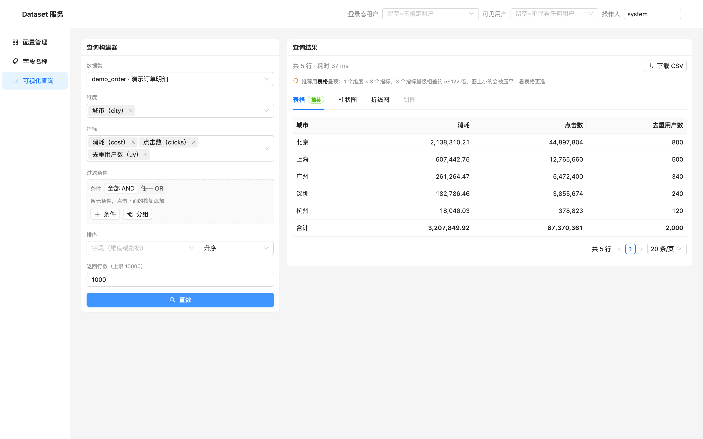

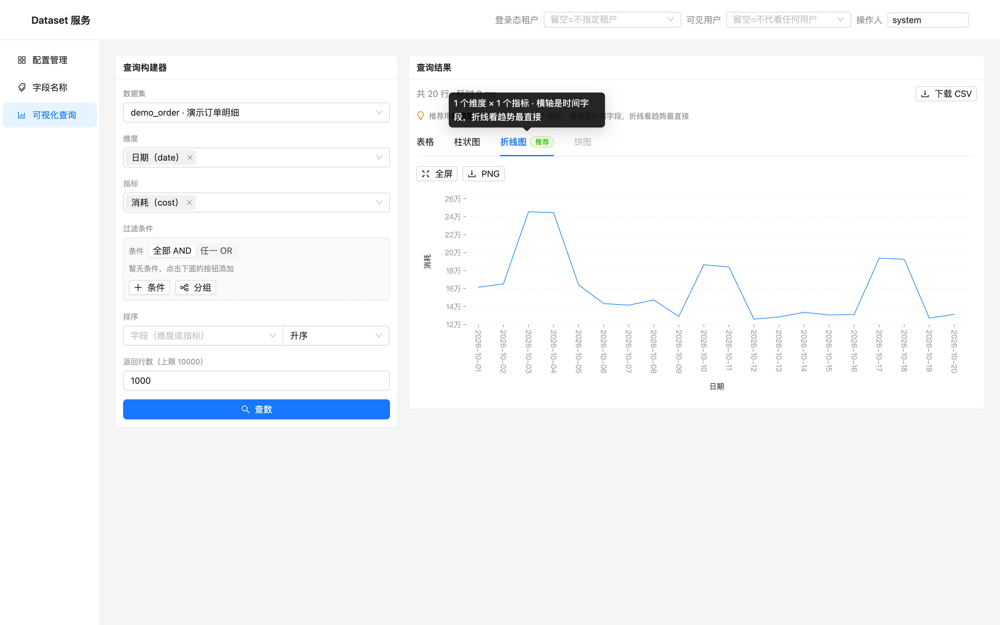

## v3 圈一周数据要点七次

**发现**：做周报要选「最近 7 天」，只能在日期维度的候选值里一个个点，7 次点击 + 一次查数。
而且候选值里没有「今天」的概念，数据是 T+1 的时候根本不知道最新到哪天。

**改动**（`components/QueryBuilder.tsx`、`utils/filterTree.ts`）：

- 新增「时间范围」：日期字段 + `RangePicker`，预设 `近 7 天 / 近 30 天 / 本月`，以及 `数据最近 7 天 / 数据最近 30 天`（相对数据最大日期）。
- 落库方式**不是新算子**，而是往条件树里写两条 `>= / <=`：自动享受条件计数、清空、URL/历史序列化，用户也能在条件区看到它到底加了什么。
- 覆盖式写入（同字段永远只有一对区间），根节点是 OR 时把原条件收进子分组——直接塞进 OR 会让「时间范围」变成「或」。
- 控件值从条件树反推，只有一个真相来源；清空条件，选择器跟着清空。
- 提示「数据最新到 2026-10-20，相对今天的区间可能查不到数据」——比让用户对着空结果怀疑自己强。

**验证**：选「数据最近 7 天」→ 条件区出现 2 条日期条件，查询返回 7 行，合计 1,040,440.91。

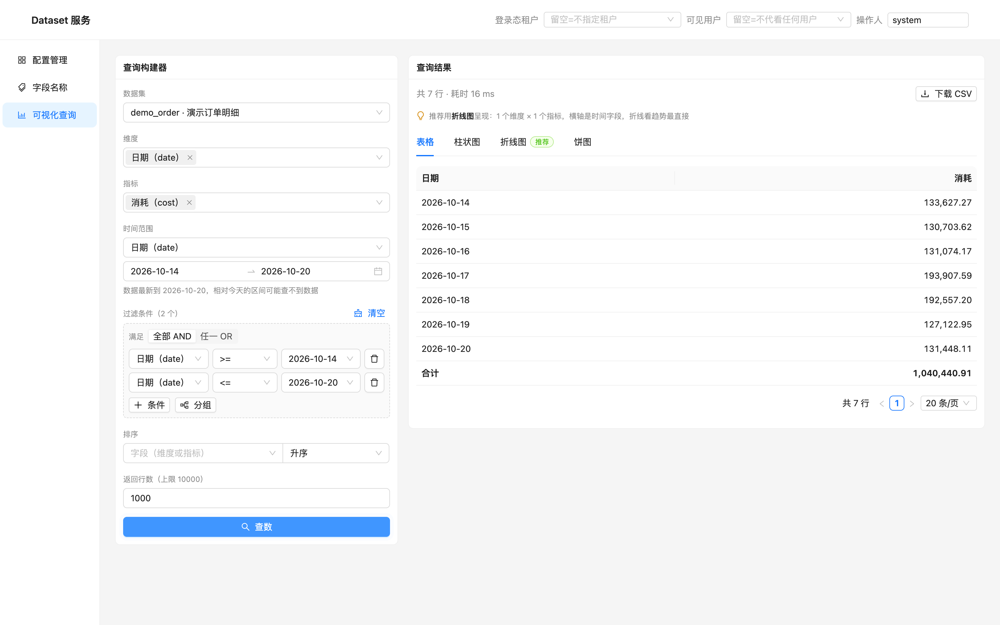

## v4 未归因流量筛不掉，也算不准

**发现**：`channel` 是可空字段，约 10% 的行是 NULL（未归因）。想「只看未归因」或「排除未归因」都做不到——
操作符只有 `= != > >= < <= like in not in`。算渠道占比时，分母里始终含着一坨看不见的 NULL。

**改动**：

- 后端 `internal/query`：新增 `is_null / is_not_null`，编译成 `IS NULL / IS NOT NULL`，不产生参数绑定；只对普通维度开放（指标的聚合结果判断空值没有业务含义）。
- 前端 `FilterTreeEditor`：操作符下拉加「为空 / 不为空」，选中后不渲染右侧输入框。
- **关键一处**：`leafFilled` 必须把这两个操作符认成「已填」。否则 `pruneEmpty` 会把它当没填值静默裁掉——界面看着筛了，实际查的是全量。这类「静默丢条件」比报错危险得多，之前做多值维度时就踩过一次。

**验证**：加「渠道 为空」→ 结果只剩一行 `NULL 52,086.94`；不筛时是 4 行。三个单测覆盖（IS NULL / 分组维度 / 指标上拒绝）。

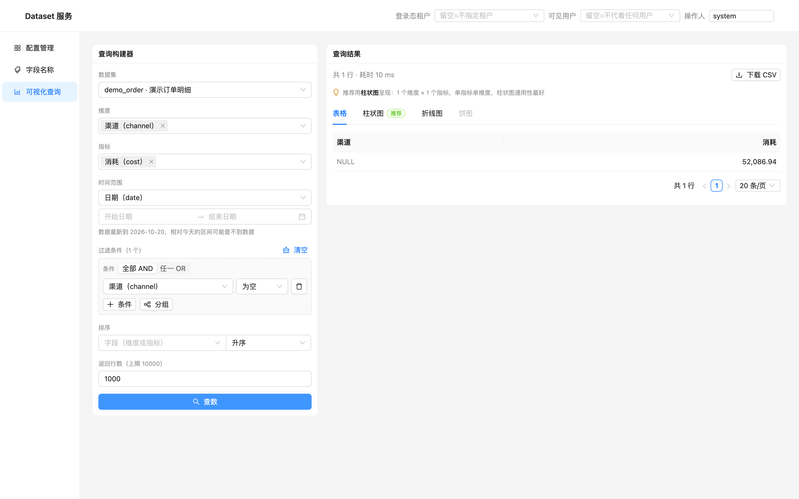

## v5 图能画出来，但读不了

**发现**：`日期 × 渠道` 两张图 —— 折线图的 20 个日期标签全部旋转 90°，歪头也读不清；
柱状图 8 条系列挤在一格宽里，颜色糊成一片；图例挤在一行，颜色对不上名字。

**改动**（`components/ChartView.tsx`、`ResultView.tsx`）：

- X 轴标签：`labelAutoRotate: false` + 自动隐藏 + ISO 日期压成 `10-01`。宁可少显示几个，也不竖排——完整值在 tooltip 里。
- 图例允许换行（`flexWrap`），不再被压扁。
- 柱状图加「分组 / 堆叠」开关。
- **限制**：堆叠只在「单指标 + 按维度分组」时出现。第一版做完发现它把「消耗」和「点击数」堆在一根柱子上——量纲不同，加出来的数没有含义，图还很唬人。这条约束是这次迭代里最值得留下的一课。

**验证**：折线 X 轴 20 个日期全部水平可读；`日期 × 渠道 × 消耗` 堆叠后能同时读出「日总量」与「渠道构成」，周末两个峰（10-03/04、10-10/11）很明显。

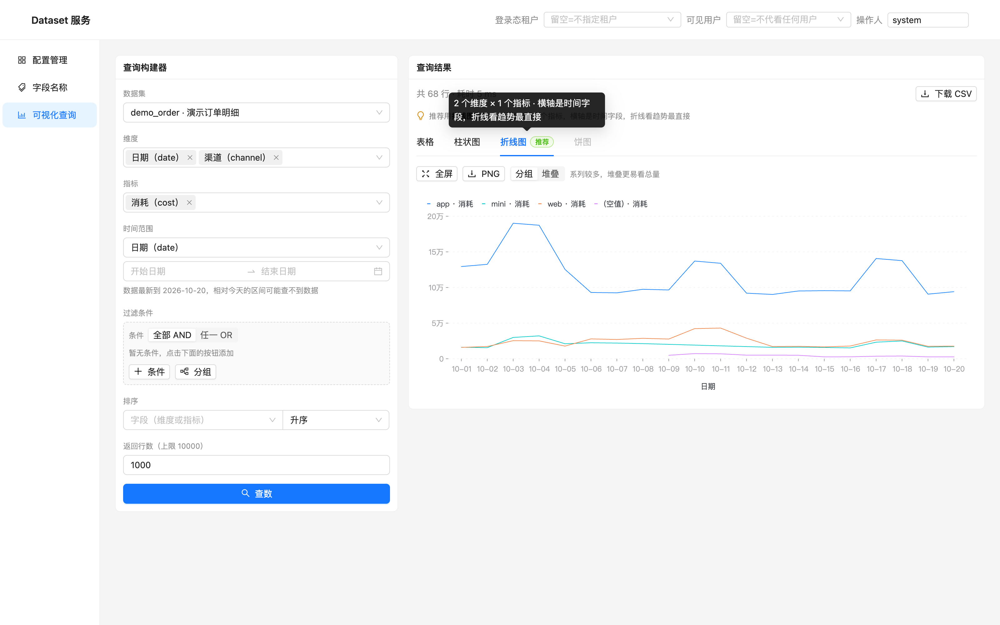

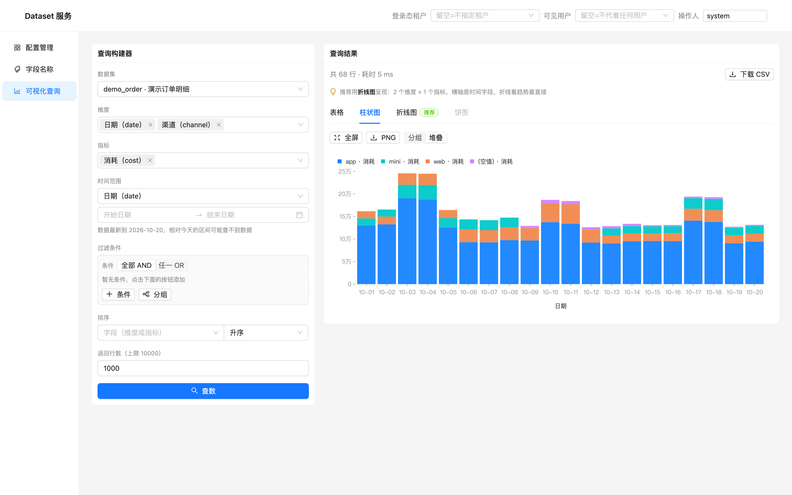

## v6 想看「谁最高」，得回左边重设排序

**发现**：表格已经拿到 80 行数据，但想按「点击数」看一眼排序，必须回左侧改排序字段、再点一次查数——
为了看内存里已有的数据，又打了一次 ClickHouse。

**改动**：列头本地排序。数值列用 `parseScaled` 定点比较（不经 float），维度列用 `localeCompare('zh-CN')`。

**验证**：点「消耗」→ 升序杭州在最上，再点 → 降序北京在最上。

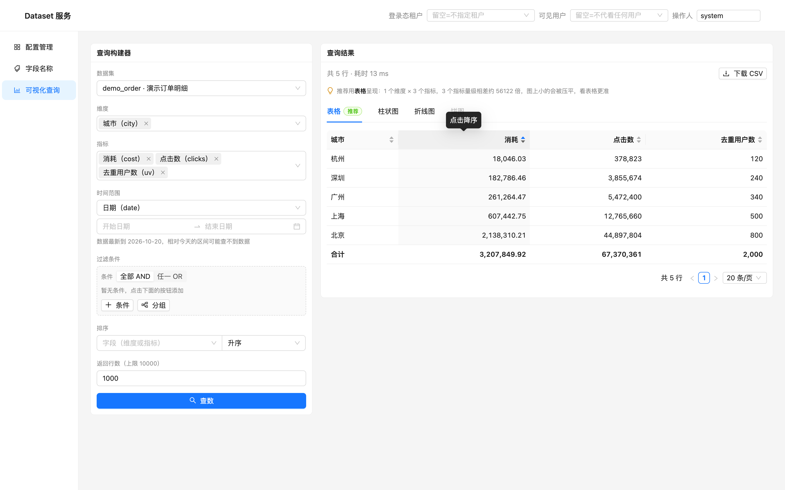

## v7 刷新就丢，发不给同事

**发现**：辛苦搭好的查询（维度 + 指标 + 三个条件 + 排序），刷新页面全没了；
想把某张图发给同事，只能截图，对方无法接着改。

**改动**（`pages/QueryPage.tsx`）：

- 查询状态（`ds / dims / metrics / filter / order / limit`）单向写回 URL，用 `replace` 避免历史记录被刷爆。
- 首次加载时从 URL 恢复并自动执行一次；只保留当前数据集真实存在的字段（链接可能来自别的环境或字段已删）。
- 卡片右上角「复制链接」。

**验证**：刷新后条件、结果都在；用全新浏览器上下文打开同一条链接，一进来就是同一屏（56 行、同样三个条件）。

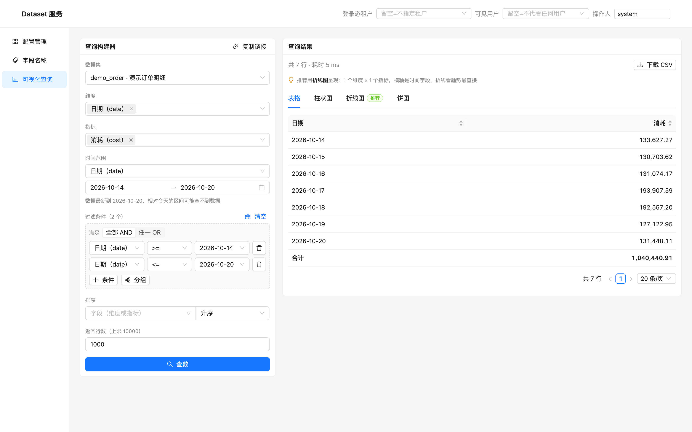

## v8 改错条件回不去

**发现**：试着换了个筛选，发现数不对，想回到上一步——没有「上一步」。每天重复搭同样的查询也是纯粹的浪费。

**改动**（`utils/queryHistory.ts` + `QueryPage` 抽屉）：

- 本地记录最近 20 条**成功**的查询（失败的那次没有参考价值），相同口径只留最新一条。
- 列表显示：数据集、维度 × 指标、筛选条件（人话，不是 JSON）、时间、行数、耗时。
- 「回填」一次性替换全部条件并重新查数。

**验证**：4 条不同查询都在列表里；回填「日期 × 消耗 + 近 7 天」后，条件区恢复 2 条区间条件，结果 7 行。

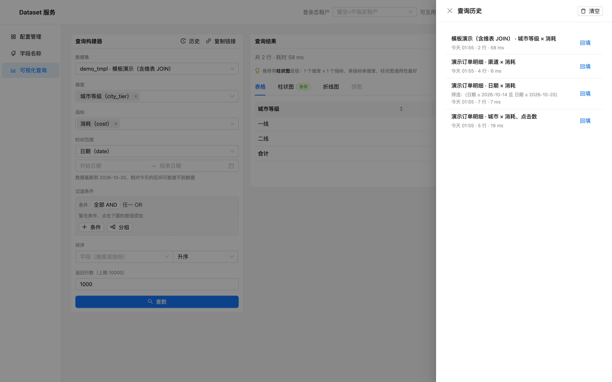

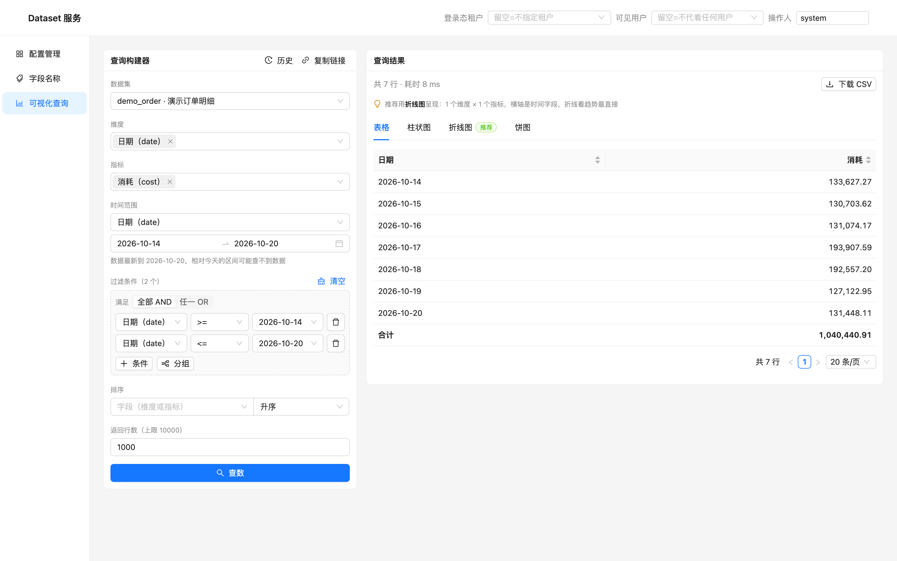

## v9 算不了比率，只能导出 Excel

**发现**：投放分析第一件事就是 CPC（消耗/点击）、CTR（点击/曝光）。看板只能给绝对值，
要么导出 CSV 用 Excel 除一下，要么在脑子里估。

**改动**（`utils/expr.ts`、`components/DerivedColumnModal.tsx`）：

- 「计算列」：列名 + 表达式（`+ - * /` 与括号），点字段标签插入。
- 表达式**不用 eval / new Function**：先解析成 AST，标识符必须在白名单（本次结果的列）里，写错字段名直接报错——不能静默算成 0。
- 任一操作数为 NULL 或除以 0 → 该行 NULL，不当 0（否则 CPC 0 看起来像「不花钱」）。
- 输入时实时预览「第一行结果」。
- 计算列进表格与 CSV，**不进合计行**（比值相加没有含义，显示 `—` 并说明原因）。
- 换查询自动清空（列名可能完全不同）。

**验证**：`cost / clicks` → CPC 0.0476 / 0.0475 / 0.0475 / 0.0477，与手工计算一致；`cost / not_exists` 报「未知字段」。

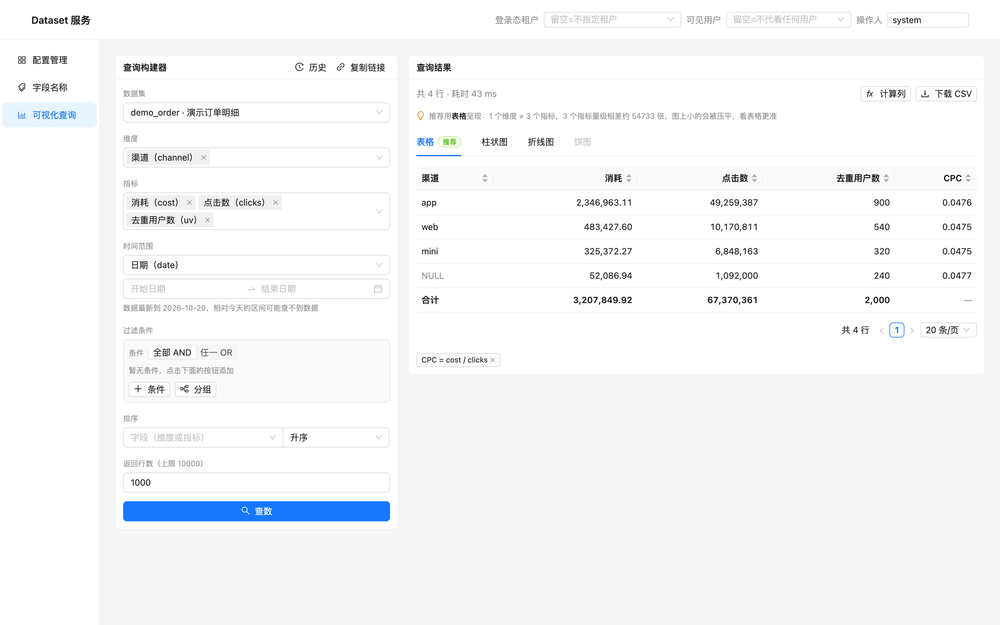

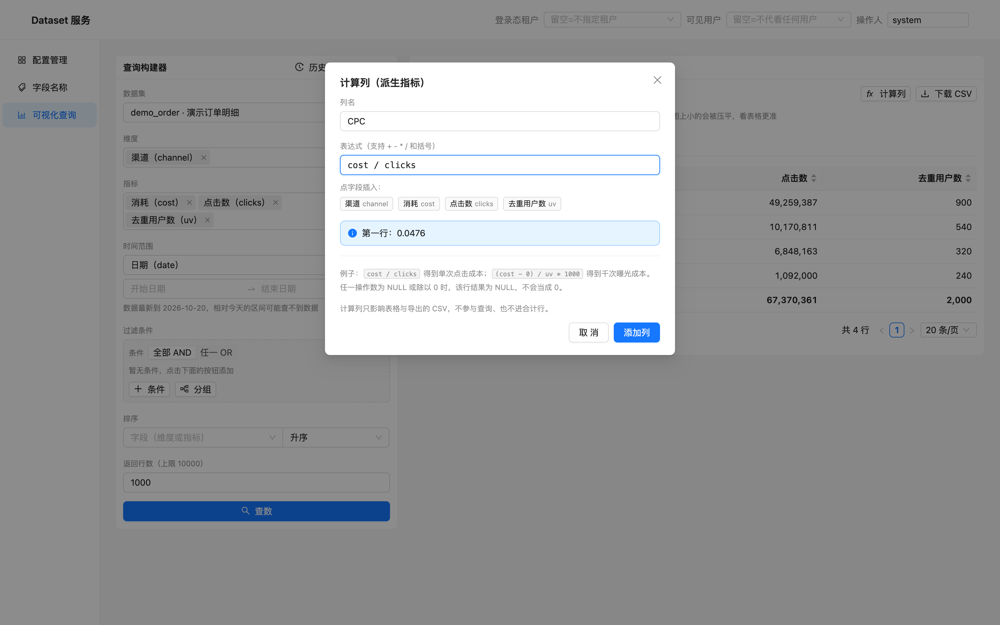

## v10 导出的数据没有口径

**发现**：把结果导出给同事，文件名是 `query-result-1730421...csv`，里面只有裸数据。
对方第一句一定是「这是哪段时间、筛了哪个渠道、去重了没有」。

**改动**（`ResultView.downloadCSV`）：

- 文件头写口径：数据集、维度、指标、筛选（人话）、排序与返回上限、导出时间与行数（截断时标注「不是全量」）、计算列定义。
- 文件名：`demo_order_日期_20261030-0157.csv`。
- 导出顺序 = 当前表格顺序（含表头排序），不再与屏幕不一致。
- 计算列保留 4 位，避免 `0.04756712330684366` 这种 float 噪声。

样例见 [`v10-导出样例.csv`](v10-导出样例.csv)。

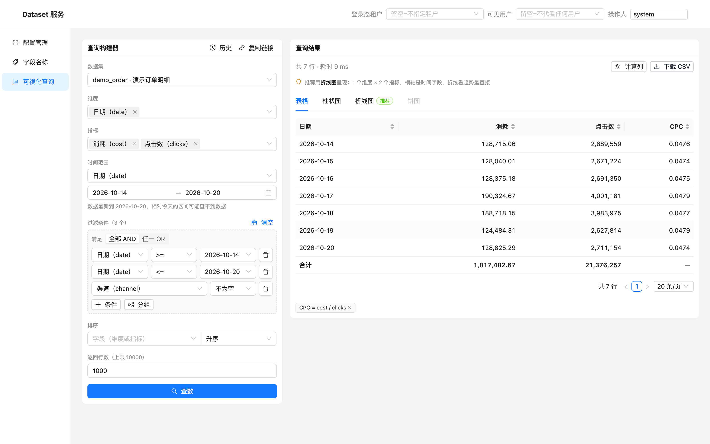

---

## 回归

```
go vet ./...                     通过
go test ./... -count=1           通过（新增 6 个构建单测：默认排序 3 + 空值 3）
tsc --noEmit                     通过
浏览器回归 11/11                 通过
```

浏览器回归覆盖：配置管理有数据、字段名称一致性检查、多值维度收拢、多值维度 `has_any`、
指标过滤走 HAVING、空值条件、计算列、表头排序、查询历史、控制台无 JS 异常。

---

## 还没解决的问题（下一轮候选）

1. **没有同环比**。看「本周 vs 上周」仍然要查两次，人肉对比。真正做需要后端支持对比周期（两次查询 + 对齐结果），不是前端能补的。
2. **图表不能下钻**。点某根柱子筛这个维度，是最自然的分析动作，现在只能回左侧加条件。
3. **计算列不能引用另一个计算列**，也不参与图表。
4. **查询历史只在本地**（换浏览器就没了），且没有「收藏/命名」。
5. **时间范围只认普通日期维度**，没有「上周同期 / 上月同期」这类自然语言口径。
6. **演示数据仍是单表**。`demo_tmpl` 那份带 JOIN 的模板数据集没有参与这轮分析，模板裁剪路径没被这次回归覆盖。

## 交付物

- 页面代码：`web/src/`（`utils/format.ts`、`utils/expr.ts`、`utils/queryHistory.ts`、`components/DerivedColumnModal.tsx` 为新增）
- 后端：`internal/query/builder.go`（默认排序 + 空值操作符）、`model.go`
- 演示数据：`deploy/clickhouse/init.sql`
- 截图：本目录 24 张，按版本命名
